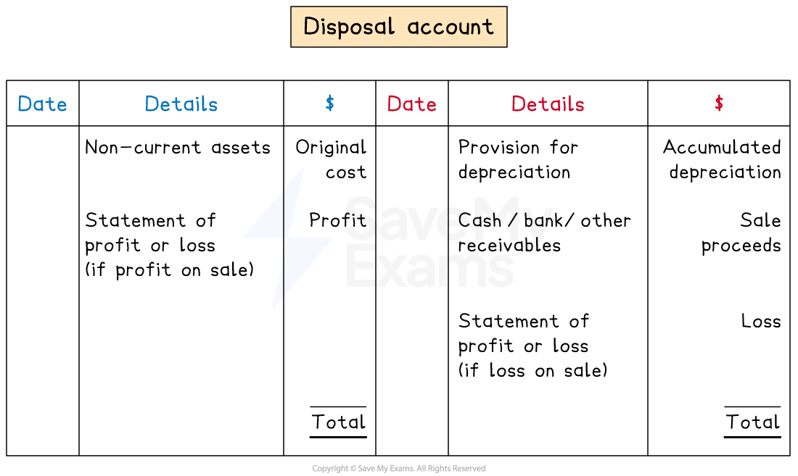

# Disposal Account

## Disposal account

> **Spec point** — `spcpt_n4t5DFkBMqbqsfMS`

## Disposal account

### What is a disposal account?

- A **disposal account** is used to show the **calculation of the profit or loss** on a sale of a non-current asset
- The **profit or loss** is **transferred to the statement of profit or loss**

  - The account will then have a **zero balance**

### How do I record the sale of a non-current asset in the ledger accounts?

- The** book of prime entry** is the **journal**
- Deal with **each transaction** one at a time
- **STEP 1**
**Reduce** the **non-current asset** account by the **original value**

  - **Credit** the **non-current asset** account
  
    - Because the value of the assets is decreasing
  - **Debit** the **disposal** account
- **STEP 2**
**Reduce** the **provision of depreciation** account by the **accumulated depreciation** of the non-current asset

  - **Debit** the **provision for depreciation** account
  - **Credit** the **disposal** account
- **STEP 3**
**Increase** the **cash, bank or other receivables** account

  - **Debit **the **relevant asset **account
  
    - Cash, if received
    - Bank, if money is received by cheque or bank transfer
    - Other receivables account if it was sold on credit
  - **Credit** the **disposal **account
- **STEP 4**
**Include** the **profit or loss** of the sale

  - If a **profit** is made, then this is an **income** for the business
  
    - **Credit** the **statement of profit or loss**
    - **Debit** the **disposal **account
  - If a **loss **is made, then this is an **expense **to the business
  
    - **Debit **the **statement of profit or loss**
    - **Credit **the **disposal** account

*The layout of a disposal account*

> **Exam Hint**
> The disposals account should balance. If it does not balance, then check for any mistakes. Some students calculate the profit or loss by completing steps 1 to 3 and then finding the amount needed to balance the disposal account. If you use this method, be extra careful that you put the entries on the correct side.

> **Worked Example**
> Riz owes an embroidery business and owns machinery. Riz purchased an additional machine on 1 March 2022 for \$30 000. Riz depreciates machinery using the straight-line method using the assumption that machinery fully depreciates after five years. Riz charges depreciation at the end of each month. Riz sells this additional machinery on 31 December 2023 and receives a cheque for \$17 500. No other non-current assets were sold in the financial year ending 29 February 2024.
> 
> Prepare the disposal account for machinery for the year ended 29 February 2024.
> 
> **Answer**:
> 
> Calculate the profit or loss on the sale
> 
> - Calculate the yearly depreciation charge
> 
> *\$30 000 ÷ 5 = \$6 000*
> 
> - Calculate the monthly depreciation charge
> 
> *\$6 000 ÷ 12 = \$500*
> 
> - Calculate the number of months that Riz owned the machinery
> 
>   - 1 March 2022 to 31 December 2023 is 22 months
> - Calculate the total depreciation of the machinery
> 
> *22 × \$500 = \$11 000*
> 
> - Calculate the net book value at 31 December 2023
> 
> *\$30 000 - \$11 000 = \$19 000*
> 
> - Calculate the loss on the sale
> 
> *\$19 000 - \$17 500 = \$1 500*
> 
> - The sale proceeds are less than the net book value so it was a loss
> 
> Fill in the disposal account
> 
> 1. Enter the original cost on the debit side
> 2. Enter the total depreciation on the credit side
> 3. Enter the sale proceeds on the credit side
> 4. Enter the loss on the credit side
> 
> **Final answer:** **Riz**
> **Disposal Account**
> 
> | **Final answer:** **Date** | **Final answer:** **Details** | **Final answer:** **\$** | **Final answer:** **Date** | **Final answer:** **Details** | **Final answer:** **\$** |
> |---|---|---|---|---|---|
> | **Final answer:** **2023**  **Final answer:** **Dec 31** | **Final answer:** **Machinery** | **Final answer:** **30 000** | **Final answer:** **2023**  **Final answer:** **Dec 31** | **Final answer:** **Provision for depreciation** | **Final answer:** **11 000** |
> |   |   |   | **Final answer:** **Dec 31** | **Final answer:** **Bank** | **Final answer:** **17 500** |
> |   |   | <u>                  </u> | **Final answer:** **2024**  **Final answer:** **Feb 29** | **Final answer:** **Statement of profit or loss** | **Final answer:** **1 500** |
> |   |   | **Final answer:** **30 000** |   |   | **Final answer:** **30 000** |
