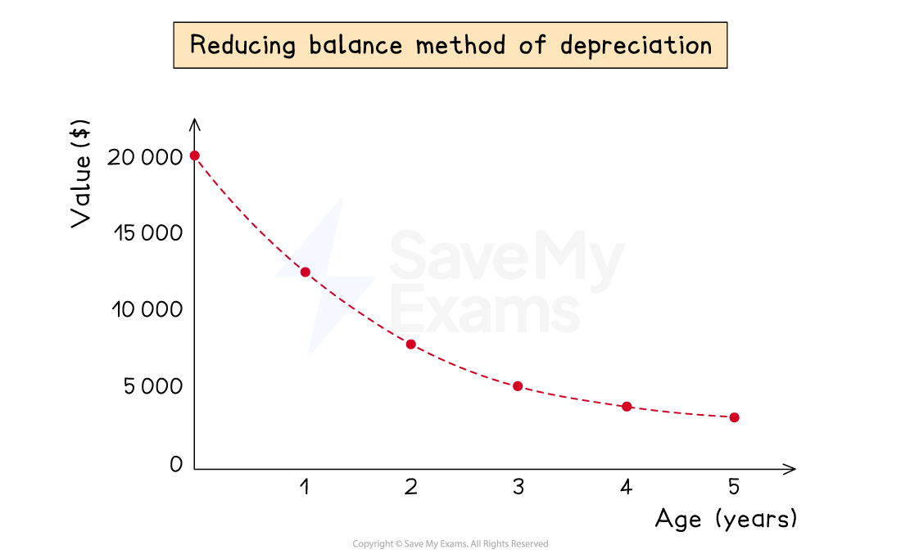

# Reducing Balance Method of Depreciation

## Reducing balance depreciation

> **Spec point** — `spcpt_5J94bqwbBp362JMW`

## Reducing balance depreciation

### What is the reducing balance method of depreciation?

- The **reducing balance method **of depreciation assumes that the non-current asset **loses value** at a **rate proportional** to its** current value**

  - This means that the **expense for its depreciation** gets **smaller each year** as the **current value decreases**
- You will be **told the percentage** of the current value to use for depreciation
- This method is usually used when a **non-current asset initially loses value at a fast rate**

  - e.g. vehicles, etc

*Example of an asset, which cost $20 000, being charged depreciation at 30% per annum using the reducing balance method*

### How do I calculate depreciation using the reducing balance method?

- Find the **percentage of the current net book value**

  - This will be the depreciation charge for that year
- If you need to calculate the depreciation for **multiple years,** then calculate **one year at a time**

  - Find the depreciation charge for one year using the **net book value at that start of the year**
  - **Subtract** this amount from the net book value at the start of the year to find the **new net book value**
  - Find the depreciation charge for the next year using the net book value at the start of **that year**
  - Continue this process
- If you just need to find the **current net book value** then you can use some maths skills

  - **Subtract** the percentage from **100%**
  - Write this as a **decimal**
  - Raise this to the power of the **number of years**
  - **Multiply** this by the** original value**

> **Exam Hint**
> The reducing balance method is similar to **compound interest** calculations used in maths.
> 
> Amounts should always be given to the nearest dollar in exams.

> **Worked Example**
> Abi purchases a vehicle for \$16 000. Machinery is depreciated at 25% per annum using the reducing balance method.
> 
> Calculate the net book value of the machinery after 3 years.
> 
> **Answer**:
> 
> **Method 1: Year-by-year**
> 
> - Find the depreciation charged in each year by finding the percentage of the net book value at that time
> - Subtract that year’s depreciation from the net book value to find the net book value at the end of the year
> 
> | *End of year* | *Depreciation charge* | *Net book value* |
> |---|---|---|
> | *0* | *-* | *\$16 000* |
> | *1* | *25% × \$16 000 = \$4 000* | *\$16 000 - \$4 000 = \$12 000* |
> | *2* | *25% × \$12 000 = \$3 000* | *\$12 000 - \$3 000 = \$9 000* |
> | *3* | *25% × \$9 000 = \$2 250* | *\$9 000 - \$2 250 = ***\$6 750** |
> 
> **Method 2: Compound interest**
> 
> - Subtract the percentage from 100%
> 
> *100% - 25% = 75%*
> 
> - Write this as a decimal
> 
> *75% = 0.75*
> 
> - Raise this to the power of the number of years
> 
> *0.75**3*
> 
> - Multiply this by the original value
> 
> *\$16 000 × 0.75**3** =* **\$6 750**
