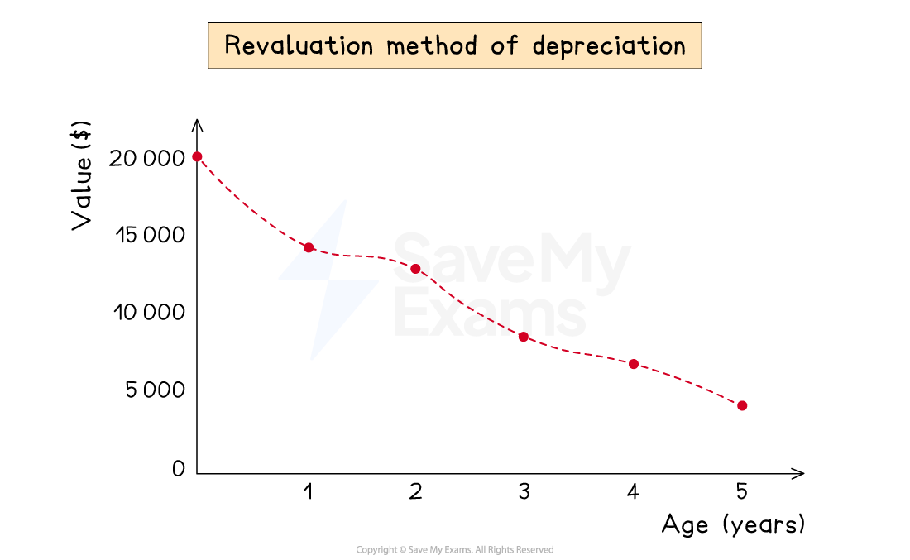

# Revaluation Method of Depreciation

## Revaluation depreciation

> **Spec point** — `spcpt_tjtH69bPwKWvQbR9`

## Revaluation depreciation

### What is the revaluation method of depreciation?

- The **revaluation method** of depreciation involves **performing a valuation of assets** at the **end of the financial year** to determine the **reduction in value**
- This method is commonly used for assets of **smaller value**

  - Such as loose tools, packing cases

*Example of an asset, which cost $20 000, being charged depreciation using the revaluation method each year*

### How do I calculate depreciation using the revaluation method?

- A **revaluation** of the non-current asset will be **given in the question**
- You need to **identify two numbers**:

  - The net book **value** **before the revaluation**
  - The net book **value** **after the revaluation**
- The depreciation charge is the **value before minus the value after**

> **Worked Example**
> Abi purchased fixtures and fittings for \$5 000 on 1 March 2023. On 29 February 2024, at the end of the financial year, the fixtures and fittings were valued at \$3 650.
> 
> Calculate the depreciation charged for the financial year ending on 29 February 2024.
> 
> **Answer**:
> 
> - Value before the revaluation is \$5 000
> - Value after the revaluation is \$3 650
> - Calculate the difference
> 
> *\$5 000 - \$3 650 =* **\$1 350**
