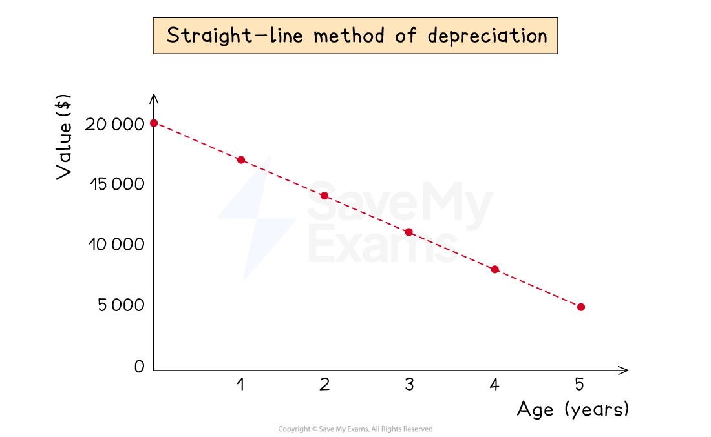

# Straight-Line Method of Depreciation

## Straight-line depreciation

> **Spec point** — `spcpt_WRzvRkrvngbg2f2k`

## Straight-line depreciation

### What is the straight-line method of depreciation?

- The **straight-line method** of depreciation assumes that a non-current asset **loses value at a constant rate **over its useful life

  - This means that the expense for its depreciation is the **same each year**
  - The net book value can reach \$0
  
    - This is when the asset is **fully depreciated**
- You could be given the **depreciation rate** as a **percentage of its original value**

  - E.g. depreciation could be charged at 20% of its original cost
- Or you could be expected to calculate the depreciation using:

  - The **number of years** that the non-current asset will be used
  - The **expected value** of the non-current asset at the **end of its working life**
  
    - This value could be \$0
    - The expected value is also called the** residual value**
- This method is usually used when the asset will be **equally valuable for each year** of its use

  - For example, fixtures and fittings, equipment, etc

*Example of an asset which cost $20 000, being charged depreciation  at 15% per annum using the straight-line method*

### How do I calculate depreciation using the straight-line method?

- If you **are given the percentage for the depreciation**

  - Find the **percentage **of the **original amount**
  - This will be the yearly depreciation charge
- If you **are not given the percentage**

  - Calculate the **expected loss in value during the expected life** of the non-current asset
  
    - The **original value minus the expected value** at the end of its life
  - **Divide** the **loss** by the **number of years** it will be used
  - This will be the yearly depreciation charge

$\mathrm{Depreciation}=\frac{\mathrm{original} \mathrm{value}-\mathrm{expected} \mathrm{value}}{\mathrm{number} \mathrm{of} \mathrm{years}}$

> **Exam Hint**
> The straight-line method is similar to **simple interest** calculations used in maths.

> **Worked Example**
> Abi purchases machinery for \$18 000. Machinery is depreciated at 15% per annum using the straight-line method.
> 
> Calculate the net book value of the machinery after 3 years.
> 
> **Answer**:
> 
> - Calculate the yearly expense due to depreciation
> 
> *15% × \$18 000 = \$2 700*
> 
> - Calculate the total depreciation after 3 years
> 
> *3 × \$2 700 = \$8 100*
> 
> - Subtract the depreciation from the original value
> 
> *\$18 000 - \$8 100 =* **\$9 900**

> **Worked Example**
> Taiki purchases a vehicle for \$30 000. He expects to use the vehicle for 3 years, after which he estimates that it will have a value of \$12 000.
> 
> Calculate the yearly expense due to the depreciation of the vehicle.
> 
> **Answer**:
> 
> - Calculate the loss in value over the 3 years
> 
> *\$30 000 - \$12 000 = \$18 000*
> 
> - Divide this by the number of years
> 
> *\$18 000 ÷ 3 =*** \$6 000**
