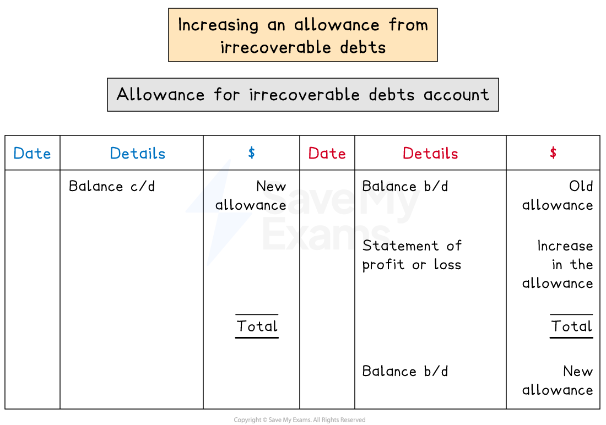
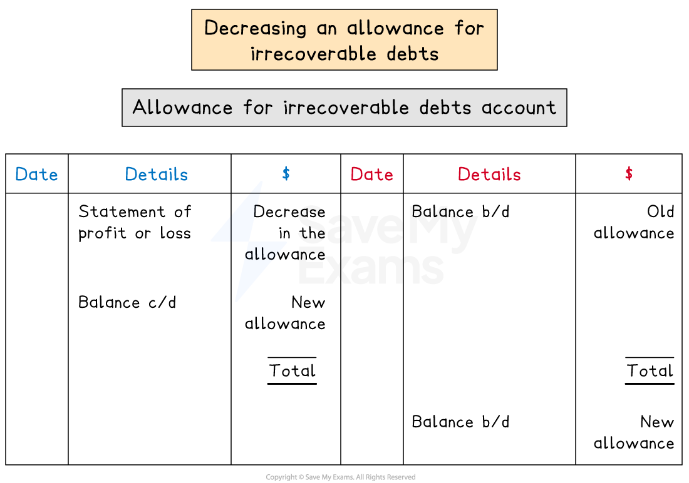

# Allowance for Irrecoverable Debts

## Allowance for irrecoverable debts

> **Spec point** — `spcpt_SdFbzMpmsf3hNVwY`

## Allowance for irrecoverable debts

### What is an allowance for irrecoverable debts?

- An **allowance for irrecoverable debts** is an **estimation **for the **amount of sales** in a given financial period which will result in **irrecoverable debts**
- The amount for the allowance for irrecoverable debts can be **determined using different methods**

  - It could be a **fixed percentage** of the **trade receivables** at the end of a financial period
  - It could be a **fixed amount** based on data from previous years
  - It could factor in **how long debts have been outstanding**
  - It could be based on **which individuals are unlikely to settle their debts**
- A business should use the **same method** for accounting for the allowance each year

  - This adheres to the **accounting principle of consistency**
- An allowance for irrecoverable debts is **similar **to a **provision for depreciation** of a non-current asset

  - The allowance for irrecoverable debts **estimates **a reduction in an asset
  
    - The asset is the amount owed by trade receivables
  - However, the reduction is kept in an **allowance account** which is separate from the asset accounts

### Why do businesses set up allowance for irrecoverable debts?

- Businesses use an allowance for irrecoverable debts to adhere to the **accounting principles**:

  - **Prudence**
  - **Matching**
- The principle of **prudence** is applied because:

  - The **assets **are **not overstated**
  
    - The allowance reduces the trade receivables by a realistic amount
  - The **profit** for the year is **not overstated**
  
    - The potential losses are factored into the expenses
- The principle of **matching **is applied because:

  - An **estimate **of **irrecoverable debts** is made **based on sales in a given period**
  - This **estimate **is then treated as an **expense **for the **same period** as the original sales

### How do I set up an allowance for irrecoverable debts?

- The allowance is **set up at the end of the financial period**
- The business **estimates **the amount of sales in that period that will result in **irrecoverable debts**

  - This is normally a percentage of the trade receivables at the end of the financial period
- This amount is **debited** to the **statement of profit or loss** as an expense

  - A **credit** entry is made in the **allowance for irrecoverable debts** account
- The **balance **of an allowance for irrecoverable debts account will be on the **credit side** because it represents a **reduction in an asset**

> **Exam Hint**
> No entries are made in any account in the sales ledger for the allowance for irrecoverable debts. Entries are made in these accounts when debts are actually written off.

> **Worked Example**
> On 31 March 2024, Josef is owed \$42 000 by credit customers. Josef decides to create an allowance for irrecoverable debts, set at 5% of trade receivables.
> 
> Prepare journal entries for the creation of an allowance for irrecoverable debts account on 31 March 2024. A narrative is not required.
> 
> **Journal**
> 
> | **Date** | **Details** | **Debit**  **\$** | **Credit**  **\$** |
> |---|---|---|---|
> |   |   |   |   |
> |   |   |   |   |
> 
> **Answer**:
> 
> - Calculate the allowance for irrecoverable debts
> 
> *5% × \$42 000 = \$2 100*
> 
> - Start with the account to be debited
> 
>   - The statement of profit or loss
> - Then include the account to be credited
> 
>   - The allowance for irrecoverable debts account
> 
> **Journal**
> 
> | **Date** | **Details** | **Debit**  **\$** | **Credit**  **\$** |
> |---|---|---|---|
> | **Final answer:** **2024**  **Final answer:** **Mar 31** | **Final answer:** **Statement of profit or loss** | **Final answer:** **2 100** |   |
> |   | ** **     **Allowance for irrecoverable debts** |   | **Final answer:** **2 100** |

## Adjustments to an allowance for irrecoverable debts

> **Spec point** — `spcpt_Dx6fR5dkV6CBXH3g`

## Adjustments to an allowance for irrecoverable debts

### How do I update an allowance for irrecoverable debts at the end of a financial period?

- The allowance for irrecoverable debts is **reviewed at the end of each year** and the amount might be updated
- At the end of the financial period

  - **Calculate** the **new **allowance for irrecoverable debts
  - This will be the **opening balance** of the allowance for irrecoverable debts account for the **next financial period**
  
    - Enter it on the **credit side **
  - Enter the **corresponding closing balance **on the **debit side** of the allowance for irrecoverable debts account for the** current financial period**
  - **Calculate** the **difference** and enter it on the appropriate side to make the account balance
  
    - This value will be **transferred to the statement of profit or loss**
- If the allowance for irrecoverable debts **increases**:

  - The **difference **will be on the **credit **side
  - This will be **debited **to the **statement of profit or loss** as an **expense**
- If the allowance for irrecoverable debts **decreases**:

  - The **difference **will be on the **debit **side
  - This will be **credited **to the **statement of profit or loss** as an **income**

### How does an allowance for irrecoverable debts affect the financial statements?

- At the end of a financial period, the **balance **from the allowance for irrecoverable debts account appears on the **statement of financial position**

  - It is listed under trade receivables
  - The balance is **subtracted **from the balance for **trade receivables**
- The **difference** in the allowance between the start of the year and the end of the year appears on the **statement of profit or loss**

  - If the allowance has **increased, **it appears with the other **expenses**
  - If the allowance has **decreased,** it appears with the other **income**

> **Exam Hint**
> When an allowance for irrecoverable debts is first created, the whole amount is charged as an expense to the statement of profit or loss, this is because the allowance has increased from \$0.

> **Worked Example**
> Ricardo keeps an allowance for irrecoverable debts at a rate of 3% of trade receivables. On 1 March 2023, the balance of the allowance for irrecoverable debts was \$1 530. On 29 February 2024, the trade receivables were \$49 500, of which \$1 000 should be written off as irrecoverable debts.
> 
> (a) Prepare the allowance for irrecoverable debts account for Ricardo. Balance the account on 29 February 2024 and bring down the balance on 1 March 2024.
> 
> (b) State how the allowance for irrecoverable debts affects the profit for the year ended 29 February 2024.
> 
> **Answer**:
> 
> - Subtract the irrecoverable debts from the trade receivables
> 
> *\$49 500 - \$1 000 = \$48 500*
> 
> - Calculate the new allowance for irrecoverable debts
> 
> *3% × \$48 500 = 1 455*
> 
> - Calculate the change in the allowance
> 
> *\$1 530 - \$1 455 = \$75*
> 
> **(a)**
> 
> Enter the details into the allowance for irrecoverable debts account
> 
> - Remember, the balance b/d is on the credit side
> 
> **Final answer:** **Ricardo**
> **Allowance for Irrecoverable Debts Account**
> 
> | **Final answer:** **Date** | **Final answer:** **Details** | **Final answer:** **\$** | **Final answer:** **Date** | **Final answer:** **Details** | **Final answer:** **\$** |
> |---|---|---|---|---|---|
> | **Final answer:** **2024**  **Final answer:** **Feb 29** | **Final answer:** **Statement of profit or loss** | **Final answer:** **75** | **Final answer:** **2023**  **Final answer:** **Mar 1** | **Final answer:** **Balance b/d** | **Final answer:** **1 530** |
> | **Final answer:** **Feb 29** | **Final answer:** **Balance c/d** | **Final answer:** **1 455** |   |   | <u>            </u> |
> |   |   | **Final answer:** **1 530** |   |   | **Final answer:** **1 530** |
> |   |   |   | **Final answer:** **2024**  **Final answer:** **Feb 29** | **Final answer:** **Balance b/d** | **Final answer:** **1 455** |
> 
> **(b) **
> 
> The allowance for irrecoverable debts has decreased. This will be credited to the statement of profit or loss and treated as an income.
> 
> **Final answer:** **The allowance for irrecoverable debts increases the profit for the year by \$75**
