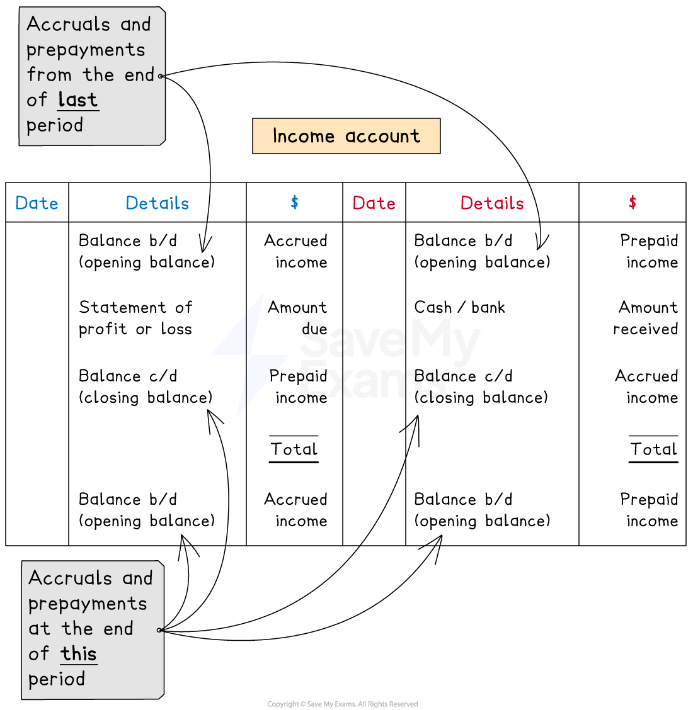

# Income Accounts with Accruals & Prepayments

## Income accounts with accruals & prepayments

> **Spec point** — `spcpt_CGfzGNbYHQ59jKGn`

## Income accounts with accruals & prepayments

### How do I complete an income account?

- Put the **opening balance** on the correct side

  - **Debit **side if the amount is an **accrual**
  - **Credit **side if the amount is a **prepayment**
- Put the **amount received** on the **credit **side

  - Label this as **cash **or **bank**
- Put the **amount due** on the **debit** side

  - Label this as **statement of profit or loss**
- Put the **closing balance** on the correct side

  - **Credit **side if the amount is an **accrual**
  - **Debit **side if the amount is a **prepayment**

*Layout of an income account showing the entries on each side for accruals and prepayments*

> **Exam Hint**
> Students sometimes get confused about where to put the closing balances. A good way to make sure that you put them on the correct side, is to also include the opening balances for the following year. Then the closing balances will be on the opposite side.

### How do I calculate a missing value in an income account?

- You can use a **ledger account** to find any missing value

  - Fill in the **amounts** that you know on the **correct sides**
  - Find the **missing value** which** balances** the account
- You can use this method to find

  - the **amount received**
  - the** amount to transfer** to the statement of profit or loss
  - the **amount accrued or prepaid** at the end of the year

> **Worked Example**
> Hussain receives rent from Sayid.
> 
> On 1 January 2023, Sayid owed Hussain three months’ rent.
> 
> On 1 March 2023, Hussain receives a cheque from Sayid for \$8 400 for 16 months’ rent.
> 
> Prepare the rent receivable account in the ledger for Hussain for the financial year ended 31 December 2023. Balance the account and bring down the balances on 1 January 2024. Clearly show the amount that is transferred to the statement or profit or loss.
> 
> **Answer**:
> 
> Sayid paid for 16 months:
> 
> - 12 months for the financial year
> - three months for the arrears at the start
> - one month prepaid for the next year
> 
> Find the accrual at the start of the year.
> 
> - **STEP 1**: Divide the payment by 16 to get the monthly rent
> 
> *\$8 400 ÷ 16 = \$525*
> 
> - **STEP 2**: Multiply the monthly rent by 3 to find the accrual at the start of the year
> 
> *\$525 × 3 = \$1 575*
> 
> Find the amount due for the year ended 31 December.
> 
> - Multiply the monthly rent by 12
> 
> *\$525 × 12 = \$6 300*
> 
> Identify which side of the rent receivable account to post each transaction:
> 
> - The payment from Sayid will be credited to the rent receivable account
> 
>   - Because it will be debited to the cash book
> - There is an accrual at the start of the year, which represents an asset
> 
>   - Therefore the opening balance will be on the debit side of the rent receivable account
> - The amount for the year is credited to the statement or profit or loss
> 
>   - Therefore the rent receivable account will be debited
> - There is a prepayment at the end of the year, which represents a liability
> 
>   - Therefore there will be an opening balance on the credit side for the next year
>   - Therefore, the closing balance will be on the debit side for this year
> 
> **Final answer:** **Hussain**
> **Rent Receivable Account**
> 
> | **Final answer:** **Date** | **Final answer:** **Details** | **Final answer:** **\$** | **Final answer:** **Date** | **Final answer:** **Details** | **Final answer:** **\$** |
> |---|---|---|---|---|---|
> | **Final answer:** **2023**  **Final answer:** **Jan 1** | **Final answer:** **Balance b/d** | **Final answer:** **1 575** | **Final answer:** **2023**  **Final answer:** **Jan 1** | **Final answer:** **Bank** | **Final answer:** **8 400** |
> | **Final answer:** **Dec 31** | **Final answer:** **Statement of profit or loss** | **Final answer:** **6 300** |   |   |   |
> | **Final answer:** **Dec 31** | **Final answer:** **Balance c/d** | **Final answer:** **525** |   |   | <u>             </u> |
> |   |   | **Final answer:** **8 400** |   |   | **Final answer:** **8 400** |
> |   |   |   | **Final answer:** **2024**  **Final answer:** **Jan 1** | **Final answer:** **Balance b/d** | **Final answer:** **525** |
