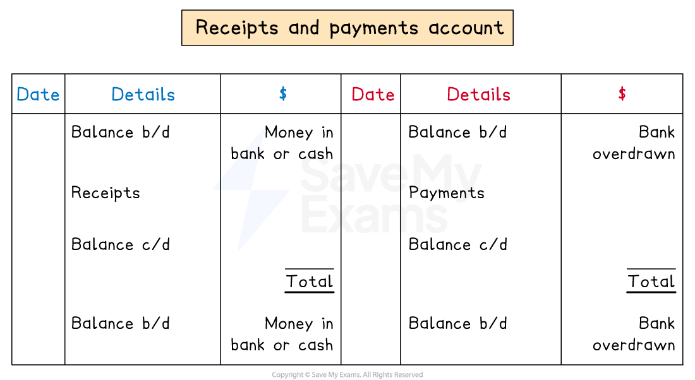

# Receipts & Payments Account

## Receipts & payments accounts

> **Spec point** — `spcpt_S5JbCfdWZJZsCpS5`

## Receipts & payments accounts

### What is a receipts and payments account?

- A **receipts and payments account** is a **simple cash book**

  - They are prepared each year by clubs and societies
- Clubs and societies use the account to **record receipts and payments**

  - Amounts are** not separated** into cash or bank transactions
  - They are summarised as money in and money out

### What is the layout of a receipts and payments account?

- A receipts and payments account is prepared in a similar way to a cash book

  - Amounts received are **debited**
  - Amounts paid are **credited**
- **Receipts **might include:

  - **Subscriptions **from members
  - Sales revenue from trading activities of the club
  
    - Such as selling **refreshments**
- **Payments **might include:

  - **Expenses **for utilities
  - Purchase of **inventory **for the trading activities

*Layout of a receipts and payments account*

> **Worked Example**
> The Old Mill Golfing club offers lessons to amateur golfers and it also provides a place for experienced golfers to play regularly. It also has a shop where golfing equipment can be bought.
> 
> The club had \$4 120 in the bank on 1 June 2023.  The club provided the following list of receipts and payments for the year ended 31 May 2024.
> 
> |   | \$ |
> |---|---|
> | Subscriptions received | 66 400 |
> | Revenue for shop sales | 8 350 |
> | Purchases of golfing equipment for resale | 4 980 |
> | Wages | 44 700 |
> | General expenses | 5 100 |
> | Purchase of golf carts for the club | 14 400 |
> | Income from the rental of golf carts | 5 200 |
> 
> Prepare the receipts and payments account for The Old Mill Golfing club for the year ended 31 May 2024. Balance the account and bring down the balance at 1 June 2024.
> 
> **Answer**:
> 
> - The bank balance on 1 June 2023 is the opening balance and goes on the debit sid
> - Label each item as:
> 
>   - A debit if the club received money
>   - A credit if the club paid money
> 
> |   | \$ |   |
> |---|---|---|
> | Subscriptions received | 66 400 | *Debit* |
> | Revenue for shop sales | 8 350 | *Debit* |
> | Purchases of golfing equipment for resale | 4 980 | *Credit* |
> | Wages | 44 700 | *Credit* |
> | General expenses | 5 100 | *Credit* |
> | Purchase of golf carts for the club | 14 400 | *Credit* |
> | Income from the rental of golf carts | 5 200 | *Debit* |
> 
> - Enter the entries into the receipts and payments account
> - And then balance the account and bring down the balance
> 
> | **Final answer:** **The Old Mill Golfing Club**  **Final answer:** **Receipts and Payments Account for year ended 31 May 2024** |   |   |   |   |   |
> |---|---|---|---|---|---|
> | **Final answer:** **Date** | **Final answer:** **Details** | **Final answer:** **\$** | **Final answer:** **Date** | **Final answer:** **Details** | **Final answer:** **\$** |
> | **Final answer:** **2023**  **Final answer:** **June 1** | **Final answer:** ** **  **Final answer:** **Balance b/d ** | **Final answer:** ** **  **Final answer:** **4 120** | **Final answer:** **2024**  **Final answer:** **May 31** | **Final answer:** ** **  **Final answer:** **Shop purchases** | **Final answer:** ** **  **Final answer:** **4 980** |
> | **Final answer:** **2024**  **Final answer:** **May 31** | **Final answer:** ** **  **Final answer:** **Subscriptions ** | **Final answer:** ** **  **Final answer:** **66 400** | **Final answer:** **May 31** | **Final answer:** **Wages ** | **Final answer:** **44 700** |
> | **Final answer:** **May 31** | **Final answer:** **Shop sales** | **Final answer:** **8 350** | **Final answer:** **May 31** | **Final answer:** **General expenses** | **Final answer:** **5 100** |
> | **Final answer:** **May 31** | **Final answer:** **Rental income** | **Final answer:** **5 200** | **Final answer:** **May 31** | **Final answer:** **Golf carts purchase** | **Final answer:** **14 400** |
> |   |   | **Final answer:** **              ** | **Final answer:** **May 31 ** | **Final answer:** **Balance c/d** | **Final answer:** **14 890** |
> |   |   | **Final answer:** **84 070** |   |   | **Final answer:** **84 070** |
> | **Final answer:** **2024**  **Final answer:** **June 1** | **Final answer:** ** **  **Final answer:** **Balance b/d** | **Final answer:** ** **  **Final answer:** **14 890** |   |   |   |
