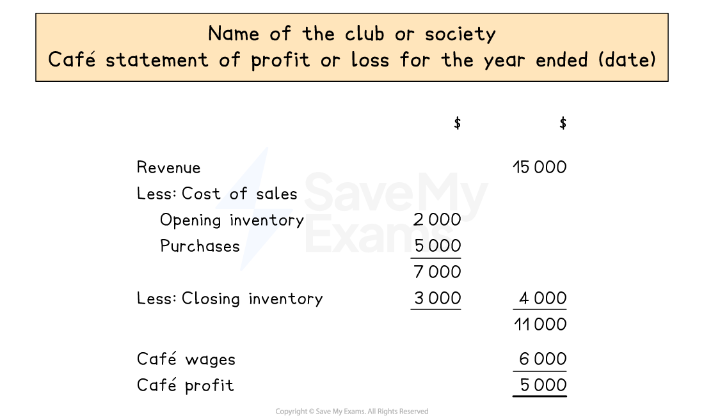

# Statement of Profit or Loss

## Clubs & societies

> **Spec point** — `spcpt_kqQJWJwQkq3gj5Tg`

## Clubs & societies

### What types of businesses are clubs and societies?

- **Clubs and societies** are classed as **non-trading organisations**
- These types of businesses provide a service or facility for a fee called a **subscription**
- They do not operate with the sole aim of making a profit

### What financial statements are prepared for clubs and societies?

- Clubs and societies **do not always keep a full set** of accounting records
- Their **main **accounting records tend to be

  - A **receipts and payments account**
  
    - This is a simple cash book
  - **Trading sections **of **statements of profit or loss** for each one of any trading activities
  
    - Such as a café or a shop
    - These are prepared in the same way as for sole traders
  - An **income and expenditure account **
  
    - This shows the sources of **income **and **expenses **of the organisation
    - This is equivalent to the statement of a profit or loss for a sole trader
  - A **subscription **account
  
    - This calculates the fees that should have been received from members during the year
  - A** statement of financial position**
  
    - This is prepared in a similar way to that of sole traders

## Statement of profit or loss for clubs & societies

> **Spec point** — `spcpt_mVBHCX5mHJyV9tSW`

## Statement of profit or loss for clubs & societies

### Why might clubs and societies prepare statements of a profit or loss?

- **Statements of profit or loss** are prepared when the club or society** involves a trading activity **which buys and sells goods to raise extra money
- A separate statement of profit or loss is prepared for each trading activity
- The **profits or losses **made from the trading activities are transferred to the income and expenditure account

### What is included in the statements of profit or loss for trading activities?

- The statement of profit or loss is prepared similarly to the **trading section** of the statement of profit or loss of any other business
- The main **difference **is that the **gross profit **is **not always calculated**

*Layout of a statement of profit or loss for a trading activity of a club or society*

> **Worked Example**
> Paramount Badminton Club owns badminton courts. It also operates a shop where it sells refreshments and badminton equipment. Shop sales are on a cash basis and purchases made for the shop are on credit.
> 
> The treasurer of the club provided the following information.
> 
> |   | 1 January 2023 | 31 December 2023 |
> |---|---|---|
> | \$ | \$ |   |
> | Subscriptions in advance | 2 200 | 2 050 |
> | Subscriptions in arrears | 6 515 | 6 850 |
> | Total shop trade payables | 5 375 | 5 950 |
> | Shop inventory | 3 600 | 3 200 |
> | Balance at bank | 360 | 220 |
> 
> Other information provided for the year ended 31 December 2023:
> 
> | Shop sales | 48 120 |
> |---|---|
> | Subscriptions received during the year | 38 700 |
> | Shop purchases | 36 200 |
> | Shop purchases returns | 2 710 |
> | Shop wages | 4 820 |
> | Wages for the club caretakers | 2 650 |
> | Insurance for the club | 3 640 |
> | Bank charges for the club | 80 |
> | Telephone for the club | 380 |
> | Advertising for the club | 460 |
> | Depreciation of equipment for the club | 520 |
> 
> Prepare the shop statement of profit or loss for the year ended 31 December 2023.
> 
> **Answer**:
> 
> - Only income and expenses related to the shop appear on the shop's statement of profit or loss
> 
>   - Do not include anything that is for the club in general such as subscriptions
> 
> | **Final answer:** **Paramount Badminton Club**  **Final answer:** **Shop Statement of Profit or Loss for the year ended 31 December 2023** |   |   |
> |---|---|---|
> |   | **Final answer:** **\$** | **Final answer:** **\$** |
> | **Final answer:** **Shop sales** |   | **Final answer:** **48 120** |
> | **Final answer:** **Less: Cost of sales** |   |   |
> | **Final answer:** **   Opening Inventory** | **Final answer:** **3 600** |   |
> | **Final answer:** **   Purchases** | **Final answer:** **36 200** |   |
> |   | **Final answer:** **39 800** |   |
> | **Final answer:** **   Less: Purchases returns** | **Final answer:** **2 710** |   |
> |   | **Final answer:** **37 090** |   |
> | **Final answer:** **   Less: Closing inventory** | **Final answer:** **3 200** | **Final answer:** **33 890** |
> | **Final answer:** **  ** |   | **Final answer:** **14 230** |
> | **Final answer:** **Less: Shop wages** |   | **Final answer:** **4 820** |
> | **Final answer:** **Shop profit** |   | **Final answer:** **9 410** |
