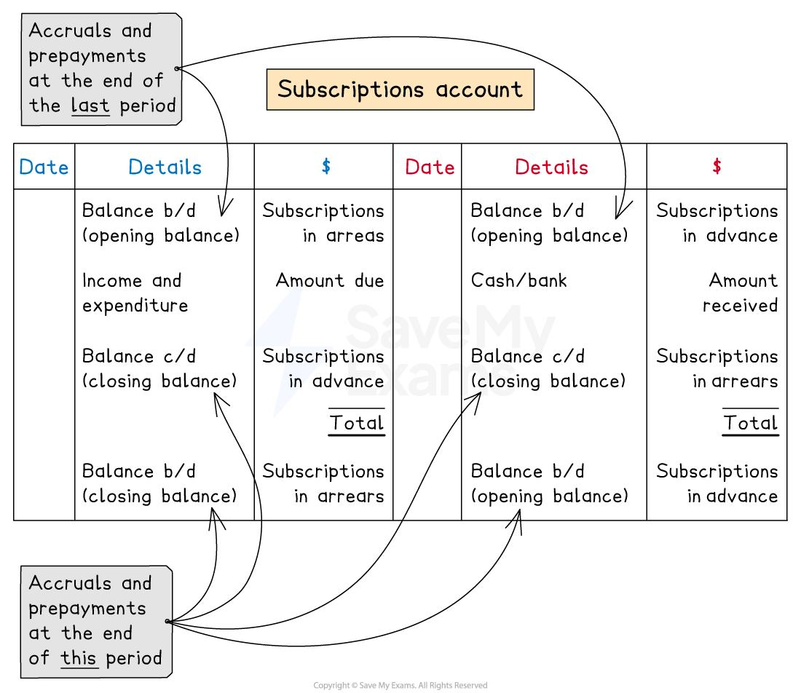

# Subscriptions Account

## Subscriptions accounts

> **Spec point** — `spcpt_4qdMkFVTs2f85mj4`

## Subscriptions accounts

### What is a subscriptions account?

- A **subscriptions account **is prepared to show the amount of subscriptions that relates to the **financial year**

  - This amount is then **transferred **to the **income and expenditure** account
- Subscription is an **income **and is treated in the same way as **income accounts** of trading businesses are treated

### What is the layout of a subscriptions account?

- The **subscriptions account** looks very similar to **any other income account**
- The account may have **two balances**

  - A **debit **balance for subscriptions in **arrears**
  
    - This amount is still owed to the organisation
    - Therefore it is an asset
  - A **credit **balance for subscriptions paid in **advance**
  
    - This amount has been paid for future services which the organisation must provide
    - Therefore it is a liability
- There might be **irrecoverable debts** that have been written off

  - The amount would be **credited **to the subscriptions account

*Layout of a subscriptions account*

> **Exam Hint**
> Just remember that this is the same as an income account. This will reduce the amount you need to remember.

> **Worked Example**
> The Batters is a baseball club. Members pay a monthly subscription of \$10 per month to use the facilities and equipment.  The treasurer wants to know the amount to be transferred to the income and expenditure account for the year ended 31 December 2023.  The following information was provided:
> 
> - 1 December 2022, nine members paid in advance for the month of January 2023
> - 31 January 2023, six members  paid the amount owing for month of December 2022
> - 31 December 2023, eight members owe the month of December 2023
> - 16 December 2023, two members paid in full for the year ending 31 December 2024
> - Received \$3 730 in total from members for subscriptions during the year ended 31 December 2023
> 
> Prepare the subscription account for the year ended 31 December 2023. Bring down the balance on 1 January 2024.
> 
> **Answer**:
> 
> Deal with each piece of information separately and identify which side to enter the amount
> 
> - 1 December 2022, nine members paid in advance for January 2023
> 
>   - This is a prepayment from the previous year
>   - This is the opening balance on the credit side
> 
> *9 × \$10 = \$90*
> 
> - 31 January 2023, six members paid the amount owing for December 2022
> 
>   - This is an accrual from the previous year
>   - This is the opening balance on the debit side
> 
> *6 × \$10 = \$60*
> 
> - 31 December 2023, eight members owe the month of December 2023
> 
>   - This is an accrual for this year
>   - This is the opening balance on the debit side for next year
>   - Therefore the balance c/d is on the credit side
> 
> *8 × \$10 = \$80*
> 
> - 16 December 2023, two members paid in full for the year ending 31 December 2024
> 
>   - This is a prepayment for the next year
>   - This is the opening balance on the credit side for next year
>   - Therefore the balance c/d is on the debit side
> 
> *2 × 12 × \$10 = \$240*
> 
> - Received \$3 730 in total from members for subscriptions during the year ended 31 December 2023
> 
>   - This is the amount received
>   - Enter this on the right side
> - Calculate the amount to transfer to the income and expenditure account
> 
>   - You can find the balancing figure for the account
>   - Alternatively, you can calculate it from the information by
>   
>     - adding amounts which are due this year
>     - and subtracting amounts that are not due this year
>   - Start with the amount received for the year
>   
>     - Subtract the accrual from last year
>     - Add the prepayment from last year
>     - Add the accrual at the end of this year
>     - Subtract the prepayment at the end of this year
> 
> *\$3 730 - \$60 + \$90 + \$80 - \$240 = \$3 600*
> 
> - Enter the details into the account
> 
> | **Final answer:** **The Batters**  **Final answer:** **Subscriptions Account** |   |   |   |   |   |
> |---|---|---|---|---|---|
> | **Final answer:** **Date** | **Final answer:** **Details** | **Final answer:** **\$** | **Final answer:** **Date** | **Final answer:** **Details** | **Final answer:** **\$** |
> | **Final answer:** **2023**  **Final answer:** **Jan 1** | **Final answer:** **Balance b/d** | **Final answer:** **60** | **Final answer:** **2023**  **Final answer:** **Jan 1** | **Final answer:** **Balance b/d** | **Final answer:** **90** |
> | **Final answer:** **Dec 31** | **Final answer:** **Income and expenditure** | **Final answer:** **3 600** | **Final answer:** **Dec 31** | **Final answer:** **Bank** | **Final answer:** **3 730** |
> | **Final answer:** **Dec 31** | **Final answer:** **Balance c/d** | **Final answer:** **240** | **Final answer:** **Dec 31** | **Final answer:** **Balance c/d** | **Final answer:** **80** |
> |   |   | **Final answer:** **3 900** |   |   | **Final answer:** **3 900** |
> | **Final answer:** **2024**  **Final answer:** **Jan 1** | **Final answer:** **Balance b/d** | **Final answer:** **80** | **Final answer:** **2024**  **Final answer:** **Jan 1** | **Final answer:** **Balance b/d** | **Final answer:** **240** |
