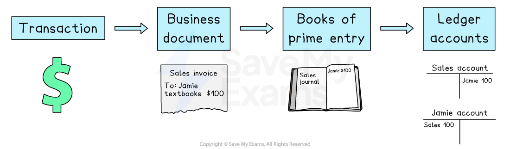

# The Accounting Process

## The accounting process

> **Spec point** — `spcpt_zfbzzN5JpXCRjV2X`

## The accounting process

### What is the accounting process?

- **Stage 1: Transaction**

  - A transaction takes place
  - Examples include:
  
    - The sale or purchase of goods, a service or an asset
    - Withdrawing or depositing cash
    - Paying an expense or receiving income
- **Stage 2: Business document**

  - A business document is **issued** or **received**
  - This is a record of the transaction
- **Stage 3: Book of prime entry**

  - The amount is entered into a book of prime entry
  - This collates the different types of transactions
- **Stage 4: Ledger account**

  - The entries from the books of prime entry are entered into the ledger accounts
  - These are part of the double-entry accounting system

*The accounting process*

> **Exam Hint**
> The aim of the accounting process is to have the information in the ledger accounts so that financial statements can be produced at the end of the accounting period.

## Purpose of business documents

> **Spec point** — `spcpt_3rCPKqDkS65Qz8Fb`

## Purpose of business documents

### What are business documents?

- **Business documents** are used to **keep records** of all transactions
- They are used as **sources of information**

  - The amounts are then entered into the **books of prime entry**
  - They can be used to **check potential errors**

### What business documents do I need to know?

- Invoices
- Debit notes
- Credit notes
- Statements of account
- Cheques
- Cheque counterfoils
- Receipts
- Paying-in slips
- Bank statements
- Petty cash vouchers

### Are business documents produced and recorded manually or digitally?

- Business documents can be produced and recorded either **manually** or **digitally**
- They can be produced and recorded **manually **by:

  - physical receipts and invoices
  - paper-based bank statements and statements of account
  - cheques
- They can be produced and recorded **digitally **by:

  - electronic receipts and invoices
  - electronic bank statements and statements of account

## Purpose of books of prime entry

> **Spec point** — `spcpt_TRDjK35FjJmSbhMc`

## Purpose of books of prime entry

### What are books of prime entry?

- **Books of prime entry** are used to **record the details** of a **transaction**

  - Older terminology for these books includes
  
    - Subsidiary books
    - Books of original entry
    - Daybooks
- Information is **taken from the business documents** and entered into the books of prime entry
- The details are **then transferred** from the books of prime entry **to the ledger accounts**
- The seven books of prime entry are:

  - Sales journal
  - Purchases journal
  - Sales returns journal
  - Purchases returns journal
  - Cash book
  - Petty cash book
  - General journal

### What are the advantages of using books of prime entry?

- **Books of prime entry **are another stage which can be used to **check for errors**

  - They can help in the **preparation of control accounts** to check the accuracy of the ledger accounts
- Each book of prime entry collects the **same type of transaction**

  - The books allow **managers** to see the** totals** for different types of transactions easily
  - Therefore, there are** fewer entries** in some of the ledger accounts
- Bigger businesses may have **multiple book-keepers**

  - Different book-keepers can be **responsible for different books** of prime entry without any risk of work being duplicated or missed

### What are the benefits and limitations of using manual or digital methods for entering transactions into books of prime entry?

- The books of prime entry can be updated **manually **or **digitally**

  - **Manually** means the transactions are entered into **physical books**
  - **Digitally **means the transactions are entered into **spreadsheets **or **accounting software**

|   | Benefits | Limitations |
|---|---|---|
| Manual entry | - No software is required - Works without electricity or internet - They can be physically signed | - Takes longer - Prone to human error - Difficult to share and access - Can be lost, damaged or stolen - Harder to analyse |
| Digital entry | - Faster to input - More accurate as built-in tools can calculate totals - Better audit trail - Easier to transfer to ledger accounts and financial statements - Easy to share and access | - Training costs for employees - Subscription costs - Need access to computers and usually the internet - Amounts can still be entered incorrectly |
