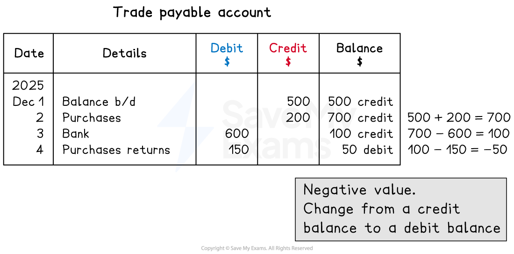

# Three-Column Running Balance Format

## Three-column running balance format

> **Spec point** — `spcpt_SycDmb62w6fmfjw7`

## Three-column running balance format

### What is the three-column running balance format?

- The** three-column running balance format** is an alternative to the usual double-sided ledger account

  - **Bank statements **and **accounting software** usually use this format
- There are five columns

  - Date
  - Details
  - Debit
  - Credit
  - Balance
- An **advantage **of using the three-column format is that the business can **always see the balance** of the account
- A **disadvantage **of using the three-column format is that the business **cannot easily see** the **total debits** and **total credits** of the account

*Layout of an account using the three-column running balance format*

### How do I fill in an account using the three-column format?

- You fill in the **date **and **details **as normal
- You enter the amount in **either **the **debit** or **credit **column

  - You use the same rules as for the normal format
- You update the **balance **after each entry

> **Exam Hint**
> If the balance changes between debit and credit, such as the bank account, then the words "debit" and "credit" are written after each balance.
> 
> If the balance is always a debit or always a credit, then the account might not write this next to the balances.

### How do I find the balance after each transaction?

- If the entry and the current balance are **both debits** or **both credits**:

  - **add **the amount to the balance
- If the entry is **different **to the current balance

  - **subtract** the amount from the balance
  - If the new balance is a **negative **number
  
    - **change **between a debit balance and a credit balance

*Layout of an account using the three-column running balance format*

> **Worked Example**
> Kamala is a trader. Bruno is a credit customer. At 1 December 2025, Bruno owes Kamala \$550.
> 
> The following transactions take place in December 2025:
> 
> - 3 Dec: Bruno settles an invoice for \$500 by paying \$475 by bank transfer
> - 5 Dec: Bruno purchases goods with list price \$230 on credit
> - 13 Dec: Bruno returns unpaid goods with list price \$70
> 
> Complete Bruno's account in the books of Kamala.
> 
> **Bruno**
> 
> | Date | Details | Debit \$ | Credit \$ | Balance \$ |
> |---|---|---|---|---|
> | 2025 |   |   |   |   |
> | Dec 1 | Balance b/d | 550 |   | 550 |
> 
> **Answer**:
> 
> - 3 Dec: Bruno settles an invoice for \$500 by paying \$475 by bank transfer
> 
>   - \$475 is paid into Kamala's bank
>   - \$25 is discount allowed by Kamala
>   - Reduce the amount Bruno owes
>   - These are credit entries as the asset is decreasing
> - 5 Dec: Bruno purchases goods with list price \$230 on credit
> 
>   - Increase the amount Bruno owes
>   - This is a debit entry as the asset is increasing
> - 13 Dec: Bruno returns unpaid goods with list price \$70
> 
>   - Reduce the amount Bruno owes
>   - These are credit entries as the asset is decreasing
> 
> **Bruno**
> 
> | Date | Details | Debit \$ | Credit \$ | Balance \$ |
> |---|---|---|---|---|
> | 2025 |   |   |   |   |
> | Dec 1 | Balance b/d | 550 |   | 550 |
> | **Final answer:** **3** | **Final answer:** **Bank** |   | **Final answer:** **475** | **Final answer:** **75** |
> |   | **Final answer:** **Discount allowed** |   | **Final answer:** **25** | **Final answer:** **50** |
> | **Final answer:** **5** | **Final answer:** **Sales** | **Final answer:** **230** |   | **Final answer:** **280** |
> | **Final answer:** **13** | **Final answer:** **Sales returns** |   | **Final answer:** **70** | **Final answer:** **210** |

> **Worked Example**
> At 1 December 2025, Kamala is £150 overdrawn on her bank account.
> 
> The following transactions take place in December 2025:
> 
> - 3 Dec: Kamala receives \$475 from Bruno by bank transfer
> - 11 Dec: Kamala pays \$200 for rent by cheque
> - 18: Kamala receives a cheque for \$180 from Amy
> 
> Complete Kamala's bank account. State whether each balance is a debit or credit balance.
> 
> **Bank**
> 
> | Date | Details | Debit \$ | Credit \$ | Balance \$ |
> |---|---|---|---|---|
> | 2025 |   |   |   |   |
> | Dec 1 | Balance b/d |   | 150 | 150 credit |
> 
> **Answer**:
> 
> - 3 Dec: Kamala receives \$475 from Bruno by bank transfer
> 
>   - This is a debit entry as the bank is increasing
>   
>     - The current balance is a credit so subtract
>     - A negative answer means the balance changes from a credit to a debit
> 
> $150-475=-325$
> 
> - 11 Dec: Kamala pays \$200 for rent by cheque
> 
>   - This is a credit entry as the bank is decreasing
>   
>     - The current balance is a debit so subtract
> 
> $325-200=125$
> 
> - 18: Kamala receives a cheque for \$180 from Amy
> 
>   - This is a debit entry as the bank is increasing
>   
>     - The current balance is also a debit so add
> 
> $125+180=305$
> 
> **Bank**
> 
> | Date | Details | Debit \$ | Credit \$ | Balance \$ |
> |---|---|---|---|---|
> | 2025 |   |   |   |   |
> | Dec 1 | Balance b/d |   | 150 | 150 credit |
> | **Final answer:** **3** | **Final answer:** **Bruno** | **Final answer:** **475** |   | **Final answer:** **325 debit** |
> | **Final answer:** **11** | **Final answer:** **Rent** |   | **Final answer:** **200** | **Final answer:** **125 debit** |
> | **Final answer:** **18** | **Final answer:** **Amy** | **Final answer:** **180** |   | **Final answer:** **305 debit** |
