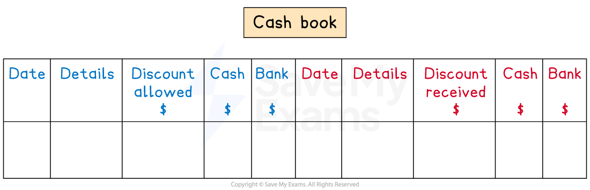

# The Cash Book

## The cash book

> **Spec point** — `spcpt_XmgbPMNWMDJRzxP7`

## The cash book

### What is the cash book?

- The cash book has **two functions**

  - It is a **book of prime entry**
  - It is a **ledger account** for both the cash and bank accounts
- The cash book **records all cash transactions**

  - Both physical cash and cash in the bank
- The cash book is **part of the double entry system**
- There are columns for the dates and details just like other ledger accounts
- There are three columns for the value of the transaction on both sides of the cash book

  - **Discount columns**
  
    - Discount **allowed** on the **debit** side
    - Discount **received** on the **credit** side
  - **Cash columns**
  - **Bank columns**

*The layout of the cash book*

### Which side should the balances be on?

- The **balance** for the **cash** account is always on the **debit side**

  - Cash is always an asset
  - It can never be a liability
- The** balance** for the **bank** account can be on **either side**

  - It is on the **debit side** if the business has **money in the bank**
  - It is on the **credit side** if the business is ***overdrawn***

### How do I enter transactions into the cash book?

- **STEP 1**
Identify whether the transaction affects the **cash** or **bank** account
- **STEP 2**
Decide whether the account should be **debited** or **credited**

  - **Debit** the account if the business is **receiving money**
  - **Credit** the account if the business is **losing money**
- **STEP 3**
Include any **discount** that was allowed or received

### What are contra entries in the cash book?

- A **contra entry** is for a transaction that is entered into **both sides** of the cash book

  - It will be entered in the cash column on one side
  - It will be entered in the bank column on the other side
- The two transactions which result in contra entries are:

  - **Withdrawing** cash from the business bank account for business use
  
    - Debit the cash account
    - Credit the bank account
  - **Depositing** cash from the business into the business bank account
  
    - Debit the bank account
    - Credit the cash account

> **Exam Hint**
> It is very easy to get confused when making contra entries into the cash book.
> 
> If the amount goes in the cash column, the details will say “bank”. If the amount goes in the bank column, the details will say “cash”.
> 
> For contra entries, remember that the name used for the details will be different to the name of the column where the entry is made.

> **Worked Example**
> Yana is a sole trader. On 1 January 2024, Yana had \$20 cash in hand and \$850 in the bank. During January 2024, the following transactions took place. Prepare Yana’s cash book.
> 
> | Jan 2 | Purchased goods on credit, \$350, from Liza |
> |---|---|
> | 4 | Paid electricity, \$250, by telephone transfer |
> | 6 | Sold goods on credit, \$180, to Tobey |
> | 10 | Withdrew cash, \$300, from the bank for business use |
> | 11 | Cash sales, \$50, were paid directly into the bank account |
> | 18 | Paid Liza, \$320, by credit transfer, in full settlement of the invoice from 2 January 2024 |
> | 21 | Tobey paid his account of £180 by cheque after deducting 5% cash discount |
> | 28 | Paid rent, \$500, by direct debit |
> | 31 | Paid \$200, cash, for wages |
> 
> **Answer**:
> 
> | Jan 1 | Debit balance of \$20 for cash and debit balance of \$850 for bank |
> |---|---|
> | 2 | No entry into the cash book as there was no exchange of cash |
> | 4 | \$250 credit entry to the bank account |
> | 6 | No entry into the cash book as there was no exchange of cash |
> | 10 | Contra entry - debit the cash account and credit the bank account |
> | 11 | \$50 debit entry to the bank account |
> | 18 | *\$350 - \$320 = \$30*  \$320 credit entry to the bank account with \$30 discount |
> | 21 | *5% × \$180 = \$9 and \$180 - \$9 = \$171*  \$171 debit entry to the bank account with \$9 discount |
> | 28 | \$500 credit entry to the bank account |
> | 31 | \$200 credit entry to the cash account |
> 
> **Yana**
> 
> **Cash Book**
> 
> | **Date** | **Details** | **Discount Allowed**  **\$** | **Cash**  **\$** | **Bank**  **\$** | **Date** | **Details** | **Discount Received**  **\$** | **Cash**  **\$** | **Bank**  **\$** |
> |---|---|---|---|---|---|---|---|---|---|
> | **Final answer:** **2024** **Jan 1** | **Final answer:** **Balance b/d** |   | **Final answer:** **20** | **Final answer:** **850** | **Final answer:** **2024** **Jan 4** | **Final answer:** **Electricity** |   |   | **Final answer:** **250** |
> | **Final answer:** **Jan 10** | **Final answer:** **Bank** |   | **Final answer:** **300** |   | **Final answer:** **Jan 10** | **Final answer:** **Cash** |   |   | **Final answer:** **300** |
> | **Final answer:** **Jan 11** | **Final answer:** **Sales** |   |   | **Final answer:** **50** | **Final answer:** **Jan 18** | **Final answer:** **Liza** | **Final answer:** **30** |   | **Final answer:** **320** |
> | **Final answer:** **Jan 21** | **Final answer:** **Tobey** | **Final answer:** **9** |   | **Final answer:** **171** | **Final answer:** **Jan 28** | **Final answer:** **Rent** |   |   | **Final answer:** **500** |
> |   |   |   |   |   | **Final answer:** **Jan 31** | **Final answer:** **Wages** |   | **Final answer:** **200** |   |
