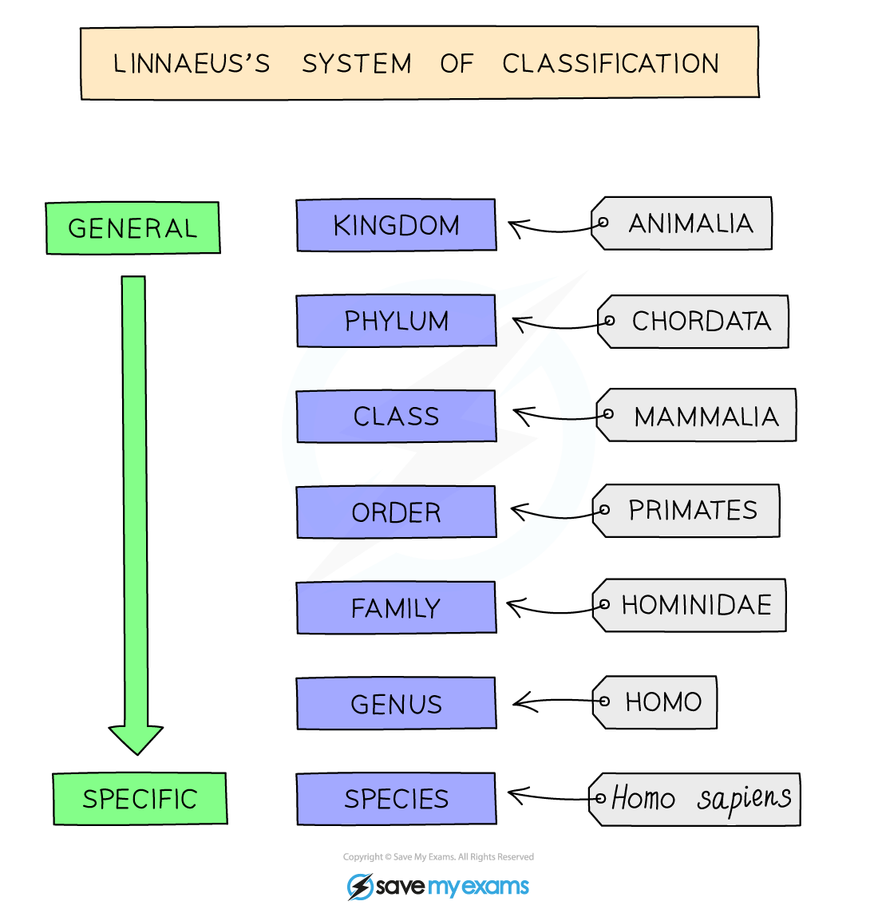
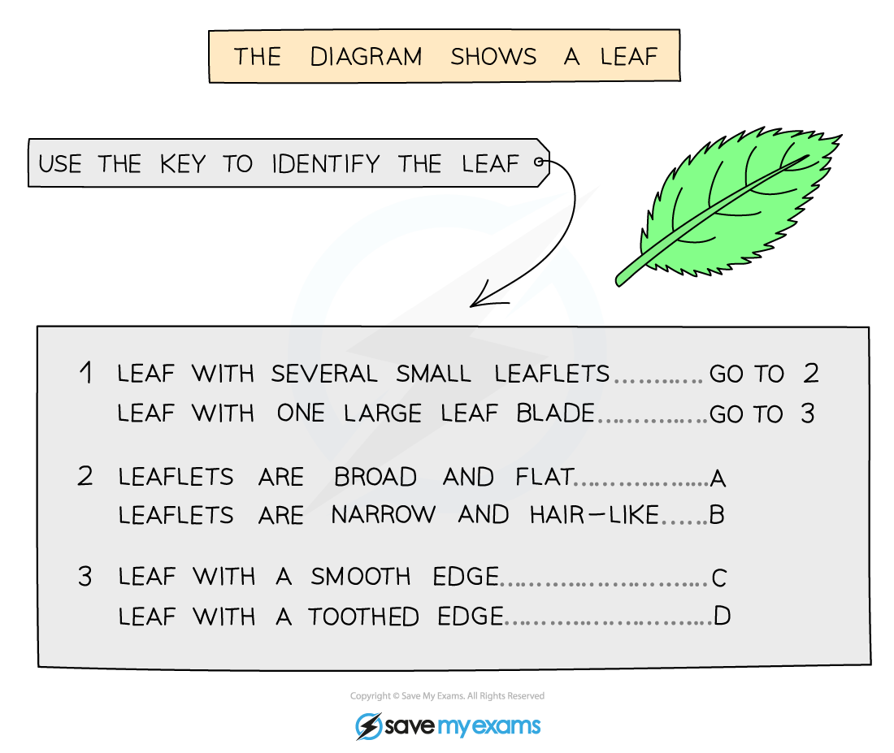
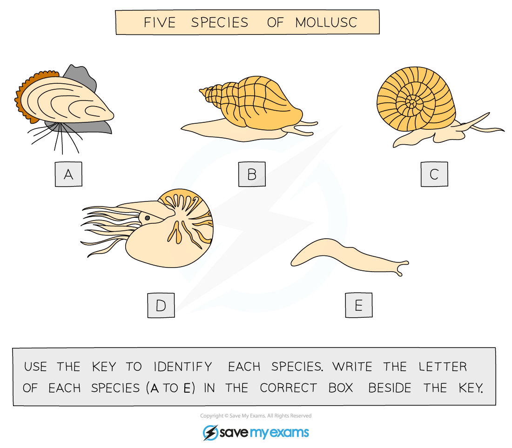

# Concept & Uses of Classification Systems

## How organisms are classified

> **Spec point** — `spcpt_nP8zcNSRTzGnHzpZ` · State that organisms can be classified into groups by the features that they share
Describe a species as a group of organisms that can reproduce to produce fertile offspring

## How organisms are classified

- There are millions of species of organisms on Earth
- A species is defined as a group of organisms that can **reproduce to produce fertile offspring**
- These species can be classified into groups by the [features that they share](https://www.savemyexams.com/igcse/biology/cie/23/revision-notes/1-characteristics-and-classification-of-living-organisms/1-1-characteristics-classification-and-features-of-organisms/1-1-4-features-of-organisms/)

## The binomial system

> **Spec point** — `spcpt_H4ZMz3cZvsFwDXjg` · Describe the binomial system of naming species as an internationally agreed system in which the scientific name of an organism is made up of two parts showing the genus and species

## The binomial system

- Organisms were first classified by a Swedish naturalist called **Linnaeus** in a way that allows the subdivision of living organisms into smaller and more specialised groups
- The species in these groups have more and more features in common the more subdivided they get
- He named organisms in Latin using the **binomial system, **an internationally agreed system in which the scientific name of an organism is made up of two parts showing the **genus** and **species**

  - The **genus** name is capitalised and comes before the species name
  - The **species** name is not capitalised and follows the genus name

- When typed binomial names are always in **italics** (which indicates they are Latin) e.g. *Homo sapiens*
- The sequence of classification is: **Kingdom**, **Phylum**, **Class**, **Order**, **Family**, **Genus**, **Species**

*Linnaeus’s system of classification*

> **Exam Hint**
> The order of classification can be remembered by using a mnemonic like:
> 
> **K**ing **P**hilip **C**ame **O**ver **F**or **G**ran's **S**paghetti
> 
> You do need to know for a given name which part is the genus and which part is the species because you could be given an unfamiliar binomial name and asked for either of these.
> 
> For examples, the binomial name for the house mouse is *Mus musculus.* If you were asked to give the genus name for the house mouse, it would be *Mus.* If you were asked for the species name, it's *musculus.*

## Dichotomous keys

> **Spec point** — `spcpt_Cnqp3FqDPfbp6DNx` · Construct and use dichotomous keys based on identifiable features

## Dichotomous keys

- Keys are used to identify organisms based on a **series of questions about their features**
- Dichotomous means ‘branching into two’ and it leads the user to identify the organism by giving **two descriptions at a time** and asking them to choose between them
- Each choice leads the user on to another two descriptions
- In order to successfully navigate a key you should:

  - Follow the statements from the beginning. Use the information or image provided in the question to answer the first statement, which will direct you to the next statement
  - Keep working through the key. If you are presented with a branching key, eventually there will be no statements left for the branch you have followed and you will have identified the organism. If you are presented with a key in a table format, you will be directed to a statement or given a name
- Fo branching keys, if you are given more than one organism to identify, it's vital that you **start at the beginning of the key for each organism**, repeating until all organisms are named

*Example of a dichotomous key #1*

*Example of a dichotomous key #2*

| Key | Letter |   |   |
|---|---|---|---|
| 1 (a) | Body is completely or partly covered in a shell | Go to 2 |   |
| 1 (b) | Body is **not** completely or partly covered in a shell | *Limax Flavus* | **E** |
| 2 (a) | Shell is attached to rocks by thin threads | *Mytilus edulis* | **A** |
| 2 (b) | Shell is **not** attached to rocks by thin threads | Go to 3 |   |
| 3 (a) | Shell is a spire that comes to a point | *Buccinum undatum* | **C** |
| 3 (b) | Shell is **not** a spire that comes to a point | Go to 4 |   |
| 4 (a) | Animal has tentacles | *Nautilus pompilius* | **D** |
| 4 (b) | Animal has 2 tentacles | *Planorbis planorbis* | **B** |

> **Exam Hint**
> Simple dichotomous keys frequently come up in the multiple choice paper, so make sure you can use one. Very occasionally they show up in the theory paper. Questions usually ask you to use a key rather than construct one, so practise using them first. Be ready to construct a simple key though, as the syllabus asks for both
