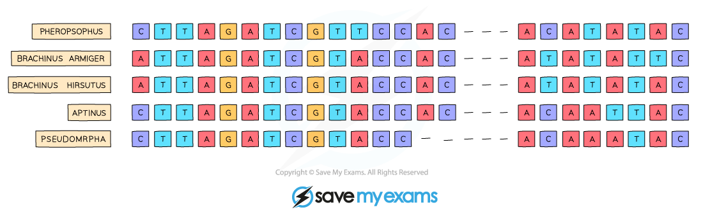

# Concept & Uses of Classification Systems Continued

## Reflecting evolutionary relationships: Extended

> **Spec point** — `spcpt_bX9gHFfxmkGxVMfQ` · nan

## Reflecting evolutionary relationships: Extended

### Extended Tier Only

- Classification systems aim to **reflect evolutionary relationships** between species
- Traditional biological classification systems grouped organisms based on the **features** that they **shared**

  - If organisms shared more similar features then they were said to be more closely related
- In the past, scientists have encountered many **difficulties** when trying to determine the** evolutionary relationships** of species based on this method
- Using the physical features of species (such as colour/shape/size) has **many limitations** and can often lead to the **wrong classification** of species

## Using DNA to classify organisms: Extended

> **Spec point** — `spcpt_c3B2hSp4N4wGjTKm` · nan

## Using DNA to classify organisms: Extended

### Extended Tier Only

- Organisms share features because they originally descended from a **common ancestor**

  - Example: all mammals have bodies covered in hair, feed young from mammary glands and have external ears (pinnas)
- Originally, organisms were classified using **morphology** (the overall form and shape of the organism, e.g. whether it had wings or legs) and **anatomy** (the detailed body structure as determined by dissection)
- As technology advanced, **microscopes**, knowledge of **biochemistry** and eventually **DNA sequencing** allowed us to classify organisms using a more scientific approach
- Studies of DNA sequences of different species show that organisms sharing a more recent ancestor have more similar base sequences than those that share only a distant ancestor
- This means that the **base sequences in a mammal’s DNA are more closely related to all other mammals** than to any other vertebrate groups

*DNA sequences can show how closely related different species are*

- The sequences above show that *Brachinus armiger* and *Brachinus hirsutus* are **more closely related** than any other species in the list as their DNA sequences are identical except for the last but one base (*Brachinus armiger* has a T in that position whereas *Brachinus hirsutus* has an A)
- As DNA base sequences are used to code for **amino acid sequences in proteins**, amino acid sequences can also be compared to determine how closely related organisms are - the more similar the sequence, the more closely related (and vice versa)
