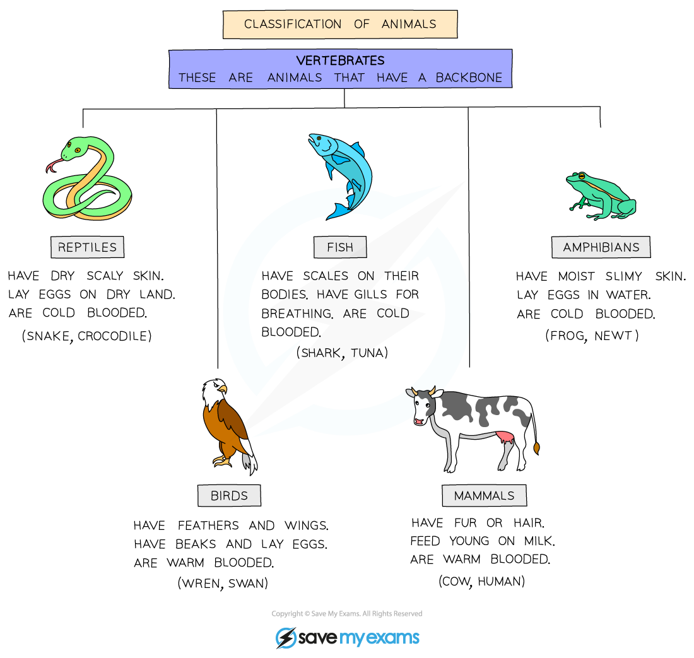
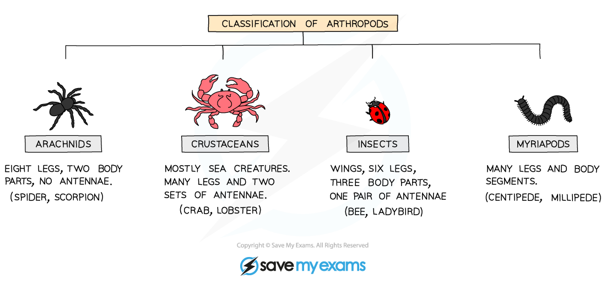

# Features of Organisms

## The five kingdoms

> **Spec point** — `spcpt_wKSFC4tWhhyGG3nR` · State the main features used to place animals and plants into the appropriate kingdoms

## Kingdoms: animals & plants

- All living organisms share characteristics. Organisms can be grouped together based on common features they share
- All living organisms can be grouped into one of five kingdoms
- Animals and plants are both kingdoms within this grouping system
- **Main features of all animals:**

  - they are multicellular
  - their cells contain a nucleus but no cell walls or chloroplasts
  - they feed on organic substances made by other living things

*A typical animal cell*

- **Main features of all plants:**

  - they are multicellular
  - their cells contain a nucleus, chloroplasts and cellulose cell walls
  - they all feed by photosynthesis

*A typical plant cell*

## The animal kingdom

> **Spec point** — `spcpt_qmyGwyncmkdTykJv` · State the main features used to place organisms into groups within the animal kingdom, limited to:
(a) the main groups of vertebrates: mammals, birds, reptiles, amphibians, fish
(b) the main groups of arthropods: myriapods, insects, arachnids, crustaceans
Classify organisms using the features identified

## The animal kingdom

- Several main features are used to [place organisms into groups](https://www.savemyexams.com/igcse/biology/cie/23/revision-notes/1-characteristics-and-classification-of-living-organisms/1-1-characteristics-classification-and-features-of-organisms/1-1-2-concept-and-uses-of-classification-systems/?_ai=internal-linking) within the animal kingdom

### Vertebrates

- All vertebrates have a **backbone**

  - There are five classes of vertebrates

#### Vertebrate table

| Class | Main features | Examples |
|---|---|---|
| Mammals | - Fur/hair on skin - Have a placenta - Young feed on milk from mammary glands - External ears (pinna) visible - Endothermic | Horse, dog, squirrel, human |
| Birds | - Skin covered in feathers - Have 2 legs and 2 wings instead of forelimbs - Lay eggs with hard shells on land - Have a beak - Endothermic | Parrot, blue tit, eagle |
| Reptiles | - Dry, fixed scales on skin - Lay eggs with rubbery shells on land | Snake, turtle, iguana |
| Amphibians | - Smooth, moist skin - Adults usually live on land (and so have lungs) - Larvae live in water (and so have gills) - Lay eggs without shells in water | Frog, toad, newt |
| Fish | - Loose, wet scales on skin - Use gills to breathe - Lay eggs without shells in water | Flounder, grouper |

*Vertebrate classification*

### Invertebrates

- Invertebrates do not possess a backbone
- One of the morphological characteristics used to classify invertebrates is **whether they have legs or not**
- All invertebrates with **jointed legs** are part of the **arthropod** phylum
- All arthropods share the following visible features:

  - They have an exoskeleton
  - They have a segmented body
  - They have jointed legs

- They are classified further into the following groups:

#### Arthropod groups table

| Class | Main features | Examples |
|---|---|---|
| Myriapods | - Body consists of many segments - Each segment contains at least one pair of jointed legs - One pair of antennae | Centipede |
| Insects | - Three-part body: head, thorax and abdomen - Adults have six jointed legs - Two pairs of wings (one or both pairs may be vestigial, meaning non-functional and undeveloped) - One pair of antennae | Butterfly |
| Arachnids | - Two-part body: cephalothorax and abdomen - Four pairs of jointed legs - No antennae | Spider |
| Crustaceans | - More than four pairs of jointed legs - Chalky exoskeleton formed from calcium - Use gills to breathe - Two pairs of antennae | Crab |

*Arthropod classification*

> **Exam Hint**
> - Make sure that you are aware of the distinction between the** main features **of a group of organisms and the **defining features** of a group:
> - An exam question might ask you to state the *main* features of a group of organisms; these are given above, and some of these main features are **shared between the groups**
> 
>   - E.g. all of the vertebrates have a backbone, and all of the arthropods have segmented bodies
> - It is also possible that an exam question might ask you to give a *defining* visible feature of any one of these groups, i.e. a feature that **sets a group apart from the other groups**
> 
>   - E.g. mammals have fur while the other vertebrates do not, and crustaceans have two pairs of antennae while this is not the case for the other groups of arthropods
> - It is common for students to confuse arachnids with crustaceans, and to not be able to state a visible feature identifying an organism as an arthropod, any one of "exoskeleton, jointed legs or segmented body" would be an appropriate answer
