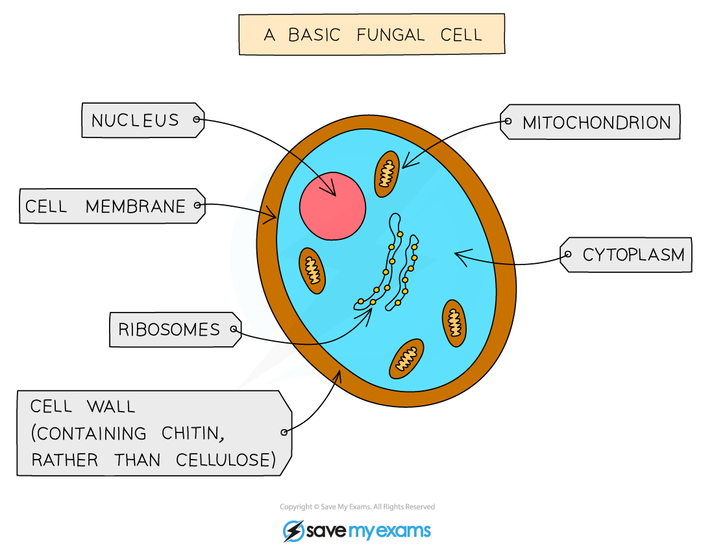
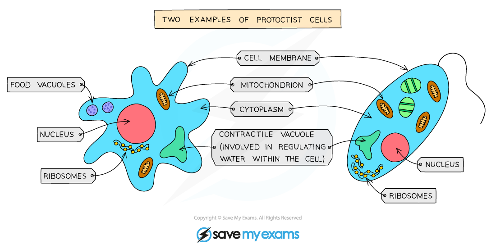
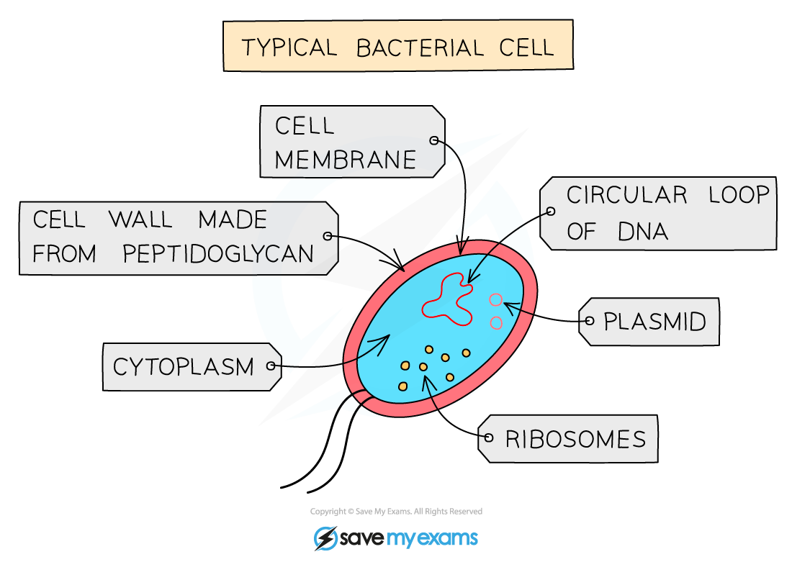
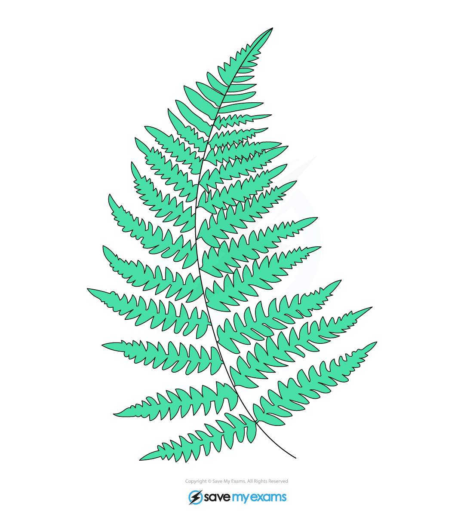
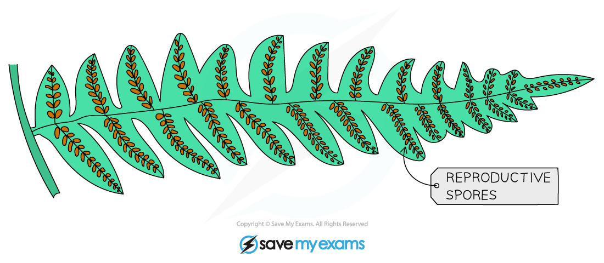
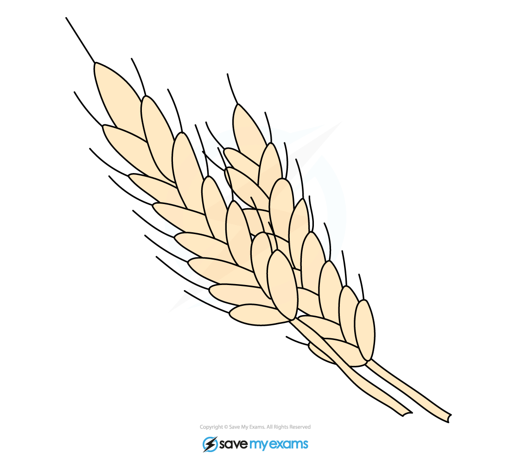
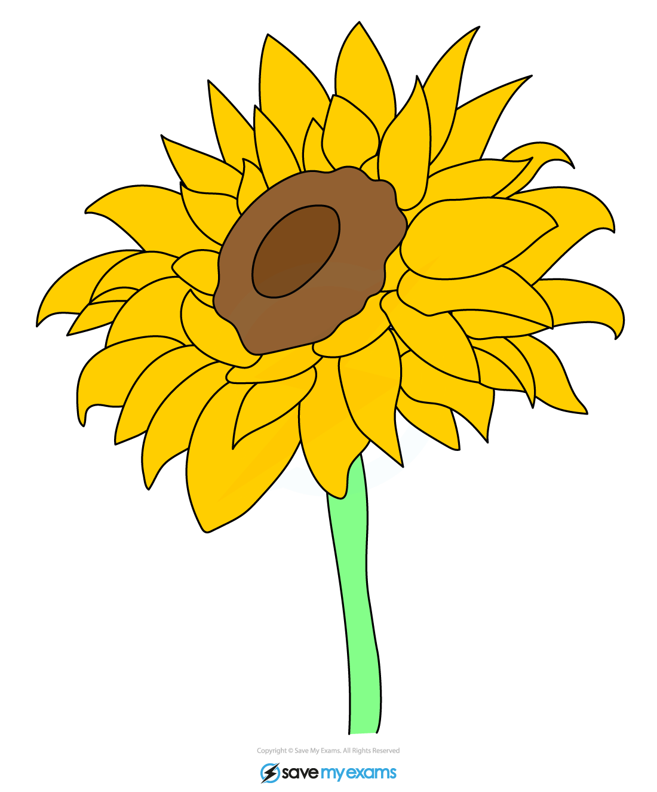
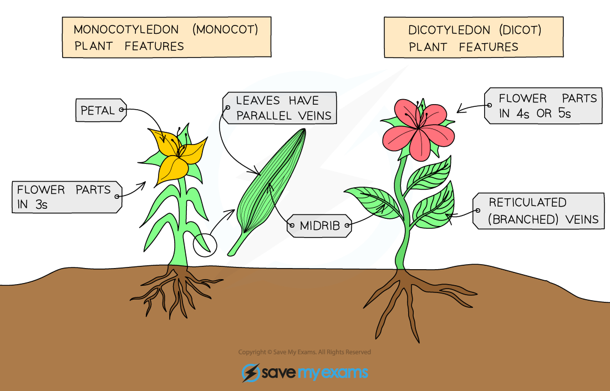

# Features of Organisms Continued

## The five kingdoms: Extended

> **Spec point** — `spcpt_STGvsdh7n4HZmjr5` · nan

## The five kingdoms: Extended

### Extended Tier Only

- The first division of living things in the classification system is to put them into one of** **[five kingdoms](https://www.savemyexams.com/igcse/biology/cie/23/revision-notes/1-characteristics-and-classification-of-living-organisms/1-1-characteristics-classification-and-features-of-organisms/1-1-4-features-of-organisms/?_ai=internal-linking)
- They are:

  - Animals
  - Plants
  - Fungi
  - Protoctists
  - Prokaryotes
- The main features of animals and plants have already been covered on the [previous revision note](https://www.savemyexams.com/igcse/biology/cie/23/revision-notes/1-characteristics-and-classification-of-living-organisms/1-1-characteristics-classification-and-features-of-organisms/1-1-4-features-of-organisms/) page
- **Main features of all fungi (e.g. moulds, mushrooms, yeast)**

  - Usually **multicellular**
  - Cells have **nuclei** and **cell walls** not made from cellulose
  - Do not photosynthesise but **feed by saprophytic** (on dead or decaying material) **or parasitic** (on live material) **nutrition**

*A typical fungal cell*

- **Main features of all Protoctists (e.g. Amoeba, Paramecium, Plasmodium)**

  - **Most are unicellular,** but some are multicellular
  - All have a **nucleus**, some may have cell walls and chloroplasts
  - Meaning **some protoctists photosynthesise** and **some feed on organic substances** made by other living things

*Two examples of protoctist cells*

> **Exam Hint**
> Protoctist is the kingdom that students are least likely to recall the features of, or identify from an image or description of, in an exam.
> 
> The key features are:
> 
> - Cells **always have a nucleus**
> - Organisms are **usually unicellular**, although some are multicellular
> 
>   - This is key difference, as other organisms formed from cells with a nucleus are often multicellular
> - **They have varied nutrition**: Some obtain nutrition like plants (by photosynthesising), while others act like fungi or animals (by consuming organic matter)

- **Main features of all Prokaryotes (e.g. bacteria, cyanobacteria)**

  - Often **unicellular**
  - Cells have **cell walls** (not made of cellulose) and **cytoplasm** but **no nucleus or mitochondria**

*A typical bacterial cell*

## The plant kingdom: Extended

> **Spec point** — `spcpt_vf7FFgyGzrr7nsJ5` · nan

## The plant kingdom: Extended

### Extended Tier Only

- At least some parts of any plant are green, caused by the presence of the pigment **chlorophyll** which absorbs energy from sunlight for the process of **photosynthesis**
- The plant kingdom includes organisms such as **ferns and flowering plants**

#### Ferns

- Have leaves called **fronds**
- Do not produce flowers but instead **reproduce by spores** produced on the underside of fronds

*Ferns*

*Ferns reproduce by spores found on the underside of their fronds*

#### Flowering plants

- Reproduce sexually by means of **flowers and seeds**
- Seeds are produced inside the ovary found at the base of the flower
- Can be divided into two groups – **monocotyledons** and **dicotyledons**

*Wheat plants are monocotyledons*

*Sunflowers are dicotyledons*

#### How do you distinguish between monocotyledons and dicotyledons?

- **Flowers**

  - Flowers from** monocotyledons** contain petals in **multiples of three **while flowers from** **dicotyledons contain petals in **multiples of four or five**

- **Leaves**

  - Leaves from monocotyledons have **parallel leaf veins **while leaves from dicotyledons have **reticulated leaf veins**
  
    - Reticulated means the veins form a web-like network throughout the leaf
  - Leaves from monocotyledons are **narrow **and grass-like while leaves from dicotyledons tend to have **broader** leaves that come in a wide range of shapes

*Comparing monocots and dicots*

> **Exam Hint**
> Identification of monocotyledons and dicotyledons comes up fairly frequently in both the multiple choice paper and theory paper, and so it is worth learning the differences between their flowers and leaves outlined above.

## Viruses: Extended

> **Spec point** — `spcpt_CXZS5kt77mNnJ6pt` · nan

## Viruses: Extended

### Extended Tier Only

- Viruses are not part of any classification system as they are **not considered living organisms**

  - They **do not carry out the seven life processes** for themselves, instead they **take over a host cell’s metabolic pathways** in order to make multiple copies of themselves
- Virus structure is simply **genetic material** (either RNA or DNA) inside a **protein coat**

*Structure of a typical virus*
