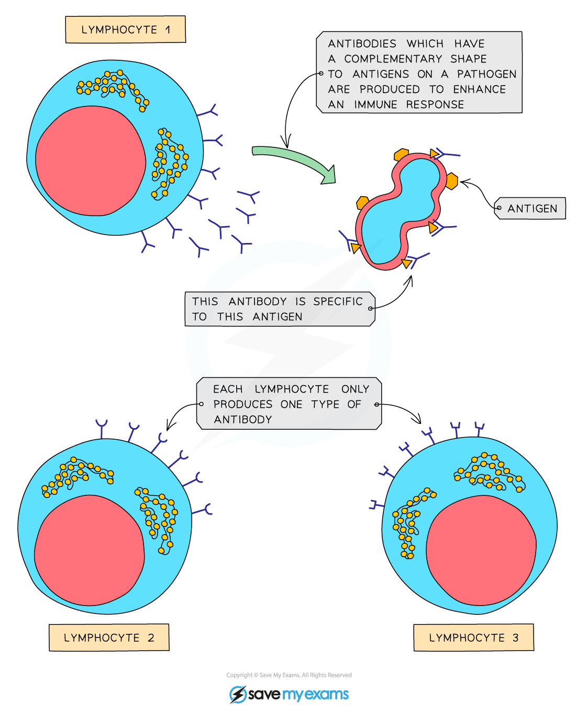
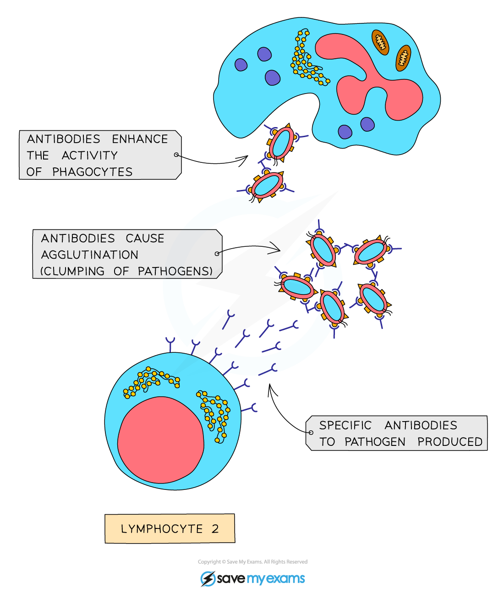

# Antigens & Antibodies

## Antigens & antibodies: Extended

> **Spec point** — `spcpt_wghhwgq24rdNvdSC` · State that each pathogen has its own antigens, which have specific shapes
Describe antibodies as proteins that bind to antigens leading to direct destruction of pathogens or marking of pathogens for destruction by phagocytes
State that specific antibodies have complementary shapes which fit specific antigens

## Antigens & antibodies: Extended

### Extended Tier Only

- All cells have molecules, such as proteins, projecting from their cell membranes
- These are known as **antigens**
- Different individuals have **different antigens** on their cell surface membranes
- Lymphocytes can recognise **foreign antigens**, e.g. the antigens of a pathogen inside the body
- In response to foreign antigens lymphocytes make **antibodies** which are **complementary** in shape to the antigens on the surface of the pathogenic cell

*Lymphocytes produce antibodies that are specific to a particular type of antigen*

### The role of antibodies

- Antibodies can **attach to antigens** and cause ***agglutination*** of pathogens

  - This means the pathogenic cells cannot move around very easily
- At the same time **chemicals** are released that signal the presence of pathogens to ***phagocytes***
- Phagocytes move towards the site of an infection where they **engulf and destroy** pathogens

  - Many pathogens can be engulfed together due to agglutination

*Agglutinated pathogens cannot move around so phagocytosis can occur more easily*

### Immunity

- The **initial response** of a lymphocyte encountering a pathogen for the first time can take **a few days**, during which time an individual may get sick
- After an initial encounter with a pathogen, lymphocytes can give rise to **memory cells** that retain the instructions for making specific antibodies
- This means that in the case of reinfection by the same type of pathogen, **antibodies can be made very quickly **and in **greater quantities**; the pathogens are destroyed before they multiply and cause illness

  - This is how people become **immune** to certain diseases after only having them once
- Note that this does not work with all disease-causing microorganisms as some of them **mutate** quickly and change the antigens on their cell surface

  - Therefore, if they invade the body for a second time the memory cells made in the first infection will not produce antibodies that match the new antigens

> **Exam Hint**
> Make sure you know the difference between antigen, antibody and antitoxin:
> 
> - An **antigen** is a molecule found on the surface of a cell
> - An **antibody** is a protein made by lymphocytes that is complementary to an antigen and, when attached, clumps them together and signals the cells they are on for destruction
> - An **antitoxin** is a protein that neutralises the toxins produced by bacteria
