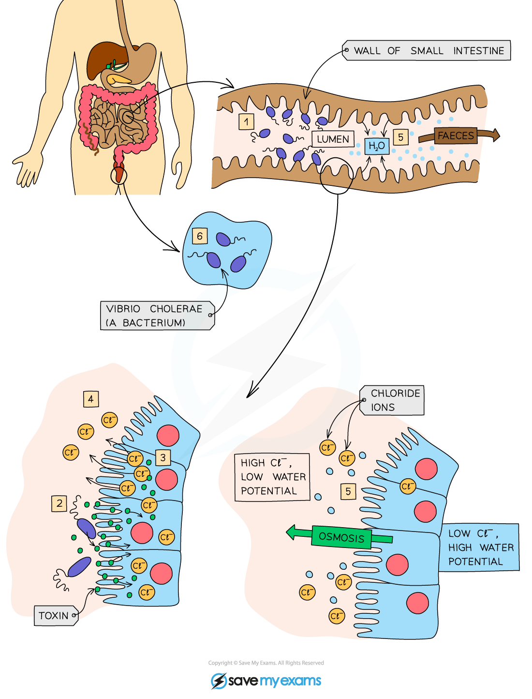

# Cholera

## Cholera

> **Spec point** — `spcpt_3sjKm9qZRcz2H9bD` · Describe cholera as a disease caused by a bacterium which is transmitted in contaminated water
Explain that the cholera bacterium produces a toxin that causes secretion of chloride ions into the small intestine, causing osmotic movement of water into the gut, causing diarrhoea, dehydration and loss of ions from the blood

## Cholera

### Cholera causes diarrhoea

- Diarrhoea is the **loss of watery faeces from the anus**
- If it is severe and continues for a long time, it **can lead to death**
- Severe diarrhoea can cause the **loss of significant amounts of water and ions** from the body, causing the tissues and organs to stop working properly
- It can be effectively treated by **oral rehydration therapy**
- This is a **drink with a small amount of salt and sugar** dissolved in it
- There are many causes of diarrhoea, one of which is infection with **Vibrio cholerae bacteria**, which causes the disease **cholera**

### How does Vibrio cholerae cause diarrhoea?

*How cholera leads to diarrhoea*

- Ingested via **infected water or food**, if it enters the small intestine it can cause illness in the following way:

1. Bacteria attach to the wall of the **small intestine**
2. They produce a **toxin**
3. The toxin stimulates the cells lining the intestine to **release chloride ions** from inside the cells into the lumen of the intestine
4. The chloride ions accumulate in the lumen of the small intestine and **lower the water potential** there
5. Once the water potential is lower than that of the cells lining the intestine, **water starts to move out of the cells** into the intestine (by [osmosis](https://www.savemyexams.com/igcse/biology/cie/23/revision-notes/3-movement-into-and-out-of-cells/3-1-diffusion-osmosis-and-active-transport/3-1-6-osmosis-in-animals-and-plants/?_ai=internal-linking))
6. Large quantities of water are lost from the body in **watery faeces**
7. The blood contains **too little chloride ions and water**
