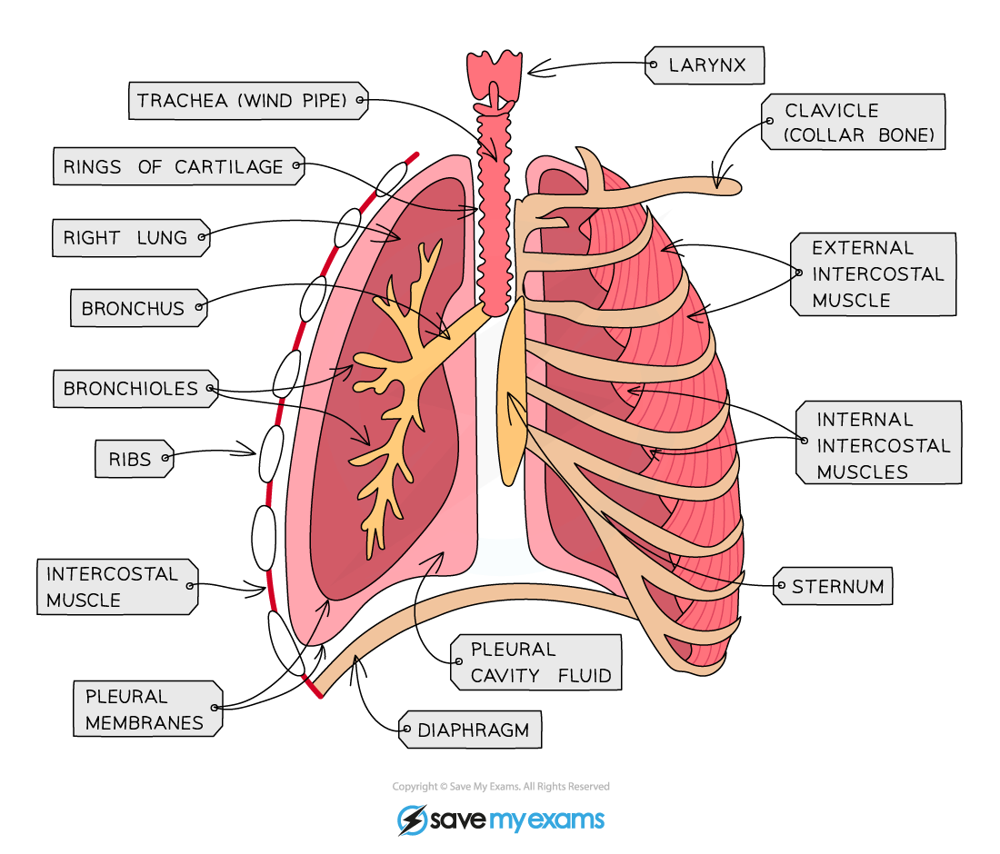

# Identifying Intercostal Muscles

## Identifying intercostal muscles: Extended

> **Spec point** — `spcpt_k2yw8NJH89Zv58jh` · Identify in diagrams and images the internal and external intercostal muscles

## Identifying intercostal muscles: Extended

### Extended Tier Only

- Muscles are only able to pull on bones, not push on them
- This means that there must be two sets of intercostal muscles; one to pull the rib cage up and another set to pull it down
- One set of intercostal muscles is found on the outside of the ribcage (the **external** intercostal muscles)
- The other set is found on the inside of the ribcage (the **internal** intercostal muscles)

*There are two sets of intercostal muscles: the external, on the outside of the ribcage, and the internal, on the inside of the ribcage*
