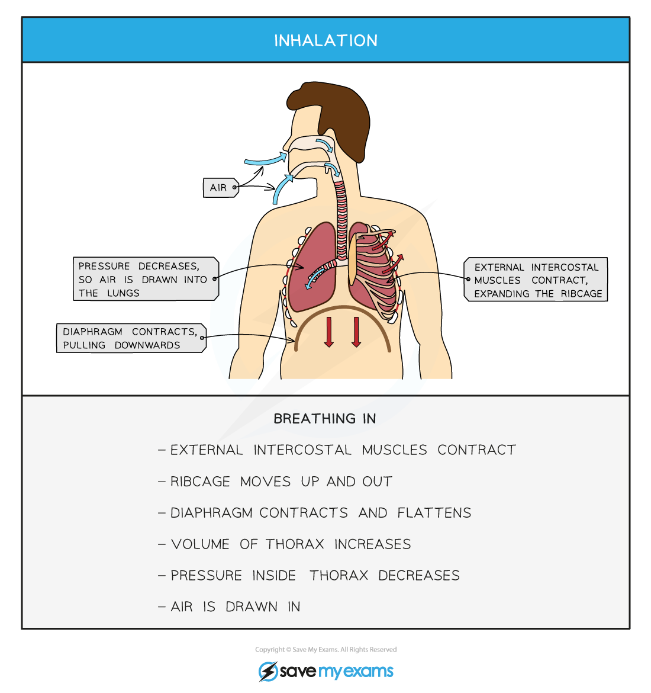
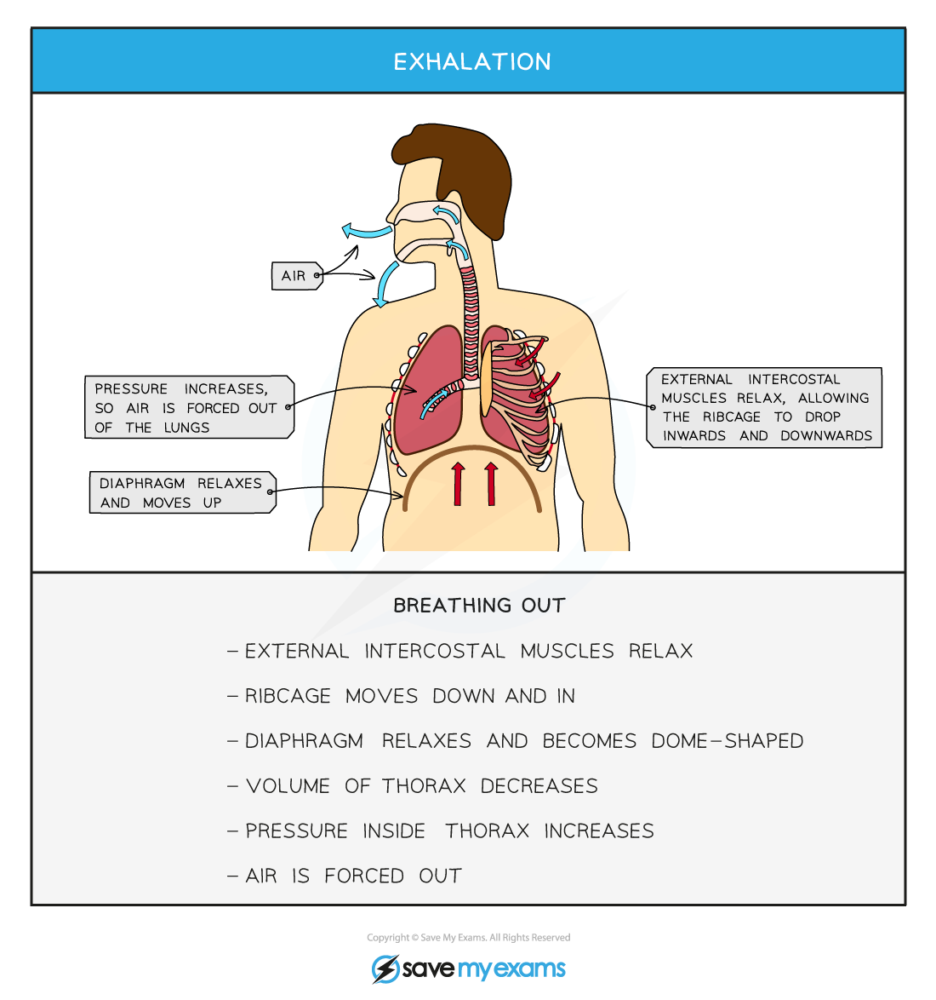

# Volume & Pressure Changes in the Lungs

## Volume & pressure changes in the lungs: Extended

> **Spec point** — `spcpt_cM3kkjkxKbj5fDFS` · Explain the role of the ribs, the internal and external intercostal muscles and the diaphragm in producing volume and pressure changes in the thorax leading to the ventilation of the lungs

## Volume & pressure changes in the lungs: Extended

### Extended Tier Only

- The **diaphragm** is a thin sheet of muscle that separates the chest cavity from the abdomen; it is ultimately responsible for **controlling ventilation** in the lungs

  - When the diaphragm **contracts** it flattens and this **increases the volume** of the chest cavity (thorax), which consequently leads to a **decrease in air pressure** inside the lungs relative to outside the body, **drawing air in**
  - When the diaphragm **relaxes** it moves upwards back into its domed shape and this **decreases the volume** of the chest cavity (thorax), which consequently leads to an **increase in air pressure** inside the lungs relative to outside the body, **forcing air out**
- The external and internal intercostal muscles work as **antagonistic** pairs (meaning they work in different directions to each other)
- During **inhalation** the **external set of intercostal muscles contract** to pull the ribs **up and out**

  - **This also increases the volume of the chest cavity (thorax), decreasing air pressure, drawing air in**
- During **exhalation,** the external **set of intercostal muscles relax** so the ribs **drop down and in**

  - **This decreases the volume of the chest cavity (thorax) increasing air pressure, forcing air out**
- When the rate of gas exchange needs to increase (for example during [strenuous activity](https://www.savemyexams.com/igcse/biology/cie/23/revision-notes/11-gas-exchange-in-humans/11-1-gas-exchange-in-humans/11-1-10-explaining-the-link-between-physical-activity-and-breathing/?_ai=internal-linking)) the internal intercostal muscles will also work to **pull the ribs down and in** to decrease the volume of the thorax more, forcing air out more forcefully and quickly – this is called **forced exhalation**

  - There is actually a greater need to rid the body of increased levels of carbon dioxide produced during strenuous activity!
- This allows a **greater volume of gases to be exchanged**

*Events that occur during inhalation*

*Events that occur during exhalation*

> **Exam Hint**
> You may see the terms **inhalation OR inspiration** (breathing in), and **exhalation OR expiration** (breathing out). Both sets of terms mean exactly the same thing, so don’t let them confuse you!
> 
> This sequence of events is a common exam question and you should be able to **explain in detail** what is happening to the external and internal intercostal muscles, the rib cage, the diaphragm, the volume and the pressure-volume of the lungs when breathing in and out.Remember, if you learn one, the other is almost exactly the opposite.
