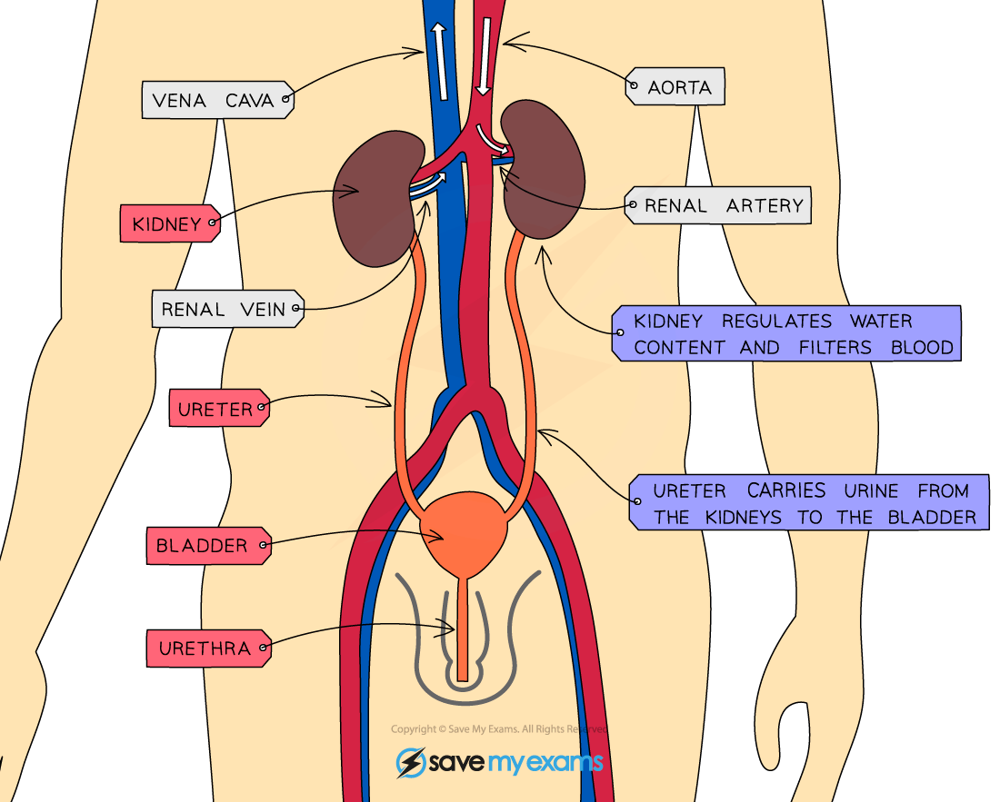

# Excretion in Humans

## Excretion of carbon dioxide & urea

> **Spec point** — `spcpt_fWPxqvsPVsN4fVhm` · State that carbon dioxide is excreted through the lungs
State that the kidneys excrete urea and excess water and ions
Identify in diagrams and images the kidneys,ureters, bladder and urethra

## Excretion of carbon dioxide & urea

### What is the excretory system?

- The human excretory system is a group of organs which are specialised for the removal of certain excretory products
- Two important organs in the human excretory system are the **lungs and kidneys**

| **Organ** | **Mainly excretes** | **Explanation** |
|---|---|---|
| Lungs | Carbon dioxide | The lungs excrete carbon dioxide (the waste product of aerobic respiration) during exhalation |
| Kidneys | Excess water, salts and urea | The kidneys excrete excess water, salts and urea (produced in the liver from excess amino acids) through the formation of urine |

### What is excretion?

- Excretion is the **removal of the waste substances of metabolic reactions (the chemical reactions that take place inside cells), toxic materials and substances in excess of requirements**
- **Carbon dioxide** must be excreted as it dissolves in water easily to form an acidic solution, **lowering the pH of cells**

  - This can **reduce the activity of enzymes** in the body which are essential for controlling the rate of metabolic reactions
  - For this reason, too much carbon dioxide in the body is **toxic**
- **Urea** is also toxic to the body in higher concentrations and so must be excreted

*The excretory system in humans*

#### The main components of the excretory system

| **Structure** | **Role** |
|---|---|
| Kidney | Two bean-shaped organs that filter the blood |
| Ureter | Tube connecting the kidney to the bladder |
| Bladder | Organ that stores urine (excess water, salts and urea) as it is produced by the kidney |
| Urethra | Tube that connects the bladder to the exterior; where urine is released |

> **Exam Hint**
> Note the difference between the ‘**ureter**’ and the ‘**urethra**’. These two names are commonly confused so take care to learn them and know which tube is which – they are **not** interchangeable!
