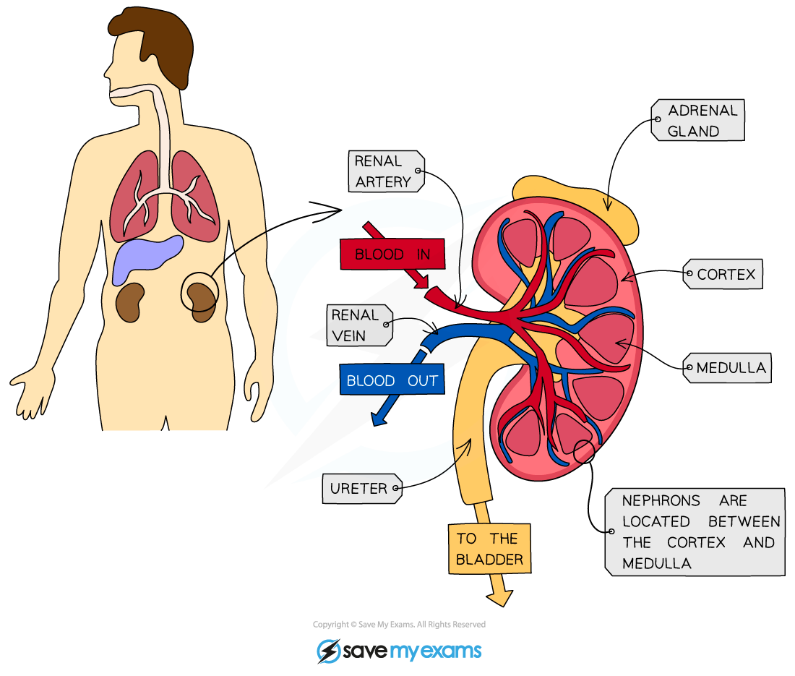
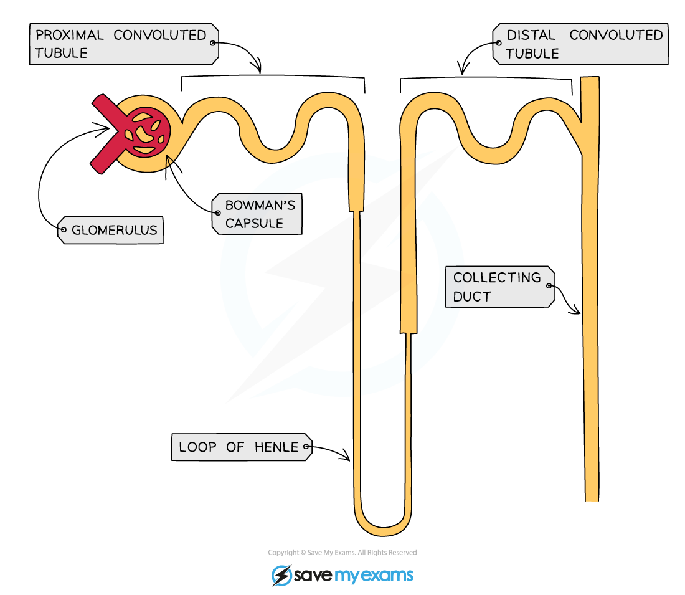
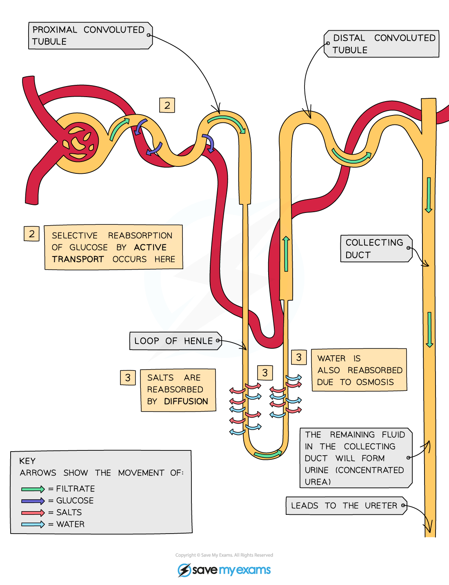

# The Kidney

## The kidney & the nephron: Extended

> **Spec point** — `spcpt_JqmQpW62m2VKsHDG` · Identify in diagrams and images the structure of the kidney, limited to the cortex and medulla
Outline the structure and function of a nephron and its associated blood vessels, limited to:
(a) the role of the glomerulus in the filtrate from the blood of water, glucose, urea and ions
(b) the role of the nephron in the reabsorption of all of the glucose, some of the ions and most of the water back into the blood (c) the formation of urine containing urea, excess water and excess ions (details of these processes are not required)

## The kidney & the nephron: Extended

- The kidneys are located in the back of the abdomen and have two important functions in the body:

  - they **regulate the water content of the blood** (vital for maintaining blood pressure)
  - they **excrete the toxic waste products of metabolism** (such as urea) and substances in excess of requirements (such as salts)

*The structure of a human kidney*

### The nephron

- Each kidney contains around a million tiny structures called **nephrons**, also known as **kidney tubules** or **renal tubules**
- The nephrons start in the **cortex** of the kidney, loop down into the **medulla** and back up to the cortex
- The contents of the nephrons drain into the innermost part of the kidney and the **urine collects** there before it flows into the **ureter** to be carried to the **bladder** for storage

*Structure of a nephron*

### Ultrafiltration

- Arterioles branch off the **renal artery** and lead to each nephron, where they form a knot of capillaries (the **glomerulus**) sitting inside the cup-shaped **Bowman’s capsule**
- The capillaries get **narrower** as they get further into the glomerulus which **increases the pressure** on the blood moving through them (which is already at high pressure because it is coming directly from the renal artery which is connected to the **aorta**)
- This eventually causes the smaller molecules being carried in the blood to be **forced out of the capillaries and into the Bowman’s capsule**, where they form what is known as the filtrate
- This process is known as **ultrafiltration**
- The substances forced out of the capillaries are: **glucose, water, urea, salts**
- Some of these are useful and will be **reabsorbed back into the blood** further down the nephron

*Diagram showing the process of ultrafiltration*

### Reabsorption of glucose

- After the glomerular filtrate enters the Bowman’s Capsule, glucose is the first substance to be reabsorbed at the proximal (first) convoluted tubule
- This takes place by **active transport**
- The nephron is adapted for this by having **many mitochondria** to provide energy for the active transport of glucose molecules
- Reabsorption of glucose **cannot take place anywhere else in the nephron** as the gates that facilitate the active transport of glucose are only found in the proximal convoluted tubule
- In a person with a normal blood glucose level, there are enough gates present to remove all of the glucose from the filtrate back into the blood
- People with **diabetes** cannot control their blood glucose levels and they are often very high, meaning that not all of the glucose filtered out can be reabsorbed into the blood in the proximal convoluted tubule
- As there is nowhere else for the glucose to be reabsorbed, it continues in the filtrate and **ends up in the urine**
- This is why one of the first tests a doctor may do to check if someone is diabetic is to test their urine for the presence of glucose

*Diagram showing the reabsorption of glucose*

### Reabsorption of water & salts

- As the filtrate drips through the **Loop of Henle** necessary salts are reabsorbed back into the blood by **diffusion** and **active transport**
- As salts are reabsorbed back into the blood, [water follows by osmosis](https://www.savemyexams.com/igcse/biology/cie/23/revision-notes/3-movement-into-and-out-of-cells/3-1-diffusion-osmosis-and-active-transport/3-1-6-osmosis-in-animals-and-plants/?_ai=internal-linking)
- Water is also reabsorbed from the collecting duct in different amounts depending on how much water the body needs at that time
