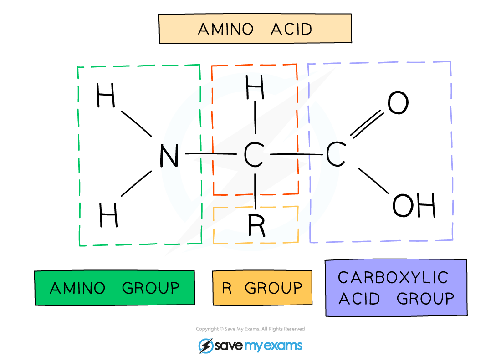

# The Role of the Liver in Excretion

## Excretion by deamination of amino acids: Extended

> **Spec point** — `spcpt_MVhb48qtMPCx8y37` · Describe the role of the liver in the assimilation of amino acids by converting them to proteins
State that urea is formed in the liver from excess amino acids
Describe deamination as the removal of the nitrogen-containing part of amino acids to form urea
Explain the importance of excretion, limited to toxicity of urea

## Excretion by deamination of amino acids: Extended

- Many digested food molecules absorbed into the blood in the small intestine are carried to the liver for **assimilation** (when food molecules are converted to other molecules that the body needs)
- These include amino acids, which are used to build proteins such as **fibrinogen**, a protein found in blood plasma that is important in blood clotting
- **Excess amino acids** in the blood that are not needed by the body **cannot be stored**, so they are broken down in a process called **deamination**

  - The amino group of all  amino acids - NH2 (which contains the nitrogen atoms) is removed, hence the term de-**amin(o)**-ation
- Enzymes in the liver split up the amino acid molecules:

  - the part of the molecule which contains **carbon** is turned into **glycogen** for storage
  - the **nitrogen-containing amino group** is **removed** and turned into **ammonia**, which is highly toxic, and so is immediately converted into **urea**, which is less toxic
- The urea dissolves in the blood and is taken to the **kidney** to be excreted
- A small amount of urea is also excreted in **sweat**

*Amino acid groups*

- The toxic consequences of high urea levels, if it is not excreted effectively, are very serious:

  - cell death
  - reduced response to insulin, potentially leading to diabetes
  - deposits inside blood vessels

> **Exam Hint**
> Take care that you understand the difference between **excretion** and **egestion**:
> 
> - excretion is the **removal from the body of waste products** of metabolic reactions, toxic substances and substances in excess of requirements.
> - egestion is the **expulsion of undigested food waste** from the anus.
