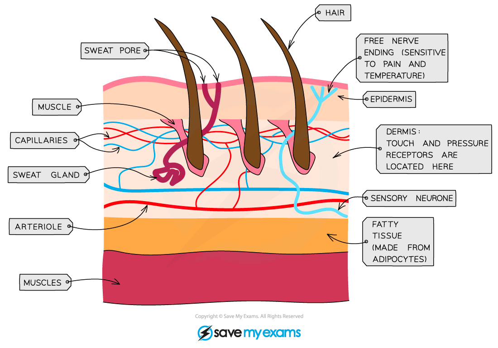
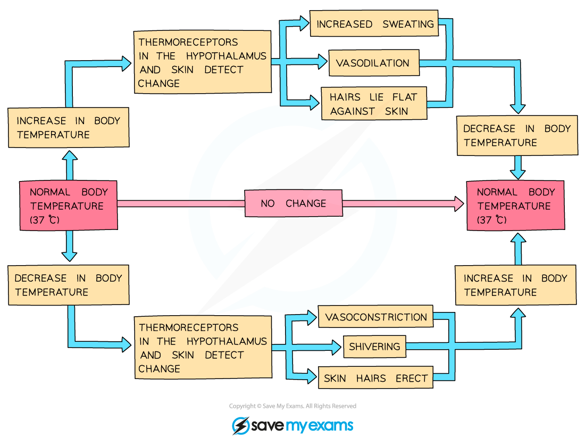
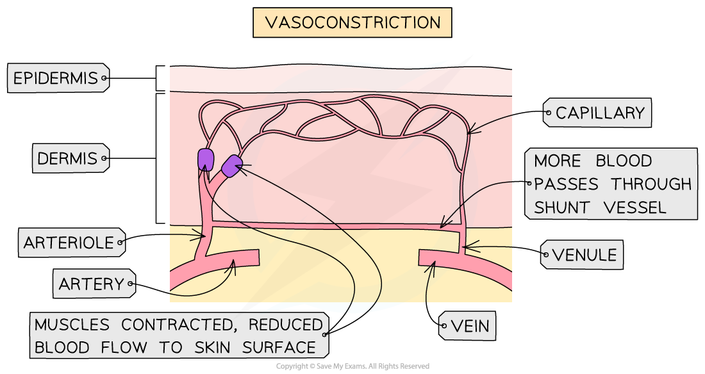
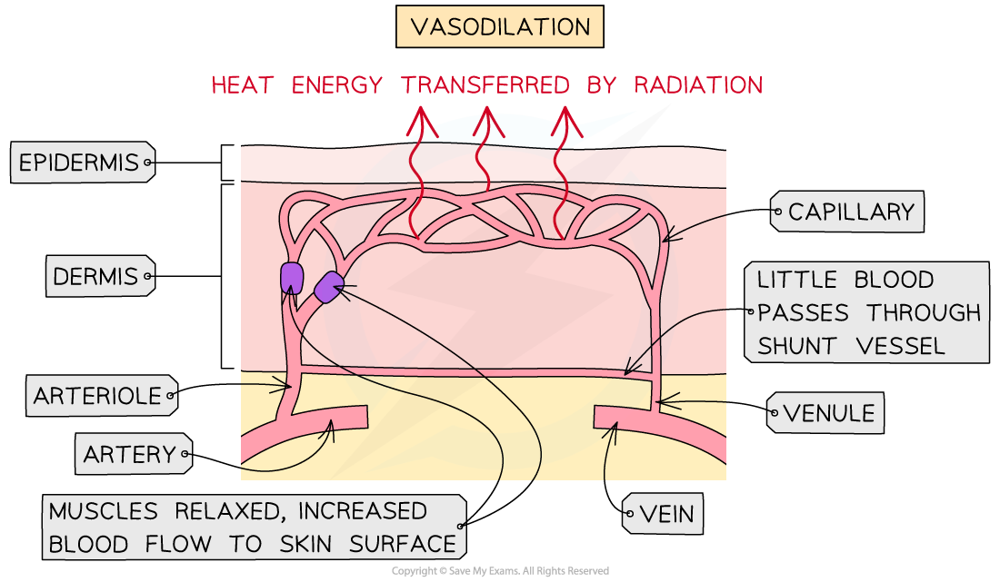

# Homeostasis: Temperature Control

## The skin & homeostasis: Extended

> **Spec point** — `spcpt_GWW9kxYWV9r8WtXr` · Identify in diagrams and images of the skin: hairs, hair erector muscles, sweat glands, receptors, sensory neurones, blood vessels and fatty tissue
Describe the maintenance of a constant internal body temperature in mammals in terms of:insulation, sweating, shivering and the role of the brain

## The skin & homeostasis: extended

- Control of body temperature is a **homeostatic** mechanism

  - Homeostasis is **the maintenance of a constant internal environment**
  - This means that **internal conditions within the body** (such as temperature, blood pressure, water concentration and glucose concentration) need to be **kept within set limits** in order to ensure that reactions in body cells can function
- The human body maintains the temperature at which enzymes work best: around **37 ℃**
- If body temperature increases too far above this, **enzymes will denature** and become less effective at catalysing reactions

### The skin and temperature regulation

- The **skin** plays an important role in the control of body temperature
- Structures in the skin that are involved with temperature regulation include:

  - sweat glands
  - temperature receptors
  - capillaries
  - hairs
  - hair erector muscles
  - insulating fatty tissue

*The skin plays an important role in the control of body temperature*

- When skin temperature changes, **temperature receptors** in the skin send nerve impulses to the brain via **sensory neurones**
- The brain responds to this information by sending nerve impulses to **effectors** in the skin that act to maintain normal body temperature
- The responses to an increase in body temperature are:

  - **sweat glands** produce sweat which cools the skin by evaporation
  - blood vessels that supply the skin capillaries **dilate**
  - hairs on the skin surface **lie flat**
- The responses to a decrease in body temperature are:

  - sweat gland stop producing sweat
  - blood vessels that supply the skin capillaries **constrict**
  - hairs on the skin stand up to **trap an insulating layer of air**
  - **shivering** generates heat in the muscles

*Regulating body temperature*

#### Table comparing responses when body temperature is too high or low

| When the body detects an increase in body temperature | When the body detects a decrease in body temperature |
|---|---|
| **Sweat is secreted** by sweat glands. This cools skin by **evaporation**. Heat energy from the body is lost as liquid water in sweat becomes water vapour (a state change). | Skeletal muscles contract rapidly (the body **shivers**). These involuntary muscle contractions require **energy from respiration**, and some of this is **released as heat**. |
| Hairs **lie flat** against the skin, allowing air to freely circulate. This increases heat transfer to the environment by **radiation**. | Erect hairs **trap a layer of air** around the skin, which acts as an **insulator**, preventing heat loss by radiation. |

## Vasoconstriction & vasodilation: Extended

> **Spec point** — `spcpt_cTDZRwWDrjBT3H3S` · Describe the maintenance of a constant internal body temperature in mammals in terms of vasodilation and vasoconstriction of arterioles supplying skin surface capillaries

## Vasoconstriction & vasodilation: Extended

- The blood vessels in and below the skin aid temperature regulation by vasoconstriction and vasodilation

### Vasoconstriction

- When the body detects a **decrease in body temperature**, the blood vessels that supply capillaries in the skin constrict, or get narrower; this is known as **vasoconstriction**
- Vasoconstriction reduces blood flow to the skin, and so **reduces the heat lost from blood by radiation** at the skin surface

*Vasoconstriction reduces blood flow to the skin, and so reduces the heat lost from blood by radiation*

### Vasodilation

- When the body detects an **increase in body temperature**, the blood vessels that supply capillaries in the skin dilate, or get wider; this is known as **vasodilation**
- Vasodilation increases blood flow to the skin surface, and so** increases heat lost at the skin by radiation**

*Vasodilation increases blood flow to the skin surface, and so increases heat lost at the skin by radiation*
