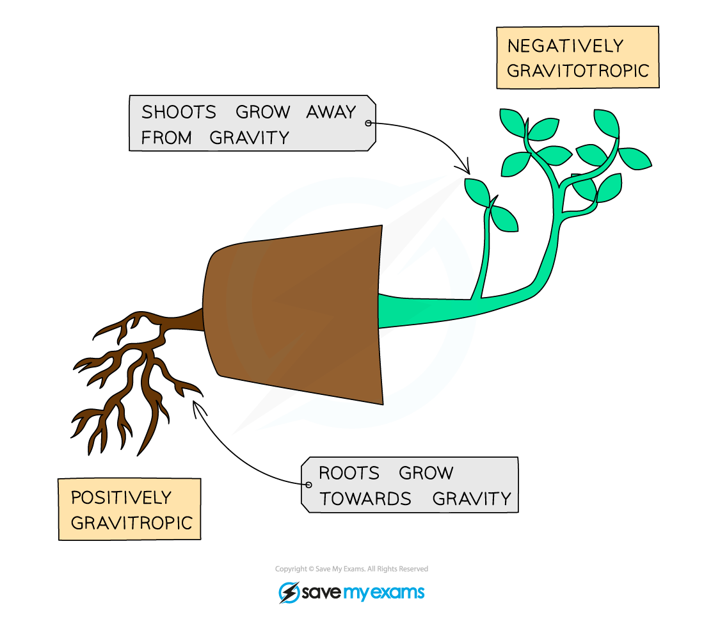
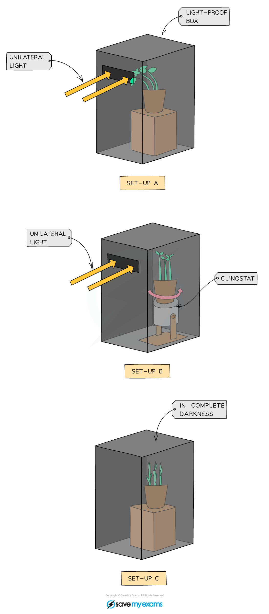
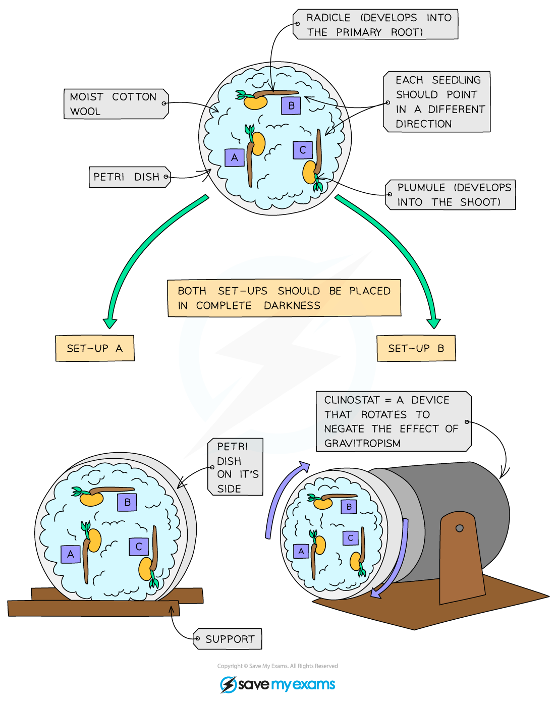
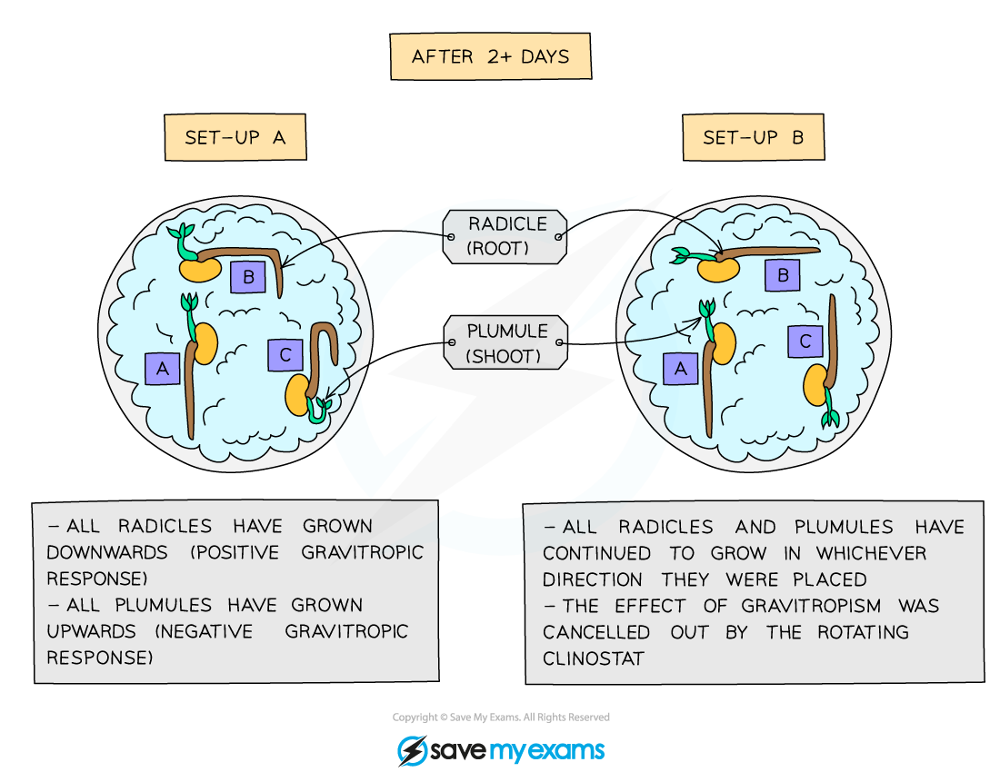
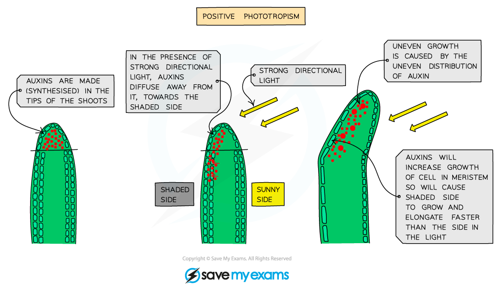
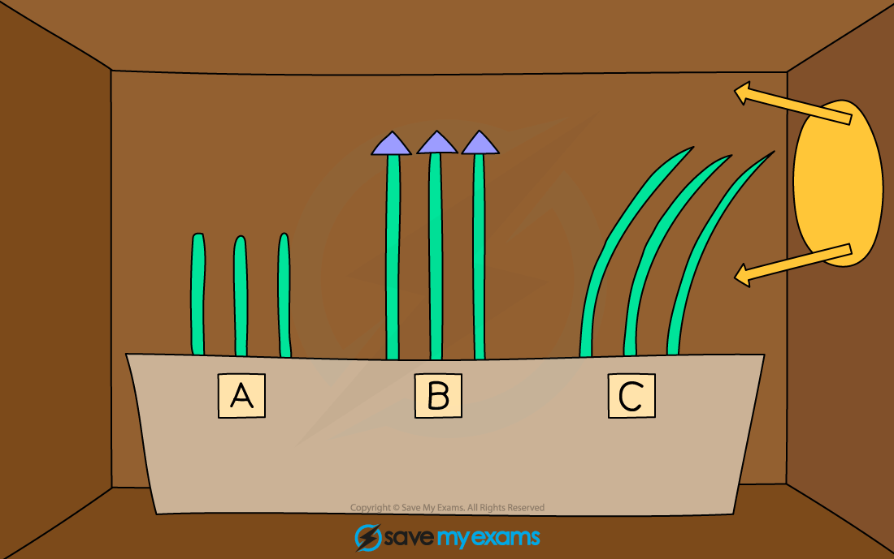

# Tropisms

## Gravitropism & phototropism

> **Spec point** — `spcpt_GrJZQ6tGDVSC29wc` · Describe gravitropism as a response in which parts of a plant grow towards or away from gravity
Describe phototropism as a response in which parts of a plant grow towards or away from the direction of the light source

## Gravitropism & phototropism

- Plants can respond to changes in environment (stimuli) for survival, e.g. **light, water, gravity**
- Their responses are usually **much slower** than animals
- They grow either **towards a stimulus** (known as a positive response) or **away from a stimulus** (known as a negative response)
- The responses are known as **tropisms**

### Examples of types of tropisms table

| **Stimulus** | **Name of response ** | **Definition** | **Positive response** | **Negative response** |
|---|---|---|---|---|
| Gravity | Gravitropism | Growth towards or away from gravity | Growth towards gravity (e.g. roots) | Growth away from gravity (e.g. shoots) |
| Light | Phototropism | Growth towards or away from the direction of light | Growth towards light source (e.g. shoots) | Growth away from light source (e.g. roots) |

- It is very important to a plant that its roots and shoots grow in the right directions
- Shoots must grow **upwards**, away from gravity and towards light, so that leaves are able to absorb sunlight
- This means that shoots have a **positive phototropic response** and a **negative gravitropic response**
- Roots need to grow **downwards** into the soil, away from light and towards gravity, in order to anchor the plant and absorb water and minerals from the soil particles
- This means that roots have a **negative phototropic response** and a **positive gravitropic response**

*Placing a plant on its side shows the gravitropic responses (also known as geotropic responses)*

## Investigating tropisms

> **Spec point** — `spcpt_TKMXprKx346TSYWB` · Investigate and describe gravitropism and phototropism in shoots and roots

## Investigating tropisms

### Investigating phototropisms

- Three identical plants are set up as shown below (A, B and C)

*Investigating the phototropic response*

- The seedlings in A grow **towards** the light source
- In B the effect of the light only coming from one direction has been **cancelled out** by using a **clinostat**

  - A clinostat is a piece of apparatus that slowly rotates a plant
  - In this experiment, it ensures the shoots are evenly exposed to unilateral light
- This means all sides of the seedlings get an **equal amount of light** so they do not curve towards the light source but grow straight up
- In C the seedlings grow straight up **looking for light** and the plant becomes tall and slender with yellowing leaves due to the lack of light

### Investigating gravitropisms

*Investigating the gravitropic response (set-up)*

- Add some damp cotton wool to two petri dishes
- Place three bean seedlings in the cotton wool in each petri dish:

  - A - radicle facing **downwards**
  - B - horizontally
  - C - radicle (root grows from here) facing **upwards**
- Cover each dish with a lid
- Attach one petri dish to a support so that it’s on its side
- Attach the second petri dish to a clinostat (as shown in the diagrams above)
- Place both in a **light-proof box** (so that the seedlings are in complete darkness), leave for two days and then observe growth of the seedlings

*Investigating the gravitropic response (results)*

- In the first petri dish **all radicles (roots) have grown downwards** (positive gravitropic response) regardless of which way they were initially facing (horizontal, up or down) and **all plumules (shoots) have grown upwards** (negative gravitropic response)
- In the second petri dish, all radicles and all plumules have all grown **neither up nor down** but straight outwards **in whichever direction they were placed** as the **effect of gravity** has been **cancelled out by the revolving of the clinostat** - they have shown no gravitropic response at all
- The experiment needs to be done in a lightproof box in order to **cancel out the effect of light on the growth of the seedlings**

## Auxins: chemical control of tropisms: Extended

> **Spec point** — `spcpt_G79YhGn4DfxNGtGw` · Explain phototropism and gravitropism of a shootas examples of the chemical control of plant growth
Explain the role of auxin in controlling shoot growth, limited to:
(a) auxin is made in the shoot tip
(b) auxin diffuses through the plant from the shoot tip
(c) auxin is unequally distributed in response to light and gravity
(d) auxin stimulates cell elongation

## Auxins: chemical control of tropisms: Extended

- Plants respond to stimuli by producing a **growth hormone called auxin** which controls the direction of growth of roots or stems
- Therefore we say plants control their growth **chemically**
- Auxin is mostly made in the **tips** of the growing stems and roots and can diffuse to other parts of the stems or roots; spreading from a high concentration in the shoot tips down the shoot to an area of lower concentration
- Auxin stimulates the cells behind the tip **to elongate **(get larger); the more auxin there is, the faster they will elongate and grow

  - Only the region behind the tip of a shoot is able to contribute to growth by cell division and cell elongation
  - This part of a shoot is called the meristem

### How does phototropism occur in plants?

- If light shines all around the tip, auxin is distributed evenly throughout and the cells in the mer:istem grow at the same rate - this is what normally happens with plants growing outside
- When light shines on the shoot predominantly from one side though, the auxin produced in the tip **concentrates on the shaded side**, making the cells on that side **elongate** and grow faster than the cells on the sunny side
- This unequal growth on either side of the shoot **causes the shoot to bend** and grow in the direction of the light

*Positive phototropism in plant shoots*

- The role of auxin can be tested using seedlings placed in a box that has a slit on one side, only allowing light in from one direction:

*Investigating the phototropic response setup*

#### Investigating the phototropic response results table

|   | **Seedling A** | **Seedling B** | **Seedling C** |
|---|---|---|---|
| Treatment | The tips of the stems have been removed | No light reaches the tips | More light reaches one side of the tips |
| Effect on auxin concentration | No auxin is produced | Equal concentration of auxin on both sides of the tip | Greater concentration of auxin on the shaded side |
| Result | The stems do not grow longer | The stems grow evenly and longer on both sides | The cells on the darker side of the stems grow longer and faster than the cells in the light |
| Reason | This proves that auxin is made in the tip and is needed to stimulate cell elongation and therefore growth. Without the tip, and therefore without auxin, there is no further growth in the stem | This proves that it is the effect of light on auxin that causes phototropism. There is no uneven distribution of auxin throughout the shoot tip, so growth is even | This proves the shoots grow towards the light because there is an uneven distribution of auxin in the shoot tip, caused by the response of auxin to light |

### How does gravitropism occur in plants?

- Auxin plays a role in a plant's response to gravity, affecting plant **shoots** and **roots** in** different ways**
- The **growth of shoots away from gravity** is known as **negative gravitropism**

  - Gravity modifies the distribution of **auxin** so that it accumulates on the **lower side** of the shoot
  - As seen in the phototropic response,** auxin increases the rate of growth in shoots**, causing the shoot to grow **upwards**
- The **growth of roots towards gravity **is known as **positive gravitropism**

  - In roots, **higher concentrations** of auxin result in **a lower rate of cell elongation**
  - The auxin that accumulates at the** lower side** of the root **inhibits cell elongation**
  - As a result, the lower side grows at a** slower rate** than the upper side of the root
  - This causes the root to bend **downwards**

> **Exam Hint**
> You should be able to explain the results of an experiment like this into the effect of light on the growth of shoots.
> 
> Make sure you understand the importance of the key word "cell elongation". When the plant grows due to auxin it does so because the existing cells get larger, not because of cell division to create new cells. This is why it is important to be specific with your use of language in your answer.
