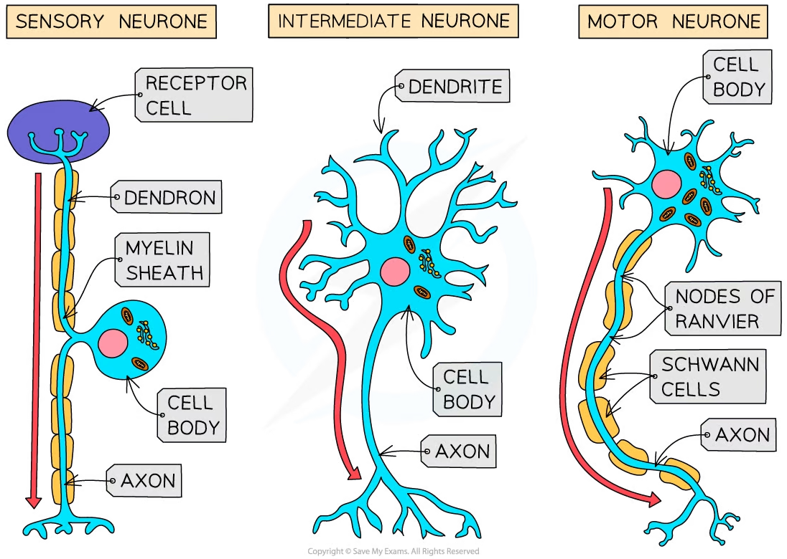

# Types of Neurones

## Neurone diagrams

> **Spec point** — `spcpt_RzgCZgpV8MQpJF82` · Identify in diagrams and images sensory, relay and motor neurones

## Neurone diagrams

- There are three main types of neurone: **sensory, relay and motor**:

  - **sensory** neurones carry impulses **from**[ sense organs to the CNS](https://www.savemyexams.com/igcse/biology/cie/23/revision-notes/14-coordination-and-response/14-1-coordination-response-and-homeostasis/14-1-5-sense-organs/?_ai=internal-linking) (brain or spinal cord)
  - **relay** neurones (also known as intermediate neurones) are found inside the CNS and **connect sensory and motor neurones**
  - **motor** neurones carry impulses **from the CNS to effectors** (muscles or glands)
- Neurones also contain extensions of the cytoplasm:

  - short, branched extensions called dendrites carry impulses towards the cell body
  - a longer extension called the axon carries impulses away from it

- The axon is insulated by a fatty sheath with small uninsulated sections along it (called nodes)

  - This means that the electrical impulse does not travel down the whole axon, but **jumps from one node to the next**

*The three types of neurone*

- Sensory neurones are **long** and have a **cell body branching off the middle of the axon**
- Relay neurones are **short** and have a **small cell body at one end** with many dendrites branching off it
- Motor neurones are **long** and have a **large cell body at one end with long dendrites branching off it**

> **Exam Hint**
> You need to be able to identify sensory, relay and motor neurones in diagrams and images, so familiarise yourself with the differences between the three neurones as shown above.
> 
> To distinguish between sensory and motor neurones in particular:
> 
> - <u>sensory</u> neurones connect a <u>sense</u> organ e.g. eye, nose, tastebuds to the CNS
> - m<u>otor</u> neurones result in a response, which is often movement; think of a moving <u>motor</u>bike
