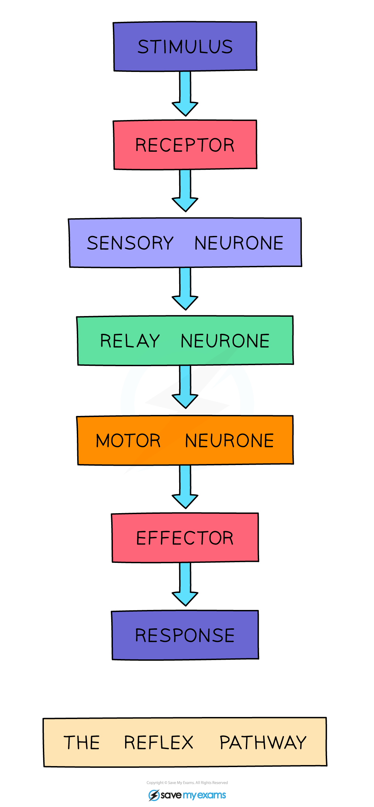

# The Reflex Arc

## The reflex arc

> **Spec point** — `spcpt_59Y5kYSTPSkmF4Zz` · Describe a simple reflex arc in terms of: receptor,sensory neurone, relay neurone, motor neuron and effector
Describe a reflex action as a means of automatically and rapidly integrating and coordinating stimuli with the responses of effectors (muscles and glands)
Describe a synapse as a junction between two neurons

## The reflex arc

### Voluntary responses

- A voluntary response is a response where a **conscious decision** is made to carry out a particular action
- Voluntary responses **start in the brain**

  - An example is reaching out to pick up a cup of coffee

### Reflex responses

- An **involuntary** (or **reflex**) response **does not involve the brain** as the coordinator of the reaction
- A person is not aware they have completed a reflex response until after the response has been carried it out
- Reflexes are **automatic and rapid responses** to a stimulus; such as touching something sharp or hot
- As it does not involve the brain, a reflex response is **quicker** than any other type of nervous response
- This helps to **minimise the damage to the body**

*A reflex arc*

- An example of a reflex arc is:

1. The pin (the stimulus) is detected by a pain/pressure/touch receptor in the skin.
2. The sensory neurone sends electrical impulses to the spinal cord (the coordinator).
3. The electrical impulse is passed on to a relay neurone in the spinal cord.
4. The relay neurone connects to a motor neurone, transmitting the impulse onward.
5. The motor neurone carries the impulse to a muscle in the leg (the effector).
6. The muscle contracts and pulls the foot up and away from the sharp object (the response).

*The reflex pathway*

### Synapses

- Where two neurones meet or join, they do so at a junction called a synapse
- Synapses are important because they allow the nervous system to function as a connected network of neurones
- Impulses can pass from one neurone to another across a synapse, allowing them to be directed along the appropriate route, e.g. to the correct part of the brain

> **Exam Hint**
> Reflex actions are:
> 
> 1. Automatic
> 2. Fast
> 3. Protective
> 
> A common exam question is to be asked to draw arrows on the neurones in the reflex arc diagram to show **the direction of movement of the impulse**. Make sure you read questions carefully – not all questions have a line underneath them to write an answer, so they can be easy to miss!
