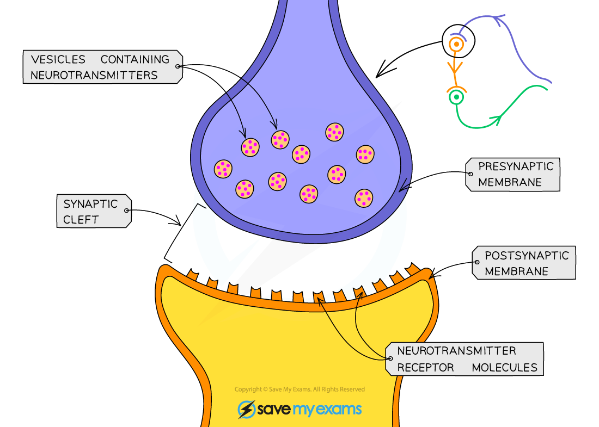
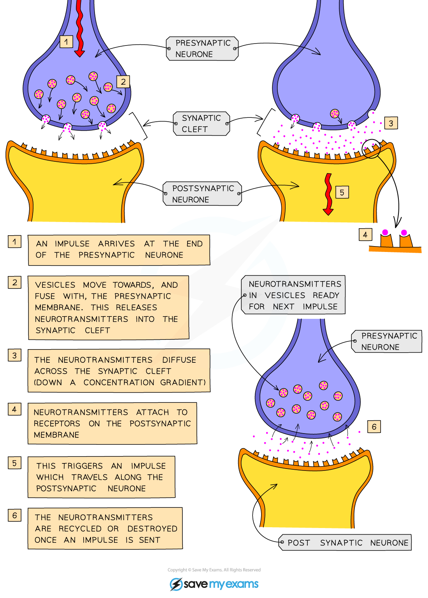

# The Synapse

## Structure of a synapse: Extended

> **Spec point** — `spcpt_Cj89Dy5MQRMXj4ZK` · Describe the structure of a synapse, including the presence of vesicles containing neurotransmitter molecules, the synaptic gap and receptor proteins

## Structure of a synapse: Extended

- The junction between two neurones is known as a **synapse**

*A synapse*

## Synapses & neurotransmitters: Extended

> **Spec point** — `spcpt_bHvKRstJxC3RYDBt` · Describe the events at a synapse as:
(a) an impulse stimulates the release of neurotransmitter molecules from vesicles into the synaptic gap
(b) the neurotransmitter molecules diffuse across the gap
(c) neurotransmitter molecules bind with receptor proteins on the next neurone
(d) an impulse is then stimulated in the next neurone
State that synapses ensure that impulses travel in one direction only

## Synapses & neurotransmitters: Extended

- Neurones are not directly connected to one another
- The junctions (gaps) in between them are called **synapses**
- Several events occur at a synapse to transmit an impulse from one neurone to the next:

  - an impulse arrives at the end of an axon
  - the impulse triggers the release of **neurotransmitters** from vesicles into the synaptic gap
  - the neurotransmitter molecules **diffuse** across the synaptic gap
  - the neurotransmitter molecules then **bind with receptor proteins** on the membrane of the next neurone
  - an impulse is then **stimulated** in the next neurone
- Synapses ensure that impulses **only travel in one direction**, avoiding confusion within the nervous system if impulses were travelling in both directions
- Since this is the point in the nervous system where messages are transmitted chemically rather than electrically, synapses are a common target for drugs affecting the nervous system; for example, this is how heroin works

*How an impulse is passed on at a synapse*

> **Exam Hint**
> For maximum marks you will need to be able to understand the structure and functioning of a synapse and **explain what happens at each step**.
