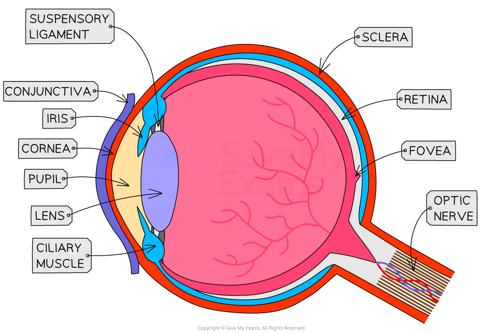
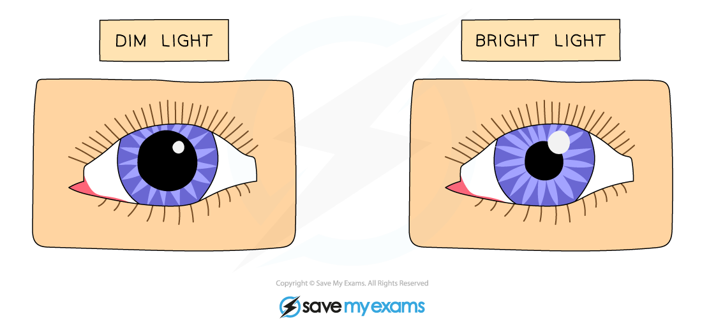
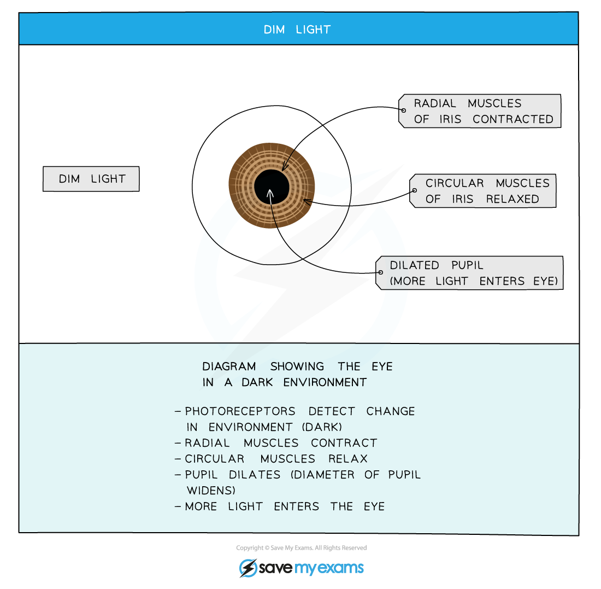
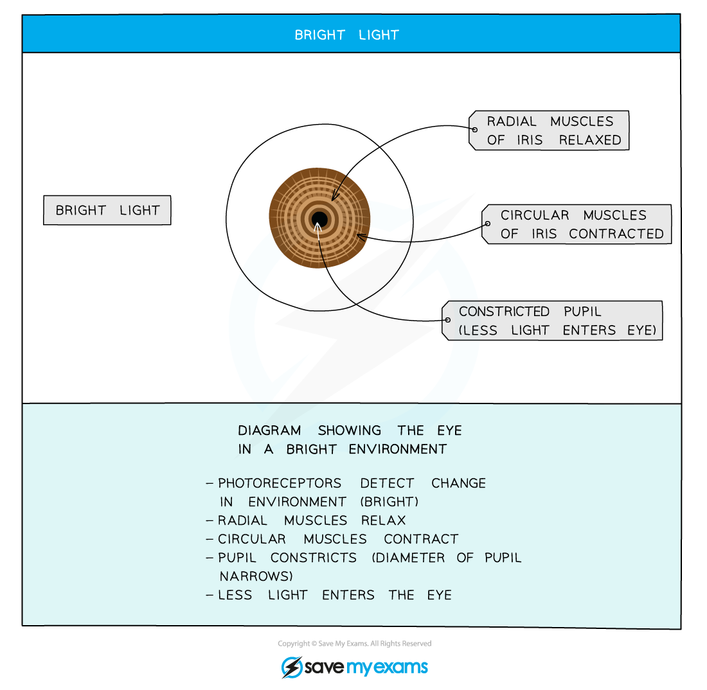
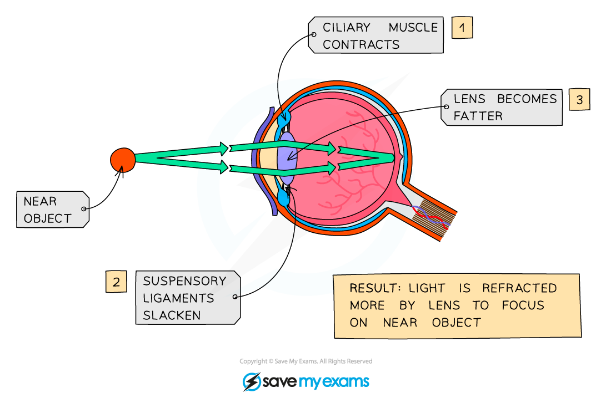
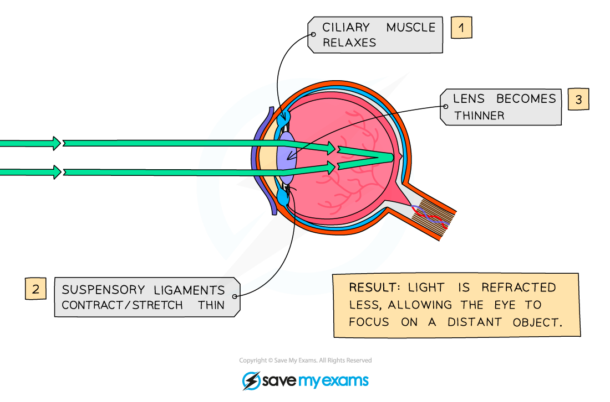

# The Eye

## Structure & function of the eye

> **Spec point** — `spcpt_shKg43jxXVqHc5n8` · nan

## Structure & function of the eye

- The eye is a[ sense organ ](https://www.savemyexams.com/igcse/biology/cie/23/revision-notes/14-coordination-and-response/14-1-coordination-response-and-homeostasis/14-1-5-sense-organs/?_ai=internal-linking)containing receptor cells that are sensitive to **light**
- The structure of the eye allows it to carry out its function; important structural features include the:

  - cornea
  - iris
  - lens
  - retina
  - optic nerve

*The structures of the eye allow it to detect light and transmit nerve impulses to the brain*

| **Structure** | **Function** |
|---|---|
| Cornea | Transparent covering at the front of the eye that refracts (bends) light |
| Iris | Muscle that controls how much light enters the pupil |
| Lens | Transparent disc that changes shape to focus light onto the retina |
| Retina | Layer of light receptor cells that detect light intensity and colour |
| Optic nerve | [Sensory neurone](https://www.savemyexams.com/igcse/biology/cie/23/revision-notes/14-coordination-and-response/14-1-coordination-response-and-homeostasis/14-1-2-types-of-neurones/?_ai=internal-linking) that carries electrical impulses from the eye to the brain |
| Fovea | The fovea is a region of the retina with the highest density of cones cells. Its function is to form sharp, coloured images |

### The pupil reflex

- The pupil reflex is an example of a [reflex action](https://www.savemyexams.com/igcse/biology/cie/23/revision-notes/14-coordination-and-response/14-1-coordination-response-and-homeostasis/14-1-3-the-reflex-arc/?_ai=internal-linking); its role is to control the light that enters the eye by altering the pupil diameter
- In **dim light** the pupil **dilates** in order to allow as much light into the eye as possible
- In **bright light** the pupil **constricts** in order to prevent too much light entering the eye and damaging the retina

*The pupil reflex causes the pupil to dilate in dim light and constrict in bright light*

> **Exam Hint**
> Note that features labelled on the eye structure diagram that are not listed in the table above are not part of the core content for this specification.
> 
> Students studying the extended course will also need to know about ciliary muscles, suspensory ligaments, the retina and the fovea.

## The pupil reflex: antagonistic muscle action: Extended

> **Spec point** — `spcpt_JWpNMRgkgx4mQ4tk` · nan

## The pupil reflex: antagonistic muscle action: Extended

- The pupil reflex occurs due to changes in the **iris muscles** which work to regulate the amount of light entering the eye
- The iris contains **circular muscles** and **radial muscles:**

  - the circular muscles form circles around the pupil
  - the radial muscles radiate outwards from the pupil

- The circular and radial muscles of the iris are **antagonistic**, meaning that they work against each other

  - When one set of muscles contracts the other relaxes, and vice versa

### Iris muscles in dim light

- When light levels are low the pupil reflex acts to dilate the pupil and maximise the light entering the eye; this is achieved as follows:

  - light receptors in the eye detect low light levels
  - the **radial muscles contract** and the** circular muscles relax**
  - the pupil **dilates**

*The pupil reflex in dim light*

### Iris muscles in bright light

- When light levels are high the pupil reflex acts to constrict the pupil to reduce light entering the eye and protect the retina; this occurs as follows:

  - light receptors in the eye detect bright light
  - the **radial muscles relax** and the **circular muscles contract**
  - the pupil **constricts**

*The pupil reflex in bright light*

#### Table comparing how the eye responds in dim and bright light

| **Stimulus** | **Radial muscles** | **Circular muscles** | **Pupil** | **Light entering eye** |
|---|---|---|---|---|
| Dim light | Contract | Relax | Dilated | More |
| Bright light | Relax | Contract | Constricted | Less |

## Accommodation in the eye: Extended

> **Spec point** — `spcpt_5VDVBzrzjs6PcBY3` · nan

## Accommodation in the eye: Extended

- Accommodation is the term used to describe the way in which the eye **focuses on near or distant objects**
- During eye accommodation the** shape of the lens** is changed, altering the extent to which light is **refracted**; this change is brought about by:

  - contraction or relaxation of the **ciliary muscles**
  - adjustment of tension in the **suspensory ligaments**

### Eye accommodation and near objects

- When an object is close up:

  - the **ciliary muscles contract**
  - the **suspensory ligaments loosen**
  - the suspensory ligaments exert less pull on the lens, allowing the lens to become** more rounded**
  - light is refracted more

*When viewing a near object accommodation of the eye involves contraction of the ciliary muscles and loosening of the suspensory ligaments*

### Eye accommodation and distant objects

- When an object is far away:

  - the **ciliary muscles relax**
  - the** suspensory ligaments tighten**
  - the suspensory ligaments pull on the lens, causing it to become **thinner**
  - light is refracted less

*When viewing a distant object accommodation of the eye involves relaxation of the ciliary muscles and tightening of the suspensory ligaments*

#### Table comparing how the eye responds to see near and distant objects

| Part of the eye | **Near objects** | **Distant objects** |
|---|---|---|
| Ciliary muscles | Contract | Relax |
| Suspensory ligaments | Loosen | Tighten |
| Lens | Fatter | Thinner |
| Light | Refracted more | Refracted less |

> **Exam Hint**
> Eye accommodation is complex and it can be hard to recall the details. If you find that you are struggling to remember in an exam, the following might be helpful:
> 
> - Staring at your hand right in front of your eye will make your eyes feel tired after a few seconds; this is because the **ciliary muscles are contracted**
> - Staring at an object far away feels relaxing and comfortable because the **ciliary muscles are relaxed**

## Rod & cone cells: Extended

> **Spec point** — `spcpt_TDCmCmpgcBbkbqwN` · nan

## Rod & cone cells: Extended

- Rods and cones are the two types of **receptor cell** present in the retina of the eye
- Rod cells and cone cells have different roles in detecting light stimuli:

  - **Rods** can detect light at low levels, so play an important role in **night vision**
  - Three different types of **cones** can detect light at **three different wavelengths**, enabling **colour vision**
- Rods and cones are **not distributed evenly** across the retina:

  - Rod cells are found** all over the retina**, with the exception of the blind spot
  - Cone cells are **concentrated in the fovea**, the region of the eye onto which light is focused by the process of accommodation
  
    - The fovea enables the brain to form **sharp, coloured images** when light is effectively focused by the eye

> **Exam Hint**
> You are expected to be able to identify the fovea on diagrams of the eye, so check the eye structure image at the top of the page to see where the fovea is located.
