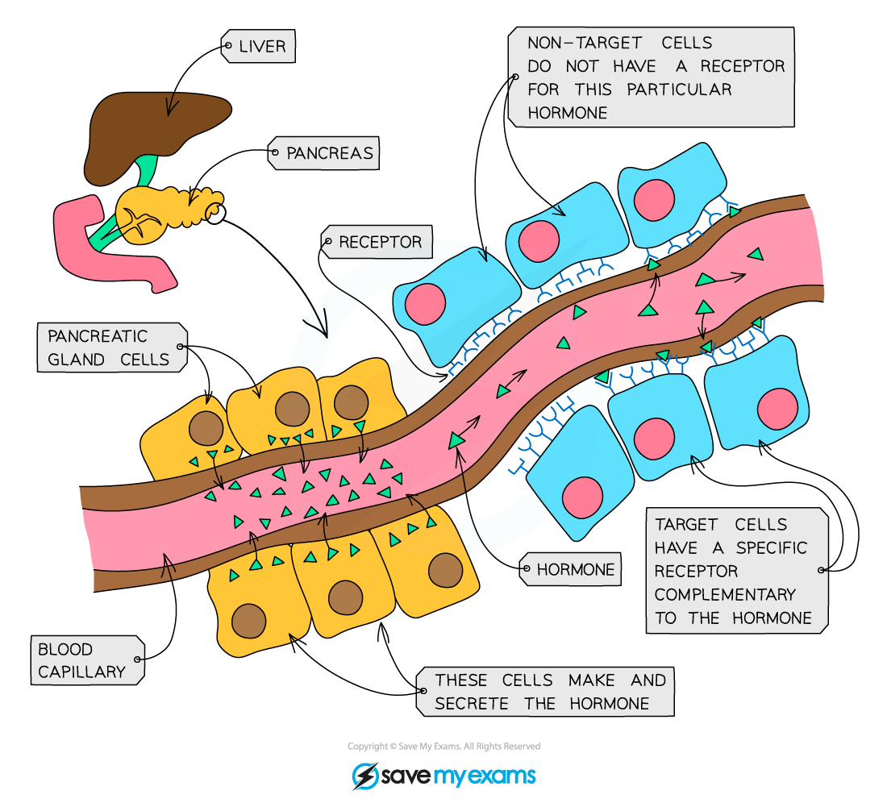

# Hormones in Humans

## Hormones & their associated glands

> **Spec point** — `spcpt_qr2YCTxNMm5t3mch` · Describe a hormone as a chemical substance, produced by a gland and carried by the blood, which alters the activity of one or more specific target organs
Identify in diagrams and images specific endocrine glands and state the hormones they secrete, limited to:
(a) adrenal glands and adrenaline
(b) pancreas and insulin
(c) testes and testosterone
(d) ovaries and oestrogen

## Hormones & their associated glands

### What is a hormone?

- A **hormone** is a chemical substance produced by a **gland** and carried by the **blood**, which alters the activity of one or more specific target organs

  - In other words, hormones are chemical messengers that transmit information from one part of the body to another, bringing about a change

- Collectively, the hormone-producing glands in the body form the **endocrine system**

*The major endocrine glands in the body*

### Transport around the body

- Endocrine glands have a **good blood supply**, allowing hormones to enter the bloodstream (specifically the blood plasma) quickly, so they can travel around the body to target organs and bring about a response
- Hormones only affect cells that have target receptors complementary to that hormone, allowing it to bind
- Target receptors may be found on the cell membrane or inside the cell
- The liver regulates levels of hormones in the blood; transforming or breaking down any that are in excess

*How hormones work*

### Important hormones in the human body

| Hormone | Source | Role | Effect |
|---|---|---|---|
| Adrenaline | Adrenal gland | Readies the body for a 'fight or flight' response | Increases heart and breathing rate, dilates pupils |
| Insulin | Pancreas | Lowers blood glucose levels | Causes excess glucose in the blood to be taken up by the muscles and liver and converted into glycogen for storage |
| Testosterone | Testes | Main sex hormone in males | Development of secondary sexual characteristics in males |
| Oestrogen | Ovaries | Main sex hormone in females | Development of secondary sexual characteristics in females and controls the menstrual cycle |

## Comparison of nervous & hormonal control

> **Spec point** — `spcpt_mnJT3XsNdmqpk58S` · Compare nervous and hormonal control, limited to speed of action and duration of effect

## Comparison of nervous & hormonal control

|   | Nervous system | Endocrine system |
|---|---|---|
| Made up of | Nerves (neurones), brain, spinal cord | Glands |
| Type of message | Electrical impulse | Chemical hormone |
| Speed of transmission | Very fast | Slower |
| Length of effect | Short – until nerve impulses stop | Longer – until hormone is broken down |

## Glucagon: Extended

> **Spec point** — `spcpt_xk66ZhDcdWFXTcjj` · State that glucagon is secreted by the pancreas

## Glucagon: Extended

- Blood glucose levels are controlled by a negative feedback mechanism involving the production of two hormones: **insulin** and **glucagon**
- Both hormones which control blood glucose concentration are made in the **pancreas**
- **Insulin** is produced when **blood glucose rises** and **stimulates liver and muscle cells to** convert excess glucose into glycogen** to be stored**
- **Glucagon** is produced when **blood glucose falls** and **stimulates liver and muscle cells to convert stored glycogen into glucose to be released into the blood**

*Negative feedback regulation of blood glucose levels*

> **Exam Hint**
> The terms glucagon and glycogen are very often mixed up as they look and sound similar. Remember:
> 
> - glucagon is the **hormone**
> - glycogen is the polysaccharide **glucose is stored as** in animals
> 
> Learn the differences between the spellings and what each one does so you do not get confused in the exam!

## The hormone adrenaline

> **Spec point** — `spcpt_cVmThj6nkgrYn46B` · Describe adrenaline as the hormone secreted in ‘fight or flight’ situations and its effects, limited to:
(a) increased breathing rate
(b) increased heart rate
(c) increased pupil diameter

## The hormone adrenaline

- Adrenaline is known as the '**fight or flight'** hormone as it is **produced in situations where the body may be in danger**

  - Flight: remove oneself rapidly from a dangerous situation e.g. run away
  - Fight: if flight is not possible, resort to physical combat to overcome danger
- Adrenaline causes a range of different things to happen in the body, all designed to prepare it for movement (i.e. fight or flight)
- These include:

  - **increasing blood glucose concentration** for **increased respiration in muscle cells**
  - **increasing pulse rate** and **breathing rate** so glucose and oxygen can be **delivered to muscle cells**, and carbon dioxide taken away, from muscles cells **more quickly**
  - **diverting blood flow towards muscles** and away from non-essential parts of the body such as the alimentary canal; again to ensure the reactants of respiration are as available as possible
  - **dilating pupils** to allow as much light as possible to reach the retina so **more information can be sent to the brain**

> **Exam Hint**
> It is worth you learning this list of effects of adrenaline as it is a fairly common exam question which can be worth several marks.

## More on adrenaline: Extended

> **Spec point** — `spcpt_ysrscNkSkhtTwWKH` · Describe the role of adrenaline in the control of metabolic activity, limited to:
(a) increasing the blood glucose concentration
(b) increasing heart rate

## More on adrenaline: Extended

- Additional effects of adrenaline include:

  - increasing the concentration of glucose in the blood
  
    - This help deliver more important glucose to muscles for respiration
  - increasing heart rate
  
    - This has the same effect, to ensure that all muscles are well prepared for high levels of activity in a flight or fight situation
