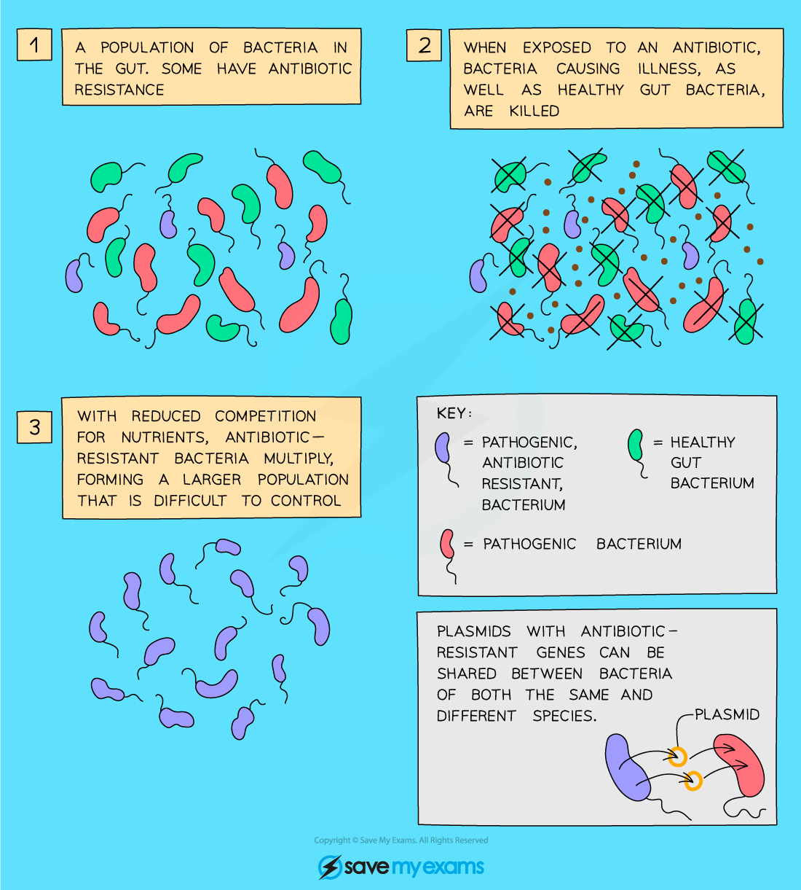

# Drugs in Medicine

## What is a drug?

> **Spec point** — `spcpt_6vkKGYZ6xXNTJG8D` · nan

## What is a drug?

### Drug definition

- A drug is **any substance taken into the body that modifies or affects chemical reactions in the body**
- Some drugs are medicinal drugs that are used to treat the symptoms or causes of a disease - for example, **antibiotics**

  - The **liver** is the primary site for drug metabolism

## Antibiotics

> **Spec point** — `spcpt_ktBKzK8SbwKvTDY8` · nan

## Antibiotics

### What are antibiotics?

- Antibiotics are **chemical substances** made by certain **fungi or bacteria** that affect the working of bacterial cells, either by **disrupting their structure or function** or by **preventing them from reproducing**
- Antibiotics are **effective against bacteria but not against viruses**
- Antibiotics target processes and structures that are specific to bacterial (prokaryotic) cells; as such they do not generally harm animal cells

*How antibiotics work*

## Antibiotic resistance & use: extended

> **Spec point** — `spcpt_dmSWyK8f7vNyg8yH` · nan

## Antibiotic resistance & use: extended

- Commonly prescribed antibiotics are becoming **less effective** due to a number of reasons:

  - **overuse** and being prescribed when not really necessary
  - patients **failing to complete the fully prescribed course** by a doctor
  - large scale **use of antibiotics in farming** to prevent disease when livestock are kept in close quarters, even when animals are not actually sick
- This has led to the effectiveness of antibiotics being reduced, and the incidence of antibiotic resistance increasing
- These bacteria are commonly known as 'superbugs' and the most common is **MRSA**

### How to prevent antibiotic resistance

- Ways individuals can help **prevent** the incidence of antibiotic resistance increasing include:

  - only taking antibiotics when **absolutely essential**
  - **ensuring that the entire course of antibiotics prescribed is completed** even if they feel better after a few days

*Antibiotic resistance*
