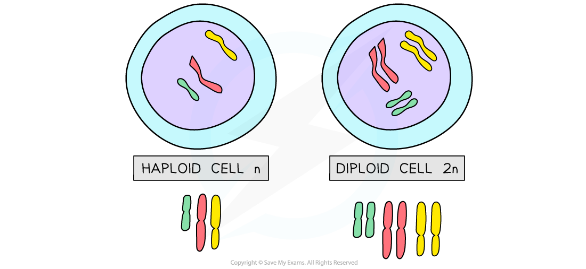

# Sexual Reproduction

## Gametes & zygotes

> **Spec point** — `spcpt_vydRFSb3ZFGBFQwM` · Describe sexual reproduction as a process involving the fusion of the nuclei of two gametes to form a zygote and the production of offspring that are genetically different from each other
Describe fertilisation as the fusion of the nuclei of gametes

## Gametes & zygotes

### Sexual reproduction

- Sexual reproduction is **a process involving the fusion of the nuclei of two gametes (sex cells) to form a zygote (fertilised egg cell) and the production of offspring that are genetically different from each other**
- Fertilisation is defined as the **fusion of gamete nuclei**, and as each gamete comes from a different parent, there is variation in the offspring

### Gametes

- A **gamete** is a sex cell (in animals: sperm and ovum; in plants pollen nucleus and ovum)
- Gametes differ from normal cells as they contain **half the number of chromosomes** found in other body cells - we say they have a **haploid nucleus**
- This is because they only contain **one copy of each chromosome**, rather than the two copies found in other body cells
- In human beings, a normal body cell contains **46 chromosomes** but each gamete contains **23 chromosomes**
- When the male and female gametes fuse, they become a **zygote** (fertilised egg cell)
- This contains the full **46 chromosomes**, half of which came from the father and half from the mother - we say the zygote has a **diploid nucleus**

## Haploid & diploid cells: Extended

> **Spec point** — `spcpt_Jsz8NP4J3rV4mx98` · State that nuclei of gametes are haploid and that the nucleus of a zygote is diploid

## Haploid & diploid cells: Extended

- The nuclei of gametes are **haploid**

  - A haploid nucleus contain half the number of chromosomes of a normal body cell
  - In humans, a haploid cell has **23** chromosomes
- The nucleus of a zygote is **diploid**

  - A diploid nucleus contains the same number of chromosomes as a normal body cell
  - In humans, this is **23 **<u>**pairs**</u> of chromosomes
  - The zygote continues to stay diploid as it grows into a foetus and embryo during pregnancy

*Haploid cells contain half the number of chromosomes as a diploid cell*

## Advantages & disadvantages of sexual reproduction: Extended

> **Spec point** — `spcpt_nkVgFmFGPQwgYXbh` · Discuss the advantages and disadvantages of sexual reproduction:
(a) to a population of a species in the wild
(b) to crop production

## Advantages & disadvantages of sexual reproduction: Extended

- **Advantages of sexual reproduction**:

  - increases genetic variation within a population
  - this variation gives the population a better chance of adapting to a changing environment
  - a population with more variation is less likely to be wiped out entirely by a single disease, since some individuals may be resistant
- **Disadvantages of sexual reproduction**:

  - finding a mate costs time and energy
  - individuals that are isolated from others may struggle to find a mate at all

- Many crop plants reproduce sexually:

  - This is an advantage as it means **variation is increased** and a genetic variant may be produced which is better able to cope with weather changes, or produces significantly higher yield
  - The disadvantage is that the variation may lead to offspring that are **less successful** than the parent plant at growing well or producing a good harvest
