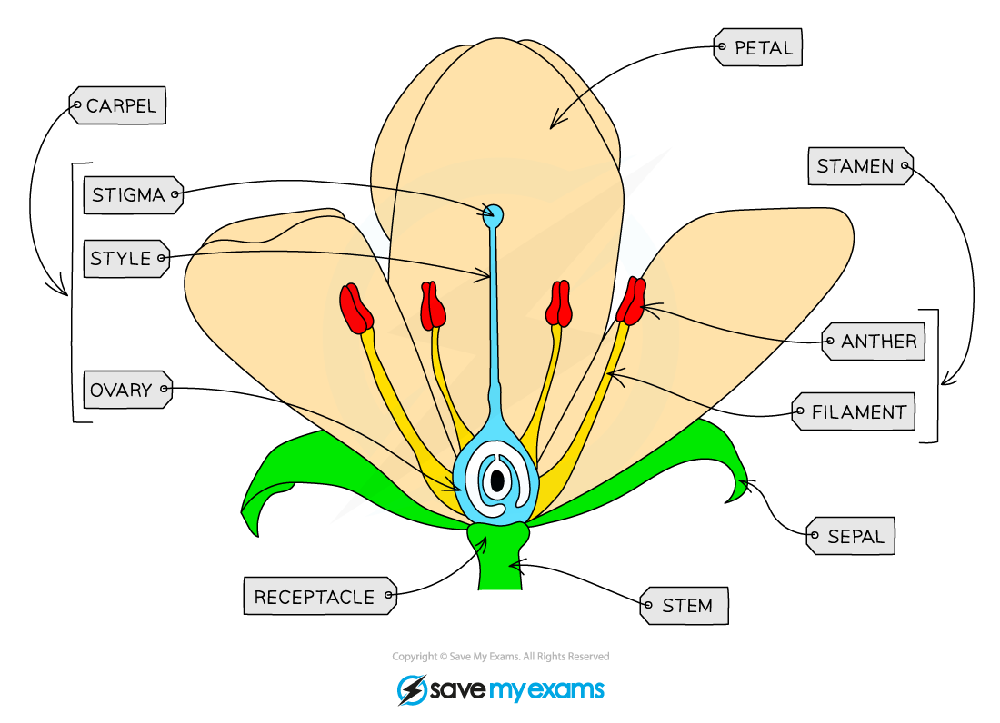
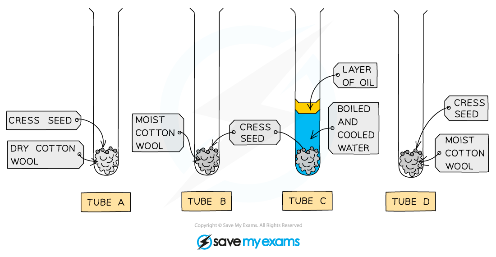
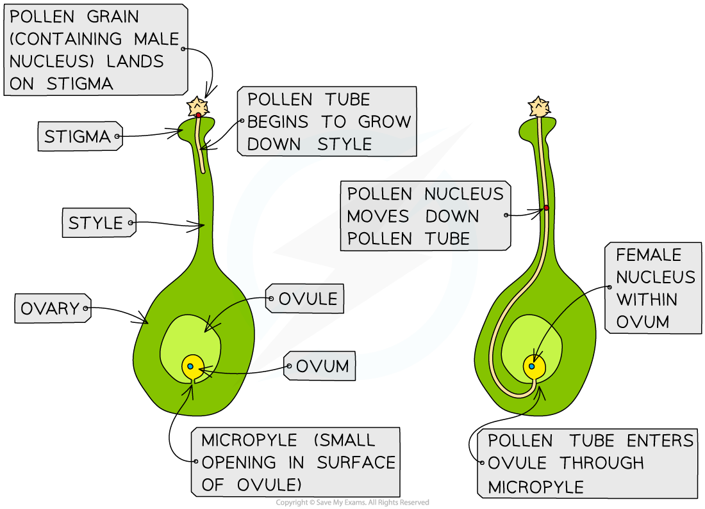
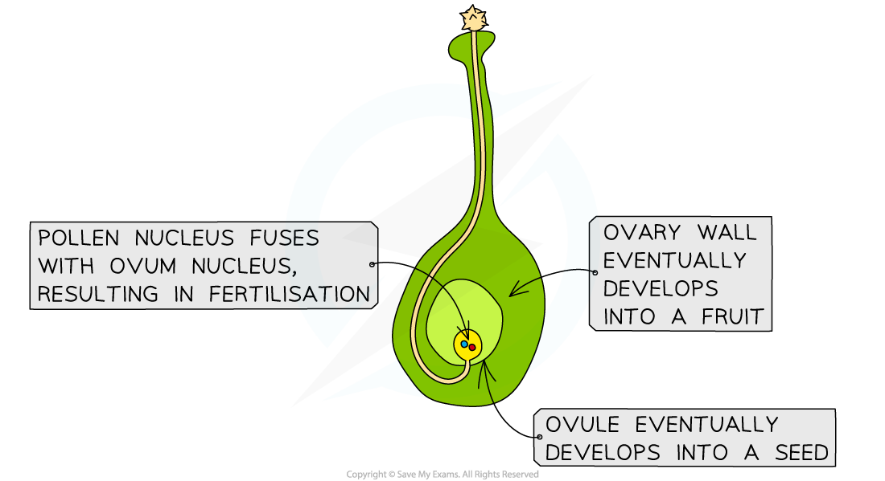

# Sexual Reproduction in Plants

## Insect pollinated flowers

> **Spec point** — `spcpt_tw9HCkd8r6sBz9wM` · nan

## Insect pollinated flowers

- Flowers are the **reproductive organs** of plants
- The role of flowers is to enable plant sex cells, or [gametes](https://www.savemyexams.com/igcse/biology/cie/23/revision-notes/16-reproduction/16-1-reproduction-in-plants-and-humans/16-1-2-sexual-reproduction/?_ai=internal-linking) to come together in **fertilisation**

  - The male gametes of plants are found in **pollen** grains
  - The female gametes of plants are in **ovules**
- The process by which pollen is transferred from the male part of a flower to the female part of a flower is known as **pollination**; this can be carried out in various ways, e.g. by insects or by wind

### Insect pollinated flower structure

- The most well known flower structure is that of the **insect pollinated flower**
- The parts of an insect pollinated flower include:

  - sepals
  - petals
  - stamens
  - filaments
  - anthers
  - carpel
  - style
  - stigma
  - ovary
  - ovules
- Insect pollinated flowers are adapted to **allow insects to collect pollen** from the male parts of the flower and easily **transfer it to the female parts** of another flower

*Insect pollinated flowers are adapted to attract insects and aid insect pollination*

#### Flower structure and function table

| **Structure** | **Description** |
|---|---|
| Sepal | Protects unopened flower |
| Petals | Brightly coloured in insect-pollinated flowers to attract insects |
| Anther | Produces and releases pollen |
| Filaments | Provides support to the anther |
| Stigma | Sticky top of the female part of the flower which collects pollen grains |
| Style | A tube that connects the stigma and ovary |
| Ovary | Contains the ovules |
| Ovule | Structures inside the ovary that contain the female gametes |

## Wind pollinated flowers

> **Spec point** — `spcpt_3bgzV3GnGF8Wr24r` · nan

## Wind pollinated flowers

- Wind pollinated flowers are adapted so that wind can easily catch pollen grains and carry them to the stigmas of other flowers
- The anthers and stigmas of wind pollinated flowers **hang outside the flower** so that:

  - pollen can easily be blown away by the wind
  - pollen can easily be caught by the stigmas of other flowers

*Wind pollinated flowers have anthers that hang outside the flower on long filaments, and feathery stigmas that can catch pollen easily*

## Pollination & fertilisation

> **Spec point** — `spcpt_Z5427yhwq85tb4s2` · Distinguish between the pollen grains of insect-pollinated and wind-pollinated flowers
Describe pollination as the transfer of pollen grains from an anther to a stigma
State that fertilisation occurs when a pollen nucleus fuses with a nucleus in an ovule
Describe the structural adaptations of insect-pollinated and wind-pollinated flowers

## Pollination & fertilisation

### Pollen and pollination

- The pollen of different types of flower is adapted to aid pollination:

  - Insect-pollinated flowers produce **larger, heavier** **pollen grains** that often contain **spikes or hooks** on the outside so they are better able to stick to insects
  - Wind-pollinated flowers produce **small, lightweight** **pollen grains** that can be caught and carried easily by the wind

> **Worked Example**
> 
> 
> **Observe the features of the different pollen grains**
> 
> 1. The pollen grains are large and have spikes around the outside
> 2. The pollen grains are small and smooth
> 3. The pollen grains are medium-sized and have wing-like structures on each side
> 
> **Consider how each feature may relate to the pollination method**
> 
> 1. Large pollen grains are likely to be too heavy to be picked up by the wind, and spikes will mean that they can catch onto the bodies of insects
> 2. Small pollen grains will be light enough to be carried by the wind
> 3. Wing-like structures will catch the wind easily
> 
> **Final answer:** **Answer:**
> 
> - **B** 1 only

### Pollination in insect and wind pollinated flowers

- Insect and wind pollinated flowers have structural adaptations which aid pollination:

#### Structural adaptations of an insect pollinated flower table

| **Feature** | **Insect pollinated flower** |
|---|---|
| **Petals** | Large and brightly coloured to attract insects |
| **Scent and nectar** | Scent and nectar are produced to encourage insects to visit the flower and push past stamen to get to nectar |
| **Anthers** | Held on stiff filaments within the flower so that they brush against insects |
| **Stigma** | Sticky stigmas within the flowers catch pollen grains when insects brush past |

#### Structural adaptations of a wind pollinated flower table

| **Feature** | **Wind pollinated flower** |
|---|---|
| **Petals** | Small and dull, often green or brown in colour |
| **Scent and nectar** | Scent and nectar are not produced; this would be a waste of energy |
| **Anthers** | Held on long filaments outside the flower to release pollen grains easily into the wind |
| **Stigma** | Feathery stigmas outside the flower catch airborne pollen grains |

### Pollination and fertilisation

- Pollination can be defined as:

**The transfer of pollen grains from an anther to a stigma**

- This is distinct from fertilisation, which is:

**The fusion of a pollen nucleus with an ovum nucleus**

- After pollination, the pollen nuclei travel to the ovule and fuse with female gametes in a process called fertilisation

*Pollen nuclei travel down a pollen tube in order to fuse with the female gametes inside the ovule; this is fertilisation*

> **Exam Hint**
> It is easy to get confused between pollination and fertilisation in plants; remember that they are not the same thing!
> 
> - Pollination is the **transfer of pollen**
> - Fertilisation is the **fusion of gametes**

## Factors affecting germination of seeds

> **Spec point** — `spcpt_jMd7ZNTNqdJtbhVx` · Investigate and describe the environmental conditions that affect germination of seeds, limited to the requirement for: water, oxygen and a suitable temperature

## Factors affecting germination of seeds

- **Germination** is the **start of growth in the seed**
- Three factors are required for successful germination:

  - **water** - allows the seed to swell up and the enzymes in the embryo to start working so that growth can occur
  - **oxygen** - so that energy can be released for germination
  - **warmth** - germination improves as temperature rises (up to a maximum) as the reactions which take place are controlled by enzymes
- As carbon dioxide is not necessary for germination but also does not inhibit it, it makes no difference whether it is present or not

### Investigating Germination

- Set up 4 boiling tubes each containing 10 cress seeds on cotton wool
- Set each test tube as shown in diagram below
- Leave tubes in set environment for a period of time: A, B and C incubated at 20°C; D placed in a fridge at 4°C
- Compare results and see which tube has the greatest number of germinated seeds

*An investigation into the conditions required for germination of seedlings*

#### Conditions required for germination results table

| **Test tube** | **Factor being tested** | **Seeds germinated** |
|---|---|---|
| A | Water / moisture | No |
| B | Control (all factors present) | Yes |
| C | Oxygen | No |
| D | Warm temperature | No |

- The results of this experiment prove that **all three factors are required** for the successful germination of the seeds and if any one factor is missing the seeds cannot germinate

## Self- & cross-pollination: Extended

> **Spec point** — `spcpt_mQ95QrG5gyPtc4xC` · Describe self-pollination as the transfer of pollen grains from the anther of a flower to the stigma of the same flower or a different flower on the same plant
Describe cross-pollination as the transfer of pollen grains from the anther of a flower to the stigma of a flower on a different plant of the same species
Discuss the potential effects of self-pollination and cross-pollination on a population, in terms of variation, capacity to respond to changes in the environment and reliance on pollinators
Describe the growth of the pollen tube and its entry into the ovule followed by fertilisation (details of production of endosperm and development are not required)

## Self- & cross-pollination: Extended

- Cross-pollination occurs when the **pollen from one plant** is transferred to the stigma of **another plant of the same species**
- This is the way most plants carry out pollination as it **improves genetic variation**
- Occasionally, the pollen from a flower can **land on its own stigma** or on the **stigma of another flower on the same plant** - this is known as self-pollination
- Self-pollination **reduces genetic variety of the offspring** as all the gametes come from the same parent (and are therefore genetically identical)
- Lack of variation in the offspring is a disadvantage if environmental conditions change, as it is **less likely that any offspring will have adaptations that suit the new conditions** well
- On the other hand, cross-pollination relies completely on the presence of **pollinators** and this can be a problem if those pollinators are **missing** (e.g. the reduction in **bee** numbers is of great importance to humans as bees pollinate a large number of food crops) - this doesn’t apply to wind-pollinated plants

### Pollen tube formation

- After pollination, the following sequence of events take place:

  - A **pollen tube** grows from the pollen grain down the style until it reaches the ovary
  - **Nuclei from pollen** travel down the tube
  - The nuclei enter the ovule and fuse with the nucleus of the female gamete (fertilisation)
  - After fertilisation the **ovules develop into seeds and the ovary develops into a fruit**

*Growth of the pollen tube and its entry into the ovule followed by fertilisation*

> **Exam Hint**
> Remember that it is the **nucleus** of the pollen grain that travels down the pollen tube in the style for fertilisation and not the pollen grain itself. Make sure to be specific with your use of key words!
