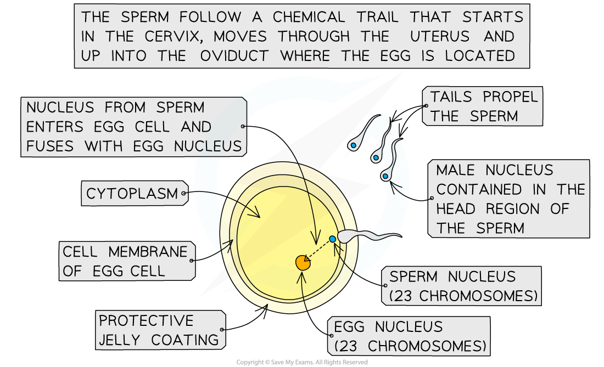
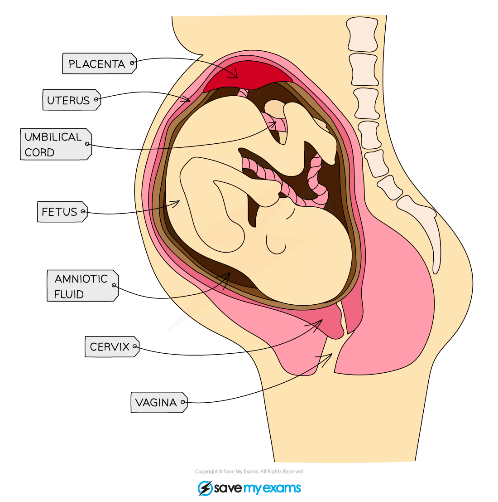
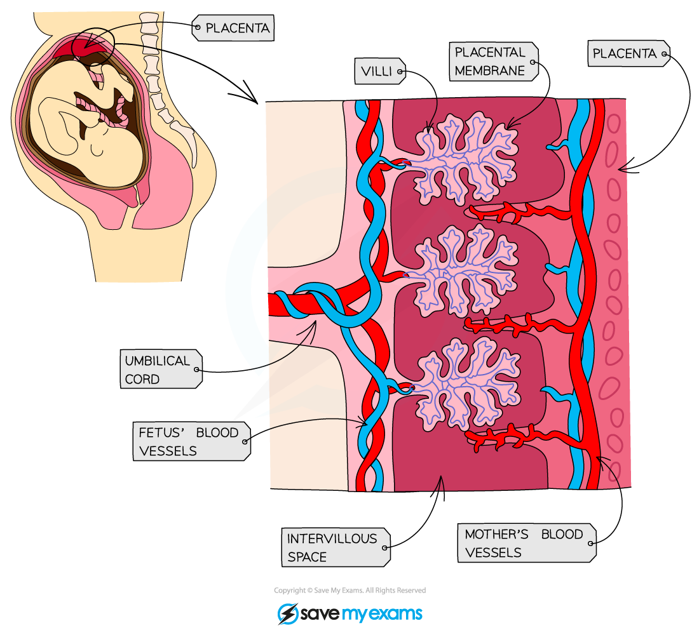

# Sexual Reproduction in Humans

## The male reproduction system

> **Spec point** — `spcpt_kSBPt45hgWJkPRSS` · nan

## The male reproductive system

### Structures of the male reproductive system

- The male reproductive system has several key organs and structures

*The male reproductive system*

- The structure and function of these components can be seen in the table below

| **Structure** | **Function** |
|---|---|
| Prostate gland | Produces a fluid that mixes with sperm cells to form semen |
| Sperm duct | Sperm passes through the sperm duct to be mixed with fluids produced by the glands before being passed into the urethra for ejaculation |
| Urethra | Tube running down the centre of the penis that can carry out urine or semen, a ring of muscle in the urethra prevents the urine and semen from mixing |
| Testis | Contained within a bag of skin (scrotum) and produces sperm (male gamete) and testosterone hormone |
| Scrotum | Sac supporting the testes outside the body to ensure that sperm are kept at a temperature slightly lower than body temperature |
| Penis | Passes urine out of the body from the bladder and allows semen to pass into the vagina of a woman during sexual intercourse |

## The female reproduction system

> **Spec point** — `spcpt_xkZ4TJ7dQJsc2Xmq` · nan

## The female reproductive system

### Structures of the female reproductive system

- The female reproductive system has several key organs and structures

*The female reproductive system*

- The structure and function of these components can be seen in the table below

| **Structure** | **Function** |
|---|---|
| Oviduct | Connects the ovary to the uterus and is lined with ciliated cells to push the released ovum down it. Fertilisation occurs here |
| Ovary | Contains ova (female gametes) which will mature and develop when hormones are released |
| Uterus | Muscular bag with a soft lining where the fertilised egg (zygote) will be implanted to develop into a foetus |
| Cervix | Ring of muscle at the lower end of the uterus to keep the developing foetus in place during pregnancy |
| Vagina | The muscular tube that leads to the inside of the woman's body where the male's penis will enter during sexual intercourse and sperm are deposited |

## Gametes & fertilisation

> **Spec point** — `spcpt_ZZzrD5MP4ms2wpxp` · Describe fertilisation as the fusion of the nuclei from a male gamete (sperm) and a female gamete (egg cell)

## Gametes & fertilisation

### What is fertilisation?

- Fertilisation is the **fusion of the nuclei from a male gamete (sperm cell) and a female gamete (egg cell)**
- Fertilisation occurs in the **oviducts**
- Gametes have **adaptations** to increase the chances of fertilisation and successful development of an embryo

*The sperm enters the egg cell during fertilisation which usually occurs in the oviduct*

## Adaptations of gametes

> **Spec point** — `spcpt_t7jF7yBcTFq6DPmR` · Explain the adaptive features of sperm, limited to: flagellum, mitochondria and enzymes in the acrosome
Explain the adaptive features of egg cells, limited to: energy stores and the jelly coat that changes at fertilisation
Compare male and female gametes in terms of: size, structure, motility and numbers

## Adaptations of gametes

### Human gametes

- The human gametes are the **egg** and the **sperm** cells

*Comparing sperm and egg cells*

#### Adaptive features of the gametes

- The gametes are **highly specialised cells** with adaptive features designed to maximise the chances of successful reproduction
- These **adaptive features** are compared in the table below

| **Gamete** | **Adaptive feature** | **Function** |
|---|---|---|
| Sperm | Has a flagellum (tail) | Allows the sperm to swim towards the egg |
| Contains **enzymes** in the head region (acrosome) | To digest a route into the egg for fertilisation |   |
| Contains many mitochondria | To provide energy for movement of the flagellum |   |
| Egg | Cytoplasm contains a store of energy | To provide energy for cell division in the developing zygote after fertilisation |
| Jelly-like coating that changes after fertilisation | To make an impenetrable barrier after fertilisation to prevent more sperm entering the egg |   |

#### Comparison of male and female gametes

| **Comparative Feature** | **Sperm** | **Egg** |
|---|---|---|
| Size | Very small (45 µm) | Large (0.15 mm) |
| Structure | Head region, flagellum, many structural adaptations | Round cell with few structure adaptations, covered in a jelly coating |
| Motility | Capable of locomotion | Not capable of locomotion |
| Numbers | Produced every day in huge numbers (around 100 million per day) | Thousands of immature eggs in each ovary, but only one is released each month |

## Pregnancy: growth & development of the fetus

> **Spec point** — `spcpt_cp9GzCbX75WhXdt9` · State that in early development, the zygote forms an embryo which is a ball of cells that implants into the lining of the uterus
Identify on diagrams and state the functions of the following in the development of the fetus: umbilical cord, placenta, amniotic sac and amniotic fluid

## Pregnancy: growth & development of the fetus

- After fertilisation in the **oviduct**, the zygote travels towards the **uterus**
- After fertilisation, the zygote travels along the oviduct towards the uterus, **dividing repeatedly** to form a ball of cells called an **embryo**
- In the uterus, the embryo embeds itself in the thick lining (**implantation**) and continues to grow and develop
- The gestation period for humans is **9 months:**

  - major **development of organs** takes place within the **first 12 weeks**, during which time the embryo gets nutrients from the mother by **diffusion through the uterus lining**
  - after this point the organs are all in place, the **placenta** has formed and the embryo is now called a **foetus**
  - the remaining gestation time is used by the foetus to **grow bigger in size**

- The foetus is surrounded by an **amniotic sac** which contains **amniotic fluid** (made from the mother’s blood plasma)
- Amniotic fluid protects the foetus during development by **cushioning it from bumps** to the mother’s abdomen
- The **umbilical cord** joins the foetus’s blood supply to the **placenta** for exchange of nutrients and removal of waste products

*The foetus in the uterus*

## The placenta & umbilical cord: extended

> **Spec point** — `spcpt_y8ZvYK6j5NgQhSsW` · Describe the function of the placenta and umbilical cord in relation to the exchange of dissolved nutrients, gases and excretory products between the blood of the mother and the blood of the fetus
State that some pathogens and toxins can pass across the placenta and affect the fetus

## The placenta & umbilical cord: extended

### What are the placenta and the umbilical cord?

- During the gestation period the foetus develops and grows by gaining the **glucose, amino acids, fats**, **water** and **oxygen** it needs from the mother’s blood
- The bloods run opposite each other, never mixing, in the **placenta**
- The foetus’s blood connects to and from the placenta by the **umbilical cord**
- The mother’s blood also absorbs the **waste** from the foetus’s blood in the placenta; substances like **carbon dioxide** and **urea** are removed from the foetus’s blood so that they do not build up to dangerous levels
- Movement of all molecules across the placenta occurs by **diffusion** due to **difference in concentration gradients**
- The placenta is adapted for this diffusion by having a **large surface area** and a **thin wall** for efficient diffusion

*The placenta*

#### Toxins and pathogens

- The placenta acts as a **barrier** to prevent toxins and pathogens getting into the foetus’s blood
- Not all **toxin molecules** or **pathogenic organisms** (such as **viruses**, eg **rubella**) are stopped from passing through the placenta (this usually depends on the size of the molecule)
- This is why pregnant women are advised **not to smoke during pregnancy** as molecules like **nicotine** can pass across the placenta

> **Exam Hint**
> It is worth learning at least two specific substances that move in either direction across the placenta – this is a common exam question and non-specific answers such as ‘waste products’ and ‘nutrients’ will not get any marks!
