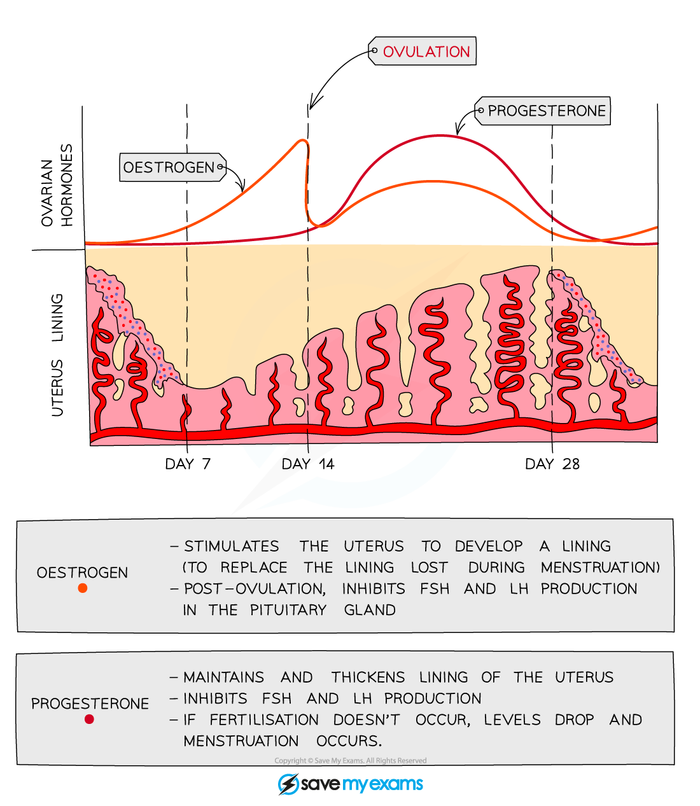
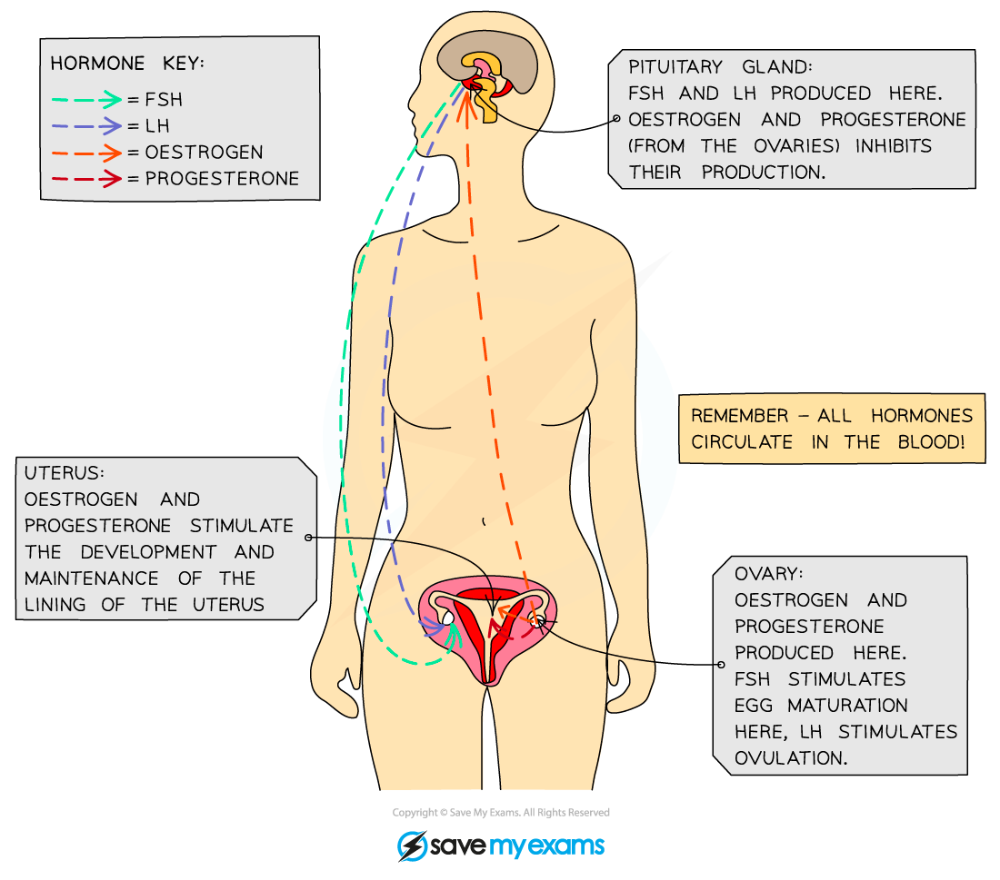

# Sexual Hormones in Humans

## Secondary sexual characteristics

> **Spec point** — `spcpt_BzBrxvJJkXNkNGTs` · Describe the roles of testosterone and oestrogen in the development and regulation of secondary sexual characteristics during puberty
Describe the menstrual cycle in terms of changes in the ovaries and in the lining of the uterus

## Secondary sexual characteristics

- Secondary sexual characteristics are the **changes that occur during puberty** as children become adolescents

  - Primary sexual characteristics are present during development in the uterus and are the differences in reproductive organs between males and females
- They are controlled by the[ release of hormones](https://www.savemyexams.com/igcse/biology/cie/23/revision-notes/14-coordination-and-response/14-1-coordination-response-and-homeostasis/14-1-7-hormones-in-humans/?_ai=internal-linking) - **oestrogen** in girls and **testosterone** in boys

### Human secondary sexual characteristics

- Some changes occur to both boys and girls, including **growth of sexual organs** and **growth of body hair**
- **Emotional changes** also occur due to the increased levels of hormones in the body
- These include more interest in sex and increased mood swings

#### Female secondary sexual characteristics

#### Male secondary sexual characteristics

## The menstrual cycle

> **Spec point** — `spcpt_vH3vPNr9B73hZxjn` · Describe the menstrual cycle in terms of changes in the ovaries and in the lining of the uterus

## The menstrual cycle

- Starts in early adolescence in girls (around age **12**) and is controlled by **hormones**
- The average menstrual cycle is **28 days** long
- **Ovulation** (the release of an egg) occurs about **halfway** through the cycle (day **14**) and the egg then [travels down the oviduct](https://www.savemyexams.com/igcse/biology/cie/23/revision-notes/16-reproduction/16-1-reproduction-in-plants-and-humans/16-1-4-sexual-reproduction-in-humans/?_ai=internal-linking) to the uterus
- Failure to fertilise the egg causes **menstruation** (commonly called a period) to occur - this is caused by the **breakdown of the thickened lining of the uterus**
- Menstruation lasts around **5 - 7 days** and signals the beginning of the next cycle After menstruation finishes, the lining of the uterus starts to thicken again in preparation for possible implantation in the next cycle

*Changes in the lining of the uterus during the menstrual cycle*

***Changes in the lining of the uterus during the menstrual cycle***

## Hormones of the menstrual cycle: Extended

> **Spec point** — `spcpt_pBMSjGH4Xj6VyQn6` · Describe the sites of production of oestrogen and progesterone in the menstrual cycle and in pregnancy
Explain the role of hormones in controlling the menstrual cycle and pregnancy, limited to FSH, LH, progesterone and oestrogen

## Hormones of the menstrual cycle: Extended

- The menstrual cycle is controlled by hormones released from the **ovary** and the **pituitary gland** in the brain

### The roles of FSH and LH

- **FSH** (**follicle-stimulating** **h**ormone) is released by the **pituitary gland** and causes an **egg to start maturing** in the ovary
- It also **stimulates the ovaries** to start releasing **oestrogen**
- The **pituitary gland** is stimulated to release **l**uteinising **h**ormone (**LH**) when **oestrogen** levels have reached their peak
- **LH** causes **ovulation to occur** and also **stimulates the ovary** to produce **progesterone**

*Changes in the levels of the pituitary hormones FSH and LH in the blood during the menstrual cycle*

### The roles of oestrogen and progesterone

- **Oestrogen** levels rise from day 1 to peak just before **day 14**
- This causes the **uterine wall to start thickening** and the **egg to mature**
- The peak in oestrogen occurs just before the egg is released
- **Progesterone** stays low from day 1 – 14 and starts to rise once ovulation has occurred
- The increasing levels **cause the uterine lining to thicken further**; a fall in progesterone levels causes the uterine lining to break down (**menstruation / ‘period’**)

*Changes in the levels of oestrogen and progesterone in the blood during the menstrual cycle*

### Interaction between all four of the menstrual cycle hormones

- The pituitary gland produces **FSH** which stimulates the development of a **follicle** in the ovary
- An egg develops inside the follicle and the follicle produces the hormone **oestrogen**
- Oestrogen causes **growth and repair of the lining of the uterus wall** and inhibits production of **FSH**
- When oestrogen rises to a high enough level it stimulates the release of **LH** from the pituitary gland which causes **ovulation** (usually around day 14 of the cycle)
- The follicle becomes the **corpus luteum** and starts producing **progesterone**
- Progesterone **maintains the uterus lining** (the thickness of the uterus wall)
- If the ovum is not fertilised, the corpus luteum breaks down and progesterone levels drop
- This causes **menstruation**, where the uterus lining breaks down and is removed through the vagina - commonly known as having a period
- If pregnancy does occur the corpus luteum **continues to produce progesterone**, preventing the uterus lining from breaking down and **aborting** the pregnancy
- It does this until the **placenta** has developed, at which point it starts secreting progesterone and **continues to do so throughout the pregnancy**

*Where hormones involved in the menstrual cycle are made and act*
