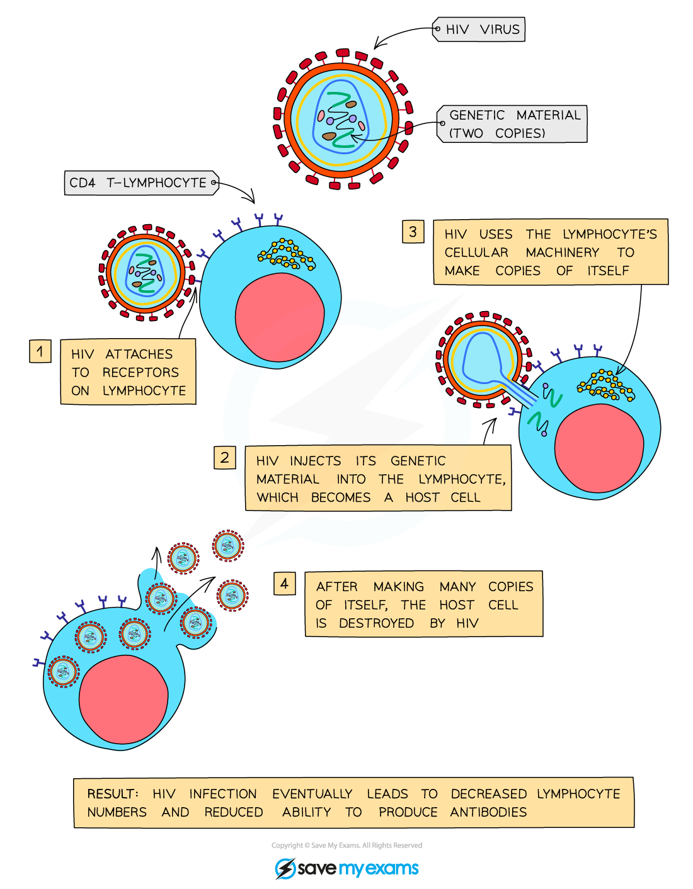

# Sexually Transmitted Infections

## STIs & HIV/AIDS

> **Spec point** — `spcpt_cxCYy5VCMdQnWSrV` · Describe a sexually transmitted infection (STI) as an infection that is transmitted through sexual contact

## STIs & HIV/AIDS

- Unprotected sexual intercourse can lead to the transfer of pathogens via exchange of body fluids
- Infections passed on in this way are known as sexually transmitted infections (STIs)
- An example of an STI is **HIV** (**H**uman **I**mmunodeficiency **V**irus), the virus that usually leads to the development of **acquired immunodeficiency disease** (**AIDS**)
- HIV can also be spread via sharing needles with an infected person, blood transfusions with infected blood and from mother to foetus through the placenta and mother to baby via breastfeeding

## How HIV affects the immune system

> **Spec point** — `spcpt_bCyCnfkQRbrKRGPB` · State that human immunodeficiency virus (HIV) is a pathogen that causes an STI
State that HIV infection may lead to AIDS Describe the methods of transmission of HIV

## How HIV affects the immune system

- Immediately after infection, people often suffer **mild flu-like symptoms**
- These symptoms pass and for a period of time **infected people might not know they are infected**
- The virus infects a certain type of **lymphocyte** of the body's immune system
- Normally lymphocytes **seek out and destroy pathogens** that enter the body, producing antibodies that attach to pathogens, enhancing phagocytic activity
- However HIV avoids being recognised and destroyed by lymphocytes by repeatedly **changing its protein coat**
- It then infects a certain type of lymphocyte and **uses the cells’ machinery to multiply**
- This **reduces the number of lymphocytes** of the immune system, and also **the number of antibodies** that can be made
- This decreases the body’s ability to fight off infections, eventually leading to **AIDS (Acquired immunodeficiency)**

*How HIV infects lymphocytes*

## Controlling the spread of STIs

> **Spec point** — `spcpt_F2hFbBk8J48prGm7` · Explain how the spread of STIs is controlled

## Controlling the spread of STIs

- The spread of STIs such as HIV are best controlled by:

  - **limiting the number of sexual partners** an individual has
  - **not having unprotected sex**, but making sure to always use a **condom**
  - **getting tested** if unprotected sex or sex with multiple partners has occurred
  - raising awareness by **education programmes**
