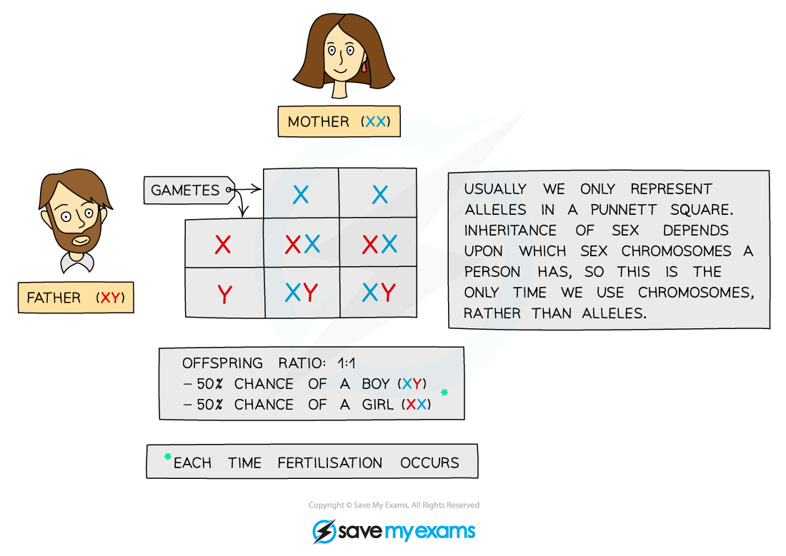

# The Inheritance of Sex

## XX & XY chromosomes

> **Spec point** — `spcpt_rvCHWxZ48V94vRqn` · Describe the inheritance of sex in humans with reference to X and Y chromosomes

## XX & XY chromosomes

- Sex is determined by an **entire chromosome pair** (as opposed to most other characteristics that are just determined by one or a number of genes)
- **Females** have the sex chromosomes **XX**
- **Males** have the sex chromosomes **XY**
- As only a father can pass on a Y chromosome, he is **responsible for determining the sex of the child**
- He does this because he produces (ejaculates) around 250 million sperm cells during sexual intercourse, and of those:

  - Around half will be carrying an X chromosome, and if one of these sperm fertilises the egg, the fetus will be female
  - The other half will be carrying a Y chromosome and if one of these sperm fertilises the egg, the fetus will be male

*Sperm cells determine the sex of offspring*

- The inheritance of sex can be shown using a **genetic diagram** (known as a **Punnett square**), with the X and Y chromosomes taking the place of the alleles usually written in the boxes

*Punnett square showing the inheritance of sex*
