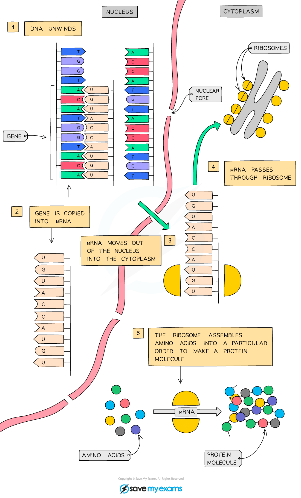
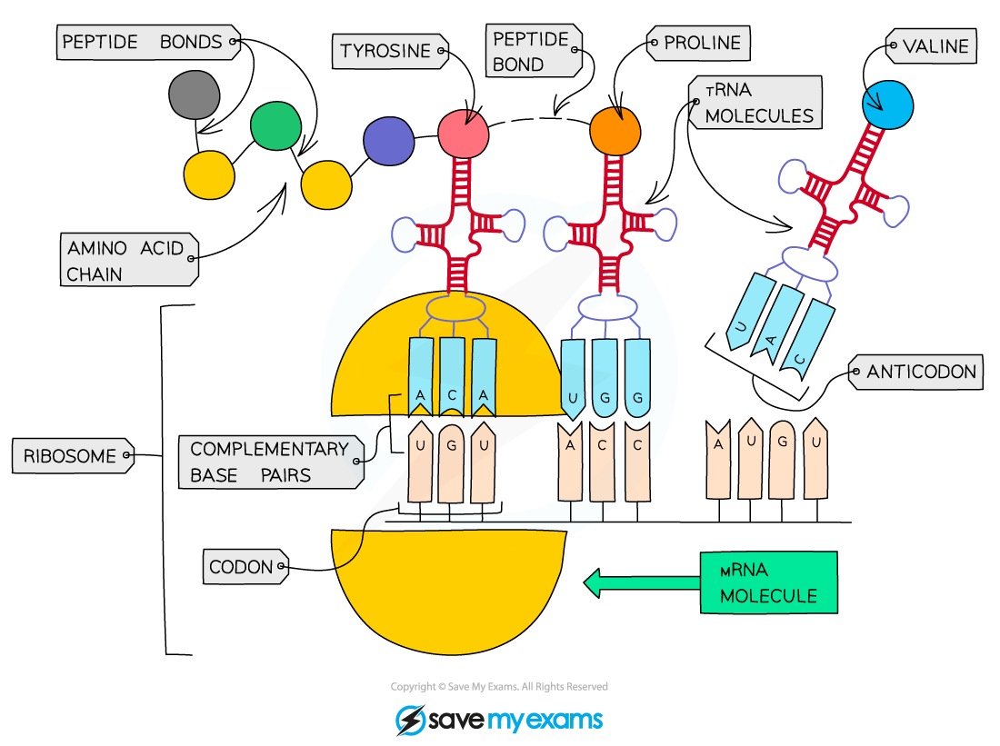

# Protein Synthesis

## Transcription & translation: Extended

> **Spec point** — `spcpt_KcD5mwChmCTfrSM8` · Explain how a protein is made, limited to: • the gene coding for the protein remains in the nucleus • messenger RNA (mRNA) is a copy of a gene
• mRNA molecules are made in the nucleus and move to the cytoplasm
• the mRNA passes through ribosomes
• the ribosome assembles amino acids into protein molecules
• the specific sequence of amino acids is determined by the sequence of bases in the mRNA (knowledge of the details of transcription or translation is not required)

## Transcription & translation: Extended

- Proteins are made by **ribosomes** with the sequence of amino acids controlled by the [sequence of bases contained within DNA](https://www.savemyexams.com/igcse/biology/cie/23/revision-notes/4-biological-molecules/4-1-biological-molecules/4-1-3-dna-structure/?_ai=internal-linking)
- DNA **cannot travel out of the nucleus** to the ribosomes (it is far too big to pass through a nuclear pore) so the base code of each gene is transcribed onto an RNA molecule called **messenger RNA** (mRNA)
- mRNA then **moves out of the nucleus** and attaches to a ribosome
- The ribosome ‘reads’ the code on the mRNA in groups of three
- Each triplet of bases **codes for a specific amino acid**
- In this way the ribosome **translates** the sequence of bases into a **sequence of amino acids** that make up a protein

*Protein synthesis*

- Each tRNA molecule binds to, and carries, a single, specific amino acid from the cytoplasm to the ribosome for the assembly of the amino acid chain
- Once the amino acid chain has been assembled, it is released from the ribosome so it can fold and form the final structure of the protein

*The triplet code of DNA (carried by mRNA) is read by the ribosome and amino acids are attached together in a specific sequence to form the protein*
