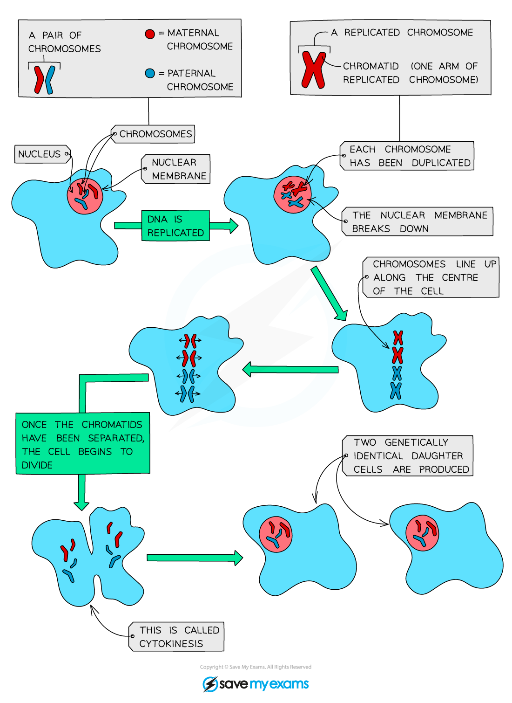

# Mitosis

## New cells are made by mitosis: Extended

> **Spec point** — `spcpt_ZkxmmCZ3tFwNtbt3` · Describe mitosis as nuclear division giving rise to genetically identical cells (details of the stages of mitosis are not required)
State the role of mitosis in growth, repair of damaged tissues, replacement of cells and asexual reproduction
State that the exact replication of chromosomes occurs before mitosis
State that during mitosis, the copies of chromosomes separate, maintaining the chromosome number in each daughter cell

## New cells are made by mitosis: Extended

### Extended Tier Only

### Mitosis - basics

- Most body cells have two copies of each chromosome
- We describe these cells as **diploid**
- When cells divide their chromosomes double beforehand
- This ensures that when the cell splits in two, each new cell still has two copies of each chromosome (is still diploid)
- This type of cell division is used for **growth, repair of damaged tissues, replacement of cells** and **asexual reproduction** and is known as **mitosis**
- Mitosis is defined as **nuclear division giving rise to genetically identical cells**

*The process of cell division by mitosis*

#### What is the process of mitosis?

- Just before mitosis, each chromosome in the nucleus copies itself exactly (forming X-shaped chromosomes)
- Chromosomes line up along the centre of the cell where cell fibres pull them apart
- The cell divides into two; each new cell has a copy of each of the chromosomes

#### Why is mitosis important?

- All cells in the body (excluding gametes) are produced by mitosis of the [zygote](https://www.savemyexams.com/igcse/biology/cie/23/revision-notes/16-reproduction/16-1-reproduction-in-plants-and-humans/16-1-2-sexual-reproduction/?_ai=internal-linking)
- Mitosis is important for replacing cells e.g. skin cells, red blood cells and for allowing growth (production of new cells e.g. when a zygote divides to form an embryo)

#### When does mitosis occur?

- *Growth*: mitosis produces new cells
- *Repair*: to replace damaged or dead cells
- *Asexual reproduction*: mitosis produces offspring that are genetically identical to the parent

## Mitosis & stem cells: Extended

> **Spec point** — `spcpt_KhMTh9cRX6yXhwt8` · Describe stem cells as unspecialised cells that divide by mitosis to produce daughter cells that can become specialised for specific functions

## Mitosis & stem cells: Extended

### Extended Tier Only

- Many tissues in the human body contain a small number of **unspecialised cells** called **stem cells**
- Stem cells divide by mitosis to **produce new daughter cells that can become specialised** for specific functions
- All stem cells originate from the **zygote**, which divides several times by mitosis to form a ball of unspecialised cells (roughly 150-200, depending on the exact stage), all of which are **embryonic stem cells**
- These cells are initially identical, but begin to differentiate as the foetus develops, gradually forming the recognisable specialised tissues and features of the body
