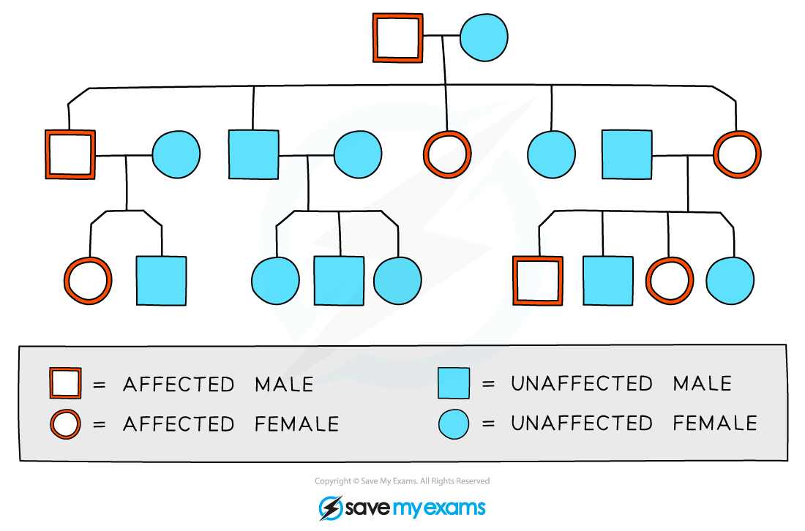

# Monohybrid Inheritance

## Inheritance: definitions

> **Spec point** — `spcpt_vzzrgRd2RJs5FvYY` · Describe inheritance as the transmission of genetic information from generation to generation
Describe genotype as the genetic makeup of an organism and in terms of the alleles present
Describe phenotype as the observable features of an organism
Describe homozygous as having two identical alleles of a particular gene
State that two identical homozygous individuals that breed together will be pure-breeding
Describe heterozygous as having two different alleles of a particular gene
State that a heterozygous individual will not be pure-breeding
Describe a dominant allele as an allele that is expressed if it is present in the genotype
Describe a recessive allele as an allele that is only expressed when there is no dominant allele of the gene present in the genotype

## Inheritance: definitions

- **Inheritance** is the transmission of genetic information from one generation to the next generation
- A **gene** is a short length of DNA found on a chromosome that codes for a particular characteristic
- **Alleles** are versions, or forms, of a gene:

  - chromosomes exist in matching pairs, so individuals have two copies of each gene and therefore two alleles of each gene
  - one of each allele is inherited from the mother and the other from the father
  
    - For example, an individual has two copies of a gene for eye colour; these alleles could be identical, or they could be different
- The observable characteristics of an organism is called the **phenotype**
- The combination of alleles that control each characteristic is called the **genotype**
- Alleles can be **dominant** or **recessive:**

  - a dominant allele **only needs to be inherited from one parent** in order for the characteristic to show up in the phenotype
  - a recessive allele needs to be **inherited from both parents** in order for the characteristic to show up in the phenotype
  
    - If there is only one recessive allele, it will remain hidden and the dominant characteristic will show
- If the two alleles of a gene are the same, the individual is described as being **homozygous** ('homo-' means 'the same'); an individual could be:

  - **homozygous dominant**: having two copies of the dominant allele, or
  - **homozygous recessive**: having two copies of the recessive allele
- If the two alleles of a gene are different, the individual is described as being **heterozygous** ('hetero-' means 'different')
- When completing genetic diagrams alleles are notated as single letters:

  - the dominant allele is given a **capital letter**
  - the recessive allele is given the **lower case** version of the same letter

*Alleles of a gene can carry the same instructions or different instructions. An individual can only inherit two alleles for each gene; these can be the same or different*

- It is **not always possible to determine the genotype** of an individual just by looking at the phenotype

  - A phenotype associated with a dominant allele will be seen in both a dominant homozygous and a heterozygous genotype
- If two individuals who are both **identically** **homozygous** for a particular characteristic are bred together, they will **produce offspring with exactly the same genotype and phenotype as the parents**

  - This is described as **pure-breeding** as two homozygous individuals will always produce offspring with the same particular characteristic
- A **heterozygous** individual can pass on **different alleles** for the same characteristic each time it breeds with any other individual and can therefore **produce offspring with a different genotype and phenotype than the parents**

  - Heterozygous individuals are not pure-breeding

## Genetic diagrams

> **Spec point** — `spcpt_MzXYxzG5364MYyTX` · Interpret pedigree diagrams for the inheritance of a given characteristic
Use genetic diagrams to predict the results of monohybrid crosses and calculate phenotypic ratios, limited to : and : ratios
Use Punnett squares in crosses which result in more than one genotype to work out and show the possible different genotypes

## Genetic diagrams

### What is monohybrid inheritance?

- Monohybrid inheritance is the inheritance of characteristics controlled by a **single gene** (mono = one)
- This can be determined using a genetic diagram known as a **Punnett square**

  - A Punnett square diagram shows the **possible combinations of alleles** that could be produced in the offspring
  - From this the **ratio** of these combinations can be worked out

> **Worked Example**
> The height of pea plants is controlled by a single gene that has two alleles: tall and short
> 
> - The tall allele is dominant and is shown as **T**
> - The small allele is recessive and is shown as **t**
> 
> Show the possible allele combinations of the offspring produced when a homozygous short plant is bred with a homozygous tall plant. Determine the probability that any offspring will be tall
> 
> **Step 1: construct a Punnett square**
> 
> - The parents are homozygous, so:
> 
>   - tall = **TT**
>   - short = **tt**
> 
> - The Punnett square should indicate:
> 
>   - parent gametes
>   - offspring genotypes
>   - an indication of which offspring are tall
> 
> **Step 2: determine the probability of tall offspring**
> 
> - All offspring are **Tt**
> - The probability that they are tall = **100 %**
> 
> ![Diagram illustrating genetic cross notation conventions: dominant alleles are shown as capital letters, recessive alleles as the same letter in lower case. Key: T = tall (dominant), t = short (recessive). A tall pea plant (genotype TT) is crossed with a short pea plant (genotype tt). The Punnett square is set up with the TT parent's gametes (T and T) along the top and the tt parent's gametes (t and t) down the left side. All four boxes in the square are filled in as Tt. The offspring genotypes are given as Tt, and the offspring phenotypes are all tall plants (100%), illustrated by a tall pea plant labelled "all tall."](assets/9f0281127e3c-f1-genetic-cross.png)
> 
> Show the possible allele combinations of the offspring produced when two of the offspring from the first cross are bred together. Determine the probability that any offspring will be short.
> 
> **Step 1: construct a Punnett square**
> 
> - The offspring from the first cross are all **Tt**
> - The Punnett square should indicate:
> 
>   - parent gametes
>   - offspring genotypes
>   - an indication of which offspring are short
> 
> **Step 2: determine the probability of short offspring**
> 
> - Offspring genotypes = **TT**, **Tt**, **Tt**, **tt**
> - Offspring phenotypes = 3 x tall, 1 x short
> - The probability that they are short = **25 %**
> 
> ![A key at the top left states: T = tall (dominant), t = short (recessive). Two tall pea plants, both genotype Tt, are crossed. The Punnett square is set up with the first Tt parent's gametes (T and t) along the top and the second Tt parent's gametes (T and t) down the left side. The four boxes are filled in as TT, Tt, Tt, and tt, with the tt box highlighted and circled. A table on the right lists offspring genotypes and phenotypes: TT and Tt genotypes correspond to a tall phenotype, and tt corresponds to a short phenotype. Below the square, a note states there is a ¼ chance of a short phenotype with each cross. Four pea plant illustrations show the resulting ratio: three tall plants to one short plant (3 tall : 1 short).](assets/033eea025497-f2-genetic-cross.png)

> **Worked Example**
> The height of pea plants is controlled by a single gene that has two alleles: tall and short
> 
> - The tall allele is dominant and is shown as **T**
> - The small allele is recessive and is shown as **t**
> 
> Show the results of crossing a heterozygous plant with a short plant. Determine the probability of the offspring being short.
> 
> **Step 1: construct a Punnett square**
> 
> - The heterozygous parent has the genotype **Tt**
> - The short parent has the genotype **tt**
> - The Punnett square should indicate:
> 
>   - parent gametes
>   - offspring genotypes
>   - an indication of which offspring are short
> 
> **Step 2: determine the probability of short offspring**
> 
> - Offspring genotypes = Tt, Tt, tt, tt
> - Offspring phenotypes = 2 x tall, 2 x short
> - The probability that they are tall = **50 %**
> 
> ![A key at the top left states: T = tall (dominant), t = short (recessive). A tall pea plant (genotype Tt) is crossed with a short pea plant (genotype tt). The Punnett square is set up with the Tt parent's gametes (T and t) along the top and the tt parent's gametes (t and t) down the left side. The four boxes are filled in as Tt, tt, Tt, and tt, with one Tt box and one tt box circled. A table on the right lists offspring genotypes and phenotypes: Tt corresponds to a tall phenotype, and tt corresponds to a short phenotype. Below the square, two notes state there is a ½ chance of a tall phenotype and a ½ chance of a short phenotype with each cross, illustrated by one tall and one short pea plant either side.](assets/2205144b702a-heterozygous-pure-recessive-cross.png)

### Constructing Punnett squares

- You may be asked to determine the ratio of different allele combinations in the offspring, calculate a percentage chances of offspring showing a specific characteristic or just determine the phenotypes of the offspring; this can be done using a Punnett square as follows:

  1. Determine the letter that will be used to notate each allele
  
    - An exam question may provide this information
    - If not, select a relevant letter, e.g. E and e for **e**ye colour
  2. Determine the parental genotypes
  3. Determine the gametes produced by each parent and add them to the Punnett square headings
  4. Fill in the middle four squares of the Punnett square to work out the possible genetic combinations in the offspring
  5. Indicate clearly on your Punnett square which individual will show each phenotype, e.g. with labels or colour coding

> **Exam Hint**
> If you are asked to use your own letters to represent the alleles in a Punnett square, try to choose a letter that has an obvious difference between its capital form and its lower case form, so the examiner is not left in any doubt as to which is dominant and which is recessive.
> 
> For example, C and c are not very different from each other when written by hand, whereas A and a are!

### Pedigree diagrams

- Family pedigree diagrams are usually used to trace the **pattern of inheritance** of a specific characteristic (usually a disease) **through generations of a family**
- This can be used to work out the probability that someone in the family will inherit the genetic disorder

*A family pedigree chart *

- Males are indicated by the **square shape** and females are represented by **circles**
- Affected individuals are **red** and unaffected are **blue**
- Horizontal lines between males and females show that they have produced children (which are shown underneath each couple)
- The family pedigree above shows:

  - both males and females are affected
  - every generation has affected individuals
  - there is one family group that has no affected parents or children
  - the other two families have one affected parent and affected children as well

## Identifying an unknown genotype: extended

> **Spec point** — `spcpt_rdQRCRHN9hMj8yxK` · Explain how to use a test cross to identify an unknown genotype

## Identifying an unknown genotype: extended

- Breeders can use a **test cross** to find out the genotype of an organism showing the dominant phenotype
- This involves crossing the unknown individual with an individual showing the recessive phenotype - if the individual is showing the recessive phenotype, then its genotype must be homozygous recessive
- By looking at the **ratio of phenotypes in the offspring**, it is possible to tell whether the unknown individual is homozygous dominant or heterozygous

> **Worked Example**
> The height of pea plants is controlled by a single gene that has two alleles: tall and short
> 
> - The tall allele is dominant and is shown as **T**
> - The small allele is recessive and is shown as **t**
> 
> A plant breeder has a tall plant of unknown genotype. Show how they can find out whether it is homozygous dominant or heterozygous.
> 
> **Step 1: construct Punnett squares**
> 
> - The short plant is showing the recessive phenotype and so must be homozygous recessive **tt**
> - The tall parent could be **either TT or Tt**, to determine which it is, two Punnett squares need to be constructed to show the different outcomes
> - The Punnett squares should indicate:
> 
>   - parent gametes
>   - offspring genotypes
>   - which offspring are tall or short
> 
> **Step 2: determine how the outcomes of the two crosses would differ**
> 
> - Homozygous tall parent offspring = Tt = all tall
> - Heterozygous tall parent offspring genotypes = Tt or tt = 50 % tall and 50 % short
> - **The presence of any short offspring indicates that the unknown parent has a heterozygous genotype**
> 
> ![A worked example on using a test cross. The problem states: a plant breeder has a tall plant of unknown genotype, and asks how they can find out whether it is homozygous dominant or heterozygous. The tall plant of unknown genotype is crossed with a short plant, which must be homozygous recessive (tt), since short is the recessive phenotype.
> 
> Two possible outcomes are shown side by side. On the left: if the tall plant is homozygous dominant (TT), a Punnett square with TT gametes (T, T) along the top and tt gametes (t, t) down the side produces all four boxes as Tt, meaning 100% of the offspring would be tall. On the right: if the tall plant is heterozygous (Tt), a Punnett square with Tt gametes (T, t) along the top and tt gametes (t, t) down the side produces two boxes as Tt and two boxes as tt, meaning 50% of the offspring would be tall and 50% would be short.](assets/1cfa0262dde4-identifying-an-unknown-genotype.png)
