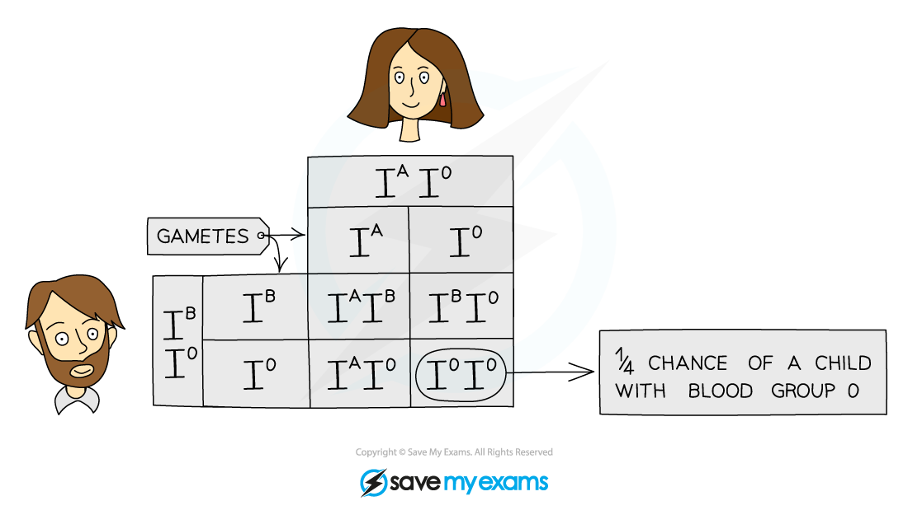
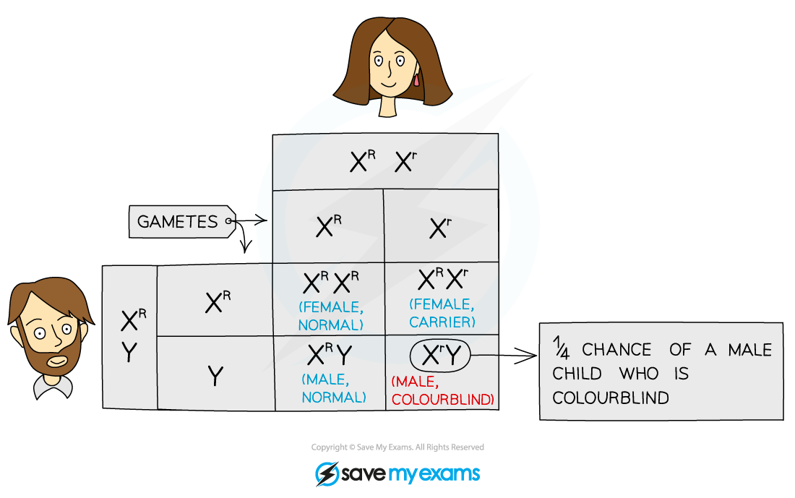

# Codominance & Sex-Linked Characteristics

## Codominance: Extended

> **Spec point** — `spcpt_rS69ZzH3x2wrMdG4` · Describe codominance as a situation in which both alleles in heterozygous organisms contribute to the phenotype
Explain the inheritance of ABO blood groups: phenotypes are A, B, AB and O blood groups and alleles are IA, IB and Io

## Codominance: Extended

### Extended Tier Only

#### Codominance

- Codominance occurs when **both alleles in heterozygous organisms contribute** to the phenotype
- Inheritance of blood group is an example of codominance
- There are three alleles of the gene governing the inheritance of blood group:

  - Alleles IA and IB are codominant
  - Both IA and IB are dominant to IO
- I represents the gene and the superscript A, B and O represent the alleles
- IA results in the production of antigen A in the blood
- IB results in the production of antigen B in the blood
- IO results in no antigens being produced in the blood
- As only two alleles can be inherited by an individual (one from the mother, one from the father), the three alleles can combine to produce the following genotypes and phenotypes:

| Genotype | Phenotype |
|---|---|
| IᴬIᴬ or IᴬIᴼ | A |
| IᴮIᴮ or IᴮIᴼ | B |
| IᴬIᴮ | AB |
| IᴼIᴼ | O |

- Genetic diagrams can be used to predict the outcome of crosses that involve codominant alleles:
- For example: **‘Show how a parent with blood group A and a parent with blood group B can produce offspring with blood group O’**

*Punnett square showing the inheritance of blood group*

- The parent with blood group A must have the genotype IAIO
- The parent with the blood group B must have the genotype IBIO
- These are the only possible genotypes (as opposed to both being homozygous) as they are able to produce a child with blood group O and so the child must have inherited an allele for group O from each parent
- Parents with these blood types have a 25% chance of producing a child with blood type O

## Sex-linked characteristics: Extended

> **Spec point** — `spcpt_chNtnFywSHP3WNng` · Describe a sex-linked characteristic as a feature in which the gene responsible is located on a sex chromosome and that this makes the characteristic more common in one sex than in the other
Describe red-green colour blindness as an example of sex linkage
Use genetic diagrams to predict the results of monohybrid crosses involving codominance or sex linkage and calculate phenotypic ratios

## Sex-linked characteristics: Extended

### Extended Tier Only

- Alleles on the same chromosome are said to be **linked**
- When alleles that control a particular characteristic are found on the **sex chromosomes**, we describe the inheritance that results as **‘sex linked’**
- In almost all cases, there are **only alleles on the X chromosome** as the **Y chromosome is much smaller**
- Because males **only have one X chromosome**, they are **much more likely to show sex-linked recessive conditions** (such as red-green colour blindness and haemophilia)
- Females, having two copies of the X chromosome, are likely to inherit one dominant allele that masks the effect of the recessive allele
- A female with one recessive allele masked in this way is known as a **carrier**; she doesn’t have the disease, but she has a 50% chance of passing it on to her offspring
- If that offspring is a male, he will have the disease
- The results of a cross between a normal male and a female who is a carrier for colour blindness is as follows:

*Punnett square showing the inheritance of colour blindness, an X-linked condition*

- In the cross above, there is a 25% chance of producing a male who is colour blind, a 25% chance of producing a female carrier, a 25% chance of producing a normal female and a 25% chance of producing a normal male
