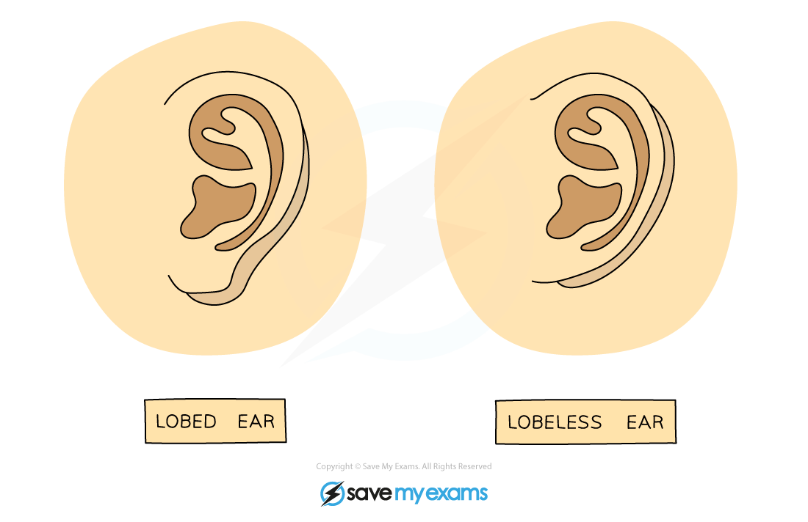

# Variation in Biology

## What is variation in biology?

> **Spec point** — `spcpt_65NSPhQTw8KBvJ8D` · nan

## Types of Variation

### What is variation in biology?

- Variation is defined as **differences between individuals of the same species**
- **Phenotypic variation** is the difference in features between individuals of the same species
- Some of these differences are caused by differences in genes, which is **genetic variation**
- Phenotypic variation can be divided into two types depending on **how you are able to group the measurements**:

  - **continuous variation** is when there are very many small degrees of difference for a particular characteristic between individuals and they are arranged in order and can usually be measured on a scale
  
    - Examples include height, mass, finger length etc. where there can be many ‘in-between’ groups
  - **discontinuous variation** is when there are distinct differences for a characteristic
  
    - For example, people are either blood group A, B, AB or O; are either male or female; can either roll their tongue or not - there are no ‘in-betweens’
- When graphs of these data are plotted, continuous variation gives smooth bell curves (a result of all the small degrees of difference), whereas discontinuous gives a ‘step – like’ shape

*Height is an example of continuous variation which gives rise to a smooth bell-shaped curve when plotted as a graph*

*Blood group is an example of discontinuous variation which gives rise to a step-shaped graph*

### Phenotypic variation

- Phenotypic variation can be caused in two main ways:

  - it can be **genetic** - controlled entirely by genes
  - or it can be **environmental** - caused entirely by the environment in which the organism lives

### Genetic variation

- Examples of genetic variation in humans include:

  - **blood group**
  - **eye colour**
  - **gender**
  - **ability to roll tongue**
  - **whether ear lobes are free or fixed**

*Whether earlobes are attached (lobeless) or free (lobed) is an example of genetic variation *

### Environmental variation

- Characteristics of all species can be affected by environmental factors such as climate, diet, accidents, culture and lifestyle
- In this instance ‘environmental’ simply means ‘outside of the organism’ and so can include factors like climate, diet, culture, lifestyle and accidents during lifetime
- Examples include:

  - an accident may lead to **scarring** on the body
  - eating too much and not leading an active lifestyle will cause **weight gain**
  - being raised in a certain country will cause you to speak a certain **language** with a certain **accent**
  - a plant in the shade of a big tree will grow **taller** to reach more light

### Genetic and environmental causes

- Discontinuous variation is usually caused by **genetic variation alone**
- Continuous features often vary because of a combination of genetic and environmental causes, for example:

  - tall parents will **pass genes** to their children for height
  - their children have the **genetic potential** to also be tall
  - however if their **diet is poor** then they will not grow very well
  - therefore their **environment** also has an impact on their height
- Another way of looking at this is that although genes decide what characteristics are inherited, the surrounding environment will affect how these inherited characteristics develop

## Mutation

> **Spec point** — `spcpt_JnsG3MfZPvmKJmkx` · nan

## Mutation

- Mutations are **genetic changes**
- Most mutations have **no effect** on the phenotype as the protein that a mutated gene produces may work just as well as the protein from the non-mutated gene
- Rarely, mutations lead to the development of new alleles and so new phenotypes and if they do, most have a **small effect** on the organism
- Occasionally, the new allele gives the individual a **survival advantage** over other members of the species
- For example:

  - a bird develops a mutation leading to a change in feather colours
  - this makes it more attractive to birds of the opposite sex
  - this causes the bird to breed more frequently and have more chances of passing on the mutated phenotype to the next generation
- Mutations can also lead to **harmful changes** that can have dramatic effects on the organism - for example, **sickle cell anaemia** in humans
- Mutations happen **spontaneously and continuously** but their frequency can be increased by exposure to the following:

  - **ionising radiation **(e.g. gamma rays and X-rays) - which can damage bonds and cause changes in base sequences
  - some **non-ionising radiation** (e.g. ultra-violet) - can also damage bonds and cause changes in base sequences
  - **certain types of chemicals** - for example chemicals such as tar in tobacco
- Increased rates of mutation can cause cells to become **cancerous**, which is why the above are linked to increased incidence of different types of cancer

## Mutation: Extended

> **Spec point** — `spcpt_XvMqWtqfp2pFjKV7` · nan

## Mutation: Extended

- **Genetic variation** in populations can be caused by a variety of sources:

  - mutations: mutations are **random genetic changes** to the base sequence of DNA, forming new alleles
  - meiosis - new allele combinations form through segregation
  - random mating - which partnerships form for sexual reproduction
  - random fertilisation - which sperm and egg combinations occur during sexual reproduction
