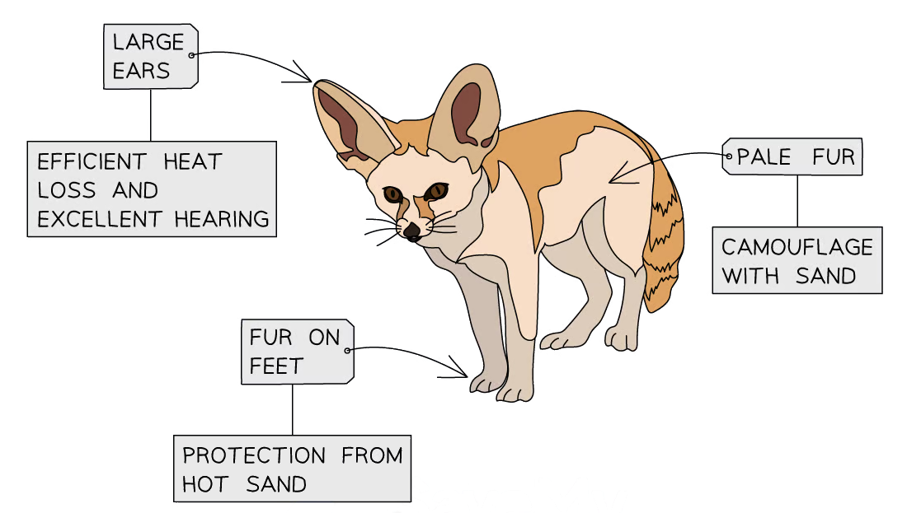

# Adaptive Features

## Adaptations & fitness

> **Spec point** — `spcpt_gtB3ctjzyBctSNRV` · Describe an adaptive feature as an inherited feature that helps an organism to survive and reproduce in its environment
Interpret images or other information about a species to describe its adaptive features

## Adaptations & fitness

- Adaptive features can be defined as:

**Inherited features that help an organism to survive and reproduce in its environment.**

- It is possible to describe adaptive features of an organism using information provided, e.g. from images or data

*Adaptive features can be identified in images of unfamiliar organisms, e.g. here a fennec fox can be seen to have large ears, pale fur and furry feet*

> **Worked Example**
> The table below contains information about the urine concentration of several different mammal species, as well as the environments in which the species live.
> 
> | Species | Environment | Urine concentration (milliosmoles/L) |
> |---|---|---|
> | Human | Temperate | 1450 |
> | Beaver | Fresh water | 480 |
> | Dolphin | Salt water | 1500 |
> | Gerbil | Desert | 5400 |
> 
> Suggest and explain one way in which gerbils are adapted to their environment.
> 
> **Answer:**
> 
> - Gerbils are able to produce urine that is much more concentrated than other species
> - This allows gerbils to conserve water / excrete less water in their urine
> 
> > *The information provided here tells us that gerbils live in a desert environment, and also allows us to compare urine concentration in several species, so we can see that gerbil urine is around four times more concentrated than some of the other mammals.*
> 
> > *Producing concentrated urine means that gerbils don't lose very much water when they excrete urea in their urine, allowing them to conserve water in an environment where water may be difficult to replace.*
