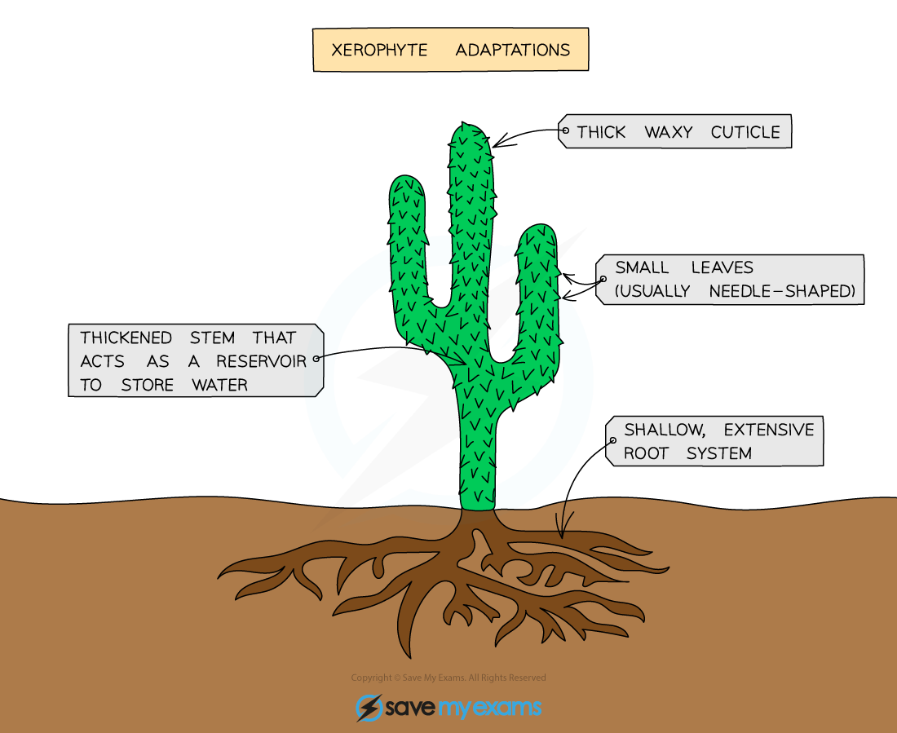

# Adaptive Features Continued

## Hydrophytes & xerophytes: Extended

> **Spec point** — `spcpt_JgKsK7zdJYwfspc7` · nan

## Hydrophytes & xerophytes: Extended

### Extended Tier Only

- **Hydrophytes** are plants adapted to live in **extremely wet conditions**
- Common adaptations include: 

* Hydrophytes are adapted to live in wet conditions such as ponds*

  - **large air spaces in their leaves** for flotation, to keep the leaves close to the surface of the water where there is more light for photosynthesis
  - **small roots** as they can also extract nutrients from the surrounding water through their tissues
  - stomata usually open all the time and **mainly found on the upper epidermis** of the leaf where they can exchange gases much more easily with the air

- **Xerophytes** are plants adapted to live in **extremely** **dry conditions**
- Common adaptations include:

  - **thick waxy cuticle** - the cuticle cuts down water loss in two ways: it acts as a barrier to evaporation and also the shiny surface reflects heat and so lowers the temperature
  - **sunken stomata** - stomata may be sunk in pits in the epidermis; moist air trapped here lengthens the diffusion pathway and reduces the evaporation rate
  - **leaf rolled** with stomata inside and an inner surface **covered in hairs** - traps moist air and prevents air movement across stomata which reduces transpiration
  - **small leaves** - many xerophytic plants have small, needle-shaped leaves which reduce the surface area and therefore the evaporating surface
  - **extensive shallow roots** allow for the quick absorption of large quantities of water when it rains or **deep roots** to reach deep water tables
  - **thickened leaves or stems** which contain cells that store water

*An example of a xerophyte adapted to live in extremely dry conditions such as deserts.*
