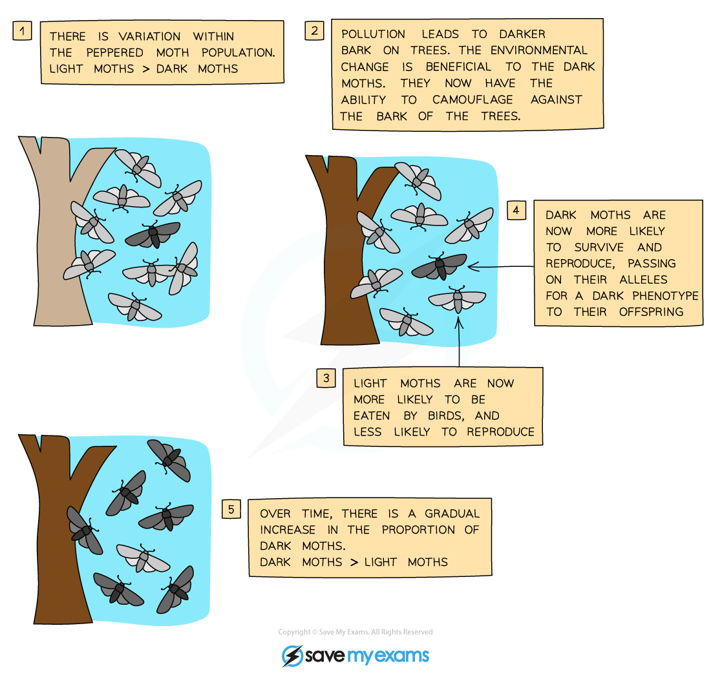

# Natural Selection

## Natural selection

> **Spec point** — `spcpt_8DqNMsz3WvKkxzJM` · Describe natural selection with reference to: 
(a) genetic variation within populations
(b) production of many offspring
(c) struggle for survival, including competition for resources
(d) a greater chance of reproduction by individuals that are better adapted to the environment than others
(e) these individuals pass on their alleles to the next generation

## Natural selection

- In any environment, the individuals that have the best [adaptive features](https://www.savemyexams.com/igcse/biology/cie/23/revision-notes/18-variation-and-selection/18-1-variation-and-natural-selection/18-1-2-adaptive-features/?_ai=internal-linking) are the ones most likely to survive and reproduce
- This results in **natural selection**:

  - individuals in a species show a **range of variation** caused by differences in genes
  - when organisms reproduce, they **produce more offspring** than the environment is able to support
  - this leads to **competition** for food and other resources which results in a **‘struggle for survival’**
  - individuals with characteristics **most suited to the environment** have a higher chance of survival and **more chances to reproduce**
  - therefore the alleles resulting in these characteristics are **passed to their offspring at a higher rate** than those with characteristics less suited to survival
  - this means that in the next generation, there will be a **greater number of individuals** with the **better adapted variations** in characteristics
- This theory of natural selection was put forward by **Charles Darwin** and became known as **‘survival of the fittest’**

### An example of natural selection

*Natural selection illustrated by snail shell colour*

- Within the population of snails there is variation in shell colour
- Normal varieties of shell colours in this snail species is black or grey (as evidenced by the first picture)
- **Chance mutations** lead to a small number of snails / one snail having a white shell
- This ‘small number’ is shown in the second diagram where there are less white shelled snails than black or grey shelled snails
- The white shelled snail(s) **survive longer**
- This is the ‘survival of the fittest’, a term used to explain why some organisms succeed in the competitive struggle for survival against other members of their population
- The reason the white shelled snail(s) survive longer is **because they are better camouflaged**
- This means that they are **less likely to be seen by predators** and eaten
- As they survive longer they get **more opportunities to reproduce**
- And so the allele for white shells is passed onto offspring more frequently than the alleles for black or grey shells
- **Over generations, this is repeated** until the majority of snails in the population have white shells

*Another good example of natural selection is the evolution of the peppered moths*

> **Exam Hint**
> There are many examples of natural selection and you cannot possibly be familiar with all of them, however, they ALL follow the same sequence described above:
> 
> - Based on the idea that within a species there is always variation and chance mutations, some individuals will develop a phenotype (characteristic) that gives them a survival advantage and therefore will:
> 
>   - live longer
>   - breed more
>   - and be more likely to pass their genes on
> - Repeated over generations, the ‘mutated’ phenotype will become the norm
> 
> Remember, it is the concept you have to understand, not the specific example.

## Adaptation by natural selection: Extended

> **Spec point** — `spcpt_RrSTgt9JbGQ3mQq5` · Describe adaptation as the process, resulting from natural selection, by which populations become more suited to their environment over many generations
Describe the development of strains of antibiotic resistant bacteria as an example of natural selection

## Adaptation by natural selection: Extended

- If the environment **does not change**, selection does not change
- This will favour individuals with the **same characteristics** as their parents
- If the environment **changes**, or a chance mutation produces a **new allele**, selection might now **favour individuals with different characteristics** or with the new allele
- So the individuals that survive and reproduce will have a **different set of alleles** that they pass on to their offspring
- Over time, this will bring about a **change in the characteristics of the species** - it will produce **evolution**
- Evolution is defined as the **change in adaptive features of a population over time as a result of natural selection**
- Natural selection results in a **process of adaptation**, which means that, over generations, those features that are better adapted to the environment become more common

  - This is how **evolution** occurs
- This means populations of organisms become **better suited to their environment**
- A good example of this is the **development of antibiotic resistance** by bacteria

*The principles of natural selection illustrate how antibiotic resistance in bacteria emerges*
