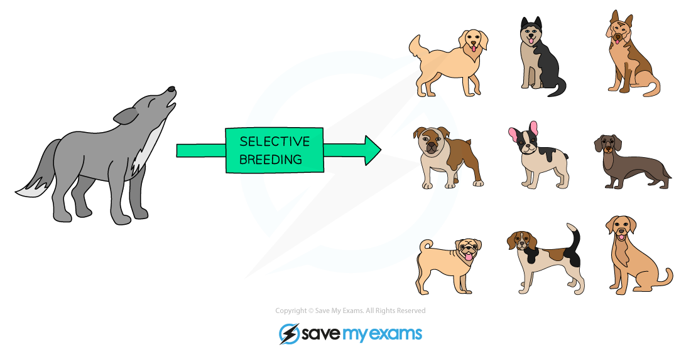
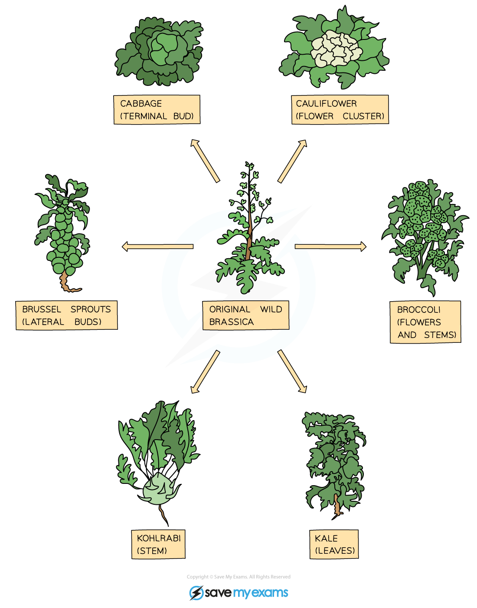

# Artificial Selection

## Selective breeding

> **Spec point** — `spcpt_zwMmkbBCcNXDnxdv` · Describe selective breeding with reference to: 
(a) selection by humans of individuals with desirable features
(b) crossing these individuals to produce the next generation
(c) selection of offspring showing the desirable features
Outline how selective breeding by artificial selection is carried out over many generations to improve crop plants and domesticated animals and apply this to given contexts

## Selective breeding

- Selective breeding means to **select individuals with desirable characteristics and breed them together**
- The process doesn’t stop there though because it’s likely that not all of the offspring will show the desired characteristics so **offspring that do show the desired characteristics are selected and bred together**
- This process has to be **repeated for many successive generations** before you can definitely say you have a **‘new breed’** which will **reliably** show those selected characteristics in all offspring

### Selective breeding in domesticated animals

- An example of selective breeding is dog breeders who select which dogs can mate together to increase the likelihood of puppies displaying desirable characteristics e.g. coat colour
- This has given rise to the many recognisable dog breeds of today, all the same species (*Canis familiaris*) and all descended from one breed

*Selective breeding in dogs*

#### Selective breeding in crop plants

- Plants are selectively bred by humans for the development of many characteristics, including:

  - **disease resistance** in food crops
  - **increased crop yield**
  - **hardiness to weather conditions** (e.g. drought tolerance)
  - better tasting fruits
  - large or unusual flowers
- An example of a plant that has been selectively bred in multiple ways is wild brassica, which has given rise to cauliflower, cabbage, broccoli, Brussels sprouts, kale and kohlrabi:

*Selective breeding in crop plants*

## Artificial vs natural selection: Extended

> **Spec point** — `spcpt_DmKDhFkNyGPnVxqP` · nan

## Artificial vs natural selection: Extended

| Natural selection | Artificial selection |
|---|---|
| Occurs naturally | Only occurs when humans intervene |
| Results in development of populations with features that are better adapted to their environment and survival | Results in development of populations with features that are useful to humans and not necessarily to survival of the individual |
| Usually takes a long time to occur | Takes less time as only individuals with the desired features are allowed to reproduce |
