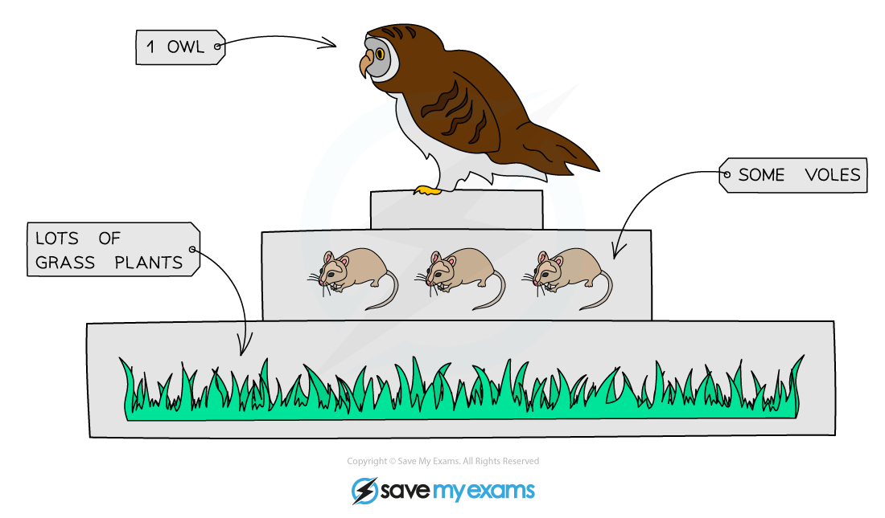
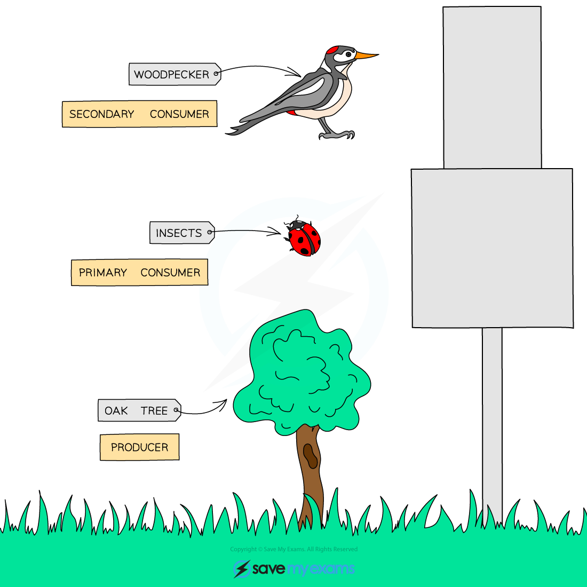
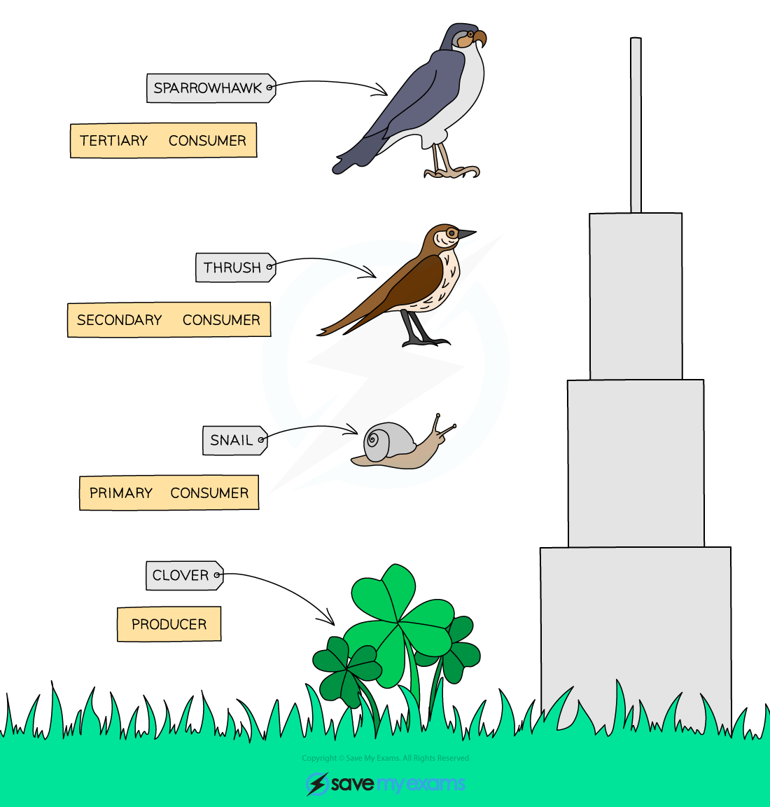

# Pyramids of Number & Biomass

## Pyramids of numbers

> **Spec point** — `spcpt_zthsB4NBRcnfVbjF` · Draw, describe and interpret pyramids of numbers

## Pyramids of numbers

- A pyramid of numbers shows **how many organisms** are present at each level of a food chain.
- The **width of the box** indicates the **number of organisms** at that trophic level
- Consider the following food chain:

*A food chain shows the transfer of energy*

- A pyramid of numbers for the food chain above would look like this:

*A pyramid of numbers*

- A pyramid of numbers **doesn’t always have to be pyramid-shaped**; this is because the **size of the organism is also important**
- One large organism, like the oak tree in the pyramid below, contains enough energy to support many smaller organisms

*Pyramids of numbers are not always pyramid-shaped*

### Rules to remember when drawing a pyramid of numbers

- When drawing a pyramid of numbers, **the trophic level of the organisms cannot be changed** - they must stay in the same order as in the food chain:

  - producers on the bottom
  - followed by primary consumers
  - then secondary consumers
  - then tertiary consumers
- Each bar should be **labelled** with its trophic level
- If graph paper is provided then the pyramid should be **drawn to scale**
- Generally, the **larger an individual organism is**,** the fewer individuals** there will be

## Pyramids of Biomass

> **Spec point** — `spcpt_3nfBzZ39Cbn2J9TM` · Draw, describe and interpret pyramids of biomass
Discuss the advantages of using a pyramid of biomass rather than a pyramid of numbers to represent a food chain
Describe a trophic level as the position of an organism in a food chain, food web or ecological pyramid
Identify the following as the trophic levels in food webs, food chains and ecological pyramids: producers, primary consumers, secondary consumers, tertiary consumers and quaternary consumers

## Pyramids of biomass

- A pyramid of biomass shows **how much living matter** is present at each trophic level of a food chain
- Biomass is often a measure of the dry mass of an organism, once the water has been removed from the tissues
- Pyramids of biomass are **always pyramid-shaped**, regardless of what the pyramid of numbers for that food chain looks like
- This is because the **mass of organisms decreases as you go up a food chain**

*A pyramid of biomass*

- It can be advantageous to use a pyramid of biomass rather than a pyramid of numbers because:

  - pyramids of biomass **take into account the size of organisms** at each trophic level, so provide a more accurate representation of the living matter within an ecosystem
  - energy is stored in biomass, so biomass can be used as an **approximate representation of the energy available** at each level of a food chain

> **Exam Hint**
> Pyramids of number can be any shape, so make sure you learn the rules for drawing a pyramid of numbers as it is more common to see unusual shapes in the exam.
> 
> Pyramids of biomass are generally pyramid-shaped, so they are simpler to sketch. Some ecosystems, such as an aquatic ecosystem, may show a different shape or inverted pyramid but it is very unlikely you will see this in an exam.
