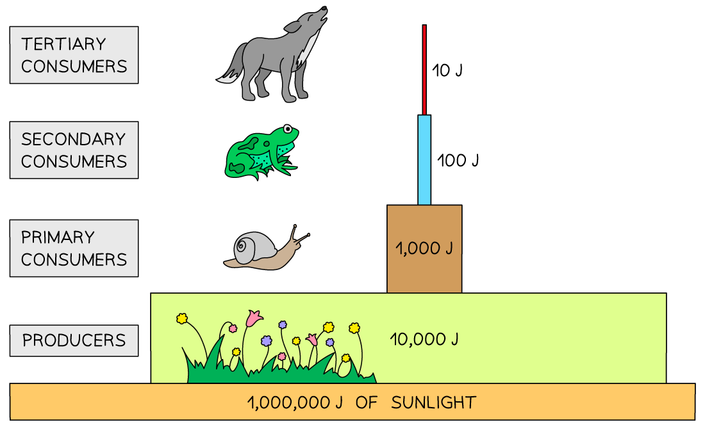

# Pyramids of Energy

## Pyramids of energy: Extended

> **Spec point** — `spcpt_vhv2M7DQfsy2ZwdF` · Draw, describe and interpret pyramids of energy
Discuss the advantages of using a pyramid of energy rather than pyramids of numbers or biomass to represent a food chain
Explain why the transfer of energy from one trophic level to another is often not efficient
Explain, in terms of energy loss, why food chains usually have fewer than five trophic levels
Explain why it is more energy efficient for humans to eat crop plants than to eat livestock that has been fed on crop plants

## Pyramids of energy: Extended

### Extended Tier Only

- The transfer of stored energy in food chains is not always efficient, and **energy is lost to the environment between each trophic level**; reasons for this inefficiency include:

  - not all of the stored energy consumed by an organism goes into making new tissues that can be eaten; energy may instead be transferred to:
  
    - **excretion of metabolic waste**, e.g. urine that gets removed from the organism
    - **movement**
    - **heat**
  - few organisms eat or digest an entire organism, so any energy stored in the uneaten or undigested parts does not get passed on, e.g.
  
    - energy stored in **uneaten** parts, such as roots of plants, or bones of animals does not enter the consumer's body at all
    - **undigested waste** (faeces) is removed from the body and provides food for decomposers
- Only **around 10 %** of the energy stored at each trophic level is available to the next trophic level
- This inefficient transfer of energy at each trophic level explains why **food chains are rarely more than five organisms long**

  - The final consumer in such a food chain would have to eat a huge number of organisms in the trophic level(s) below it to get the amount of energy needed; this is unlikely to be possible

*Energy is lost at each trophic level*

- The energy stored at each trophic level can be represented visually in a **pyramid of energy**

- Pyramids of energy can have advantages over [pyramids of biomass](https://www.savemyexams.com/igcse/biology/cie/23/revision-notes/19-organisms-and-their-environment/19-1-energy-and-feeding-relationships/19-1-3-pyramids-of-number-and-biomass/?_ai=internal-linking) because:

  - they highlight the **energy lost** at each trophic level
  - different organisms may not all store the same amount of energy in their biomass, so pyramids of energy allow for **more accurate comparisons**

### Energy transfer in a human food chain

- Humans are **omnivores**, obtaining energy from both plants and animals, which gives a **choice of what to eat**
- These choices, however, have an **impact on how land is used and what is grown**
- Think of the following food chains, both involving humans:

wheat → cow → human

wheat → human

- Given what is known about **energy transfer in food chains**, it is clear that if humans eat the wheat there is **much more energy available** to them than if they eat the cows that eat the wheat
- This is because the transfer of energy from one trophic level to another is not efficient, with much energy lost between levels

  - So **the greater the number of trophic levels in a food chain**, the greater the energy loss between the producer and the final consumer
  - In the example above, more energy is lost between the wheat and the human in the food chain with the cow, than in the food chain without
- Therefore, it is **more energy efficient for humans to be the herbivores rather than the carnivores**

  - In reality, animals are often fed on plants that humans cannot eat (e.g. grass) or that are too widely distributed for humans to collect (e.g. algae in the ocean which form the food of fish that is consumed), so the situation is more complex than for the example shown above

> **Exam Hint**
> Make sure you read any question on this topic carefully and tailor your answer to the specific organism you are being asked about – e.g. plants do not produce urine or faeces so you could not give this as one of the ways in which they transfer energy to the environment!
