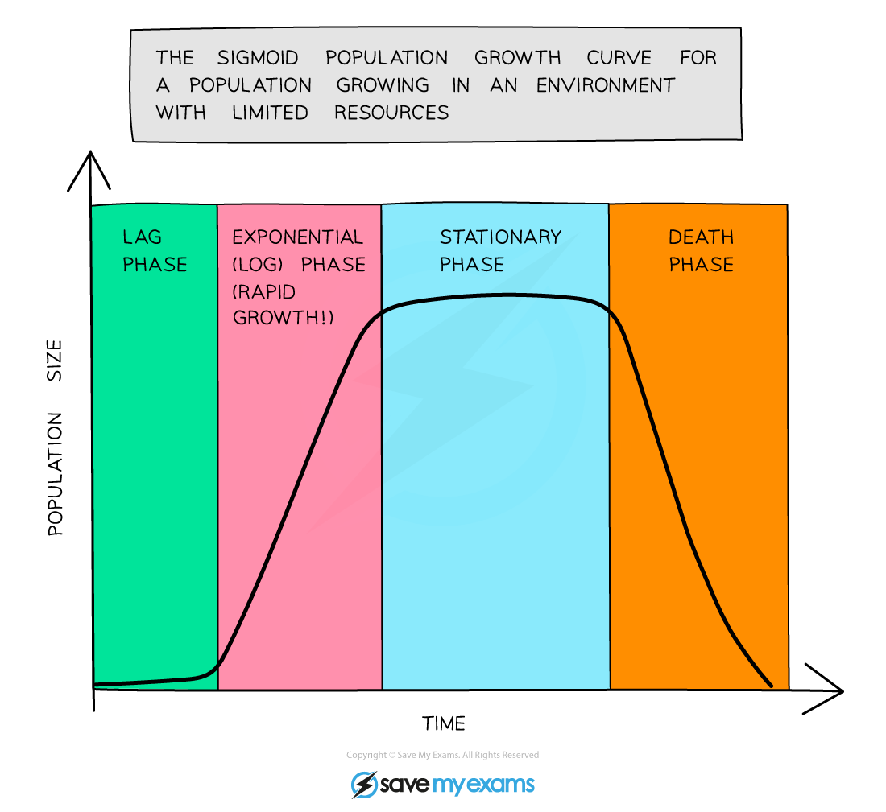

# Populations

## Definition of population

> **Spec point** — `spcpt_cS8Y5RDtshpCMZZ7` · Describe a population as a group of organisms of one species, living in the same area, at the same time
Describe a community as all of the populations of different species in an ecosystem
Describe an ecosystem as a unit containing the community of organisms and their environment, interacting together

## Definition of population

- A population is defined as **a group of organisms of one species, living in the same area at the same time**

### Other important definitions

- A community is defined as **all of the populations of different species in an ecosystem**
- An ecosystem is defined as **a unit containing the community of organisms and their environment, interacting together **(e.g. a decomposing log, a lake)

## Population growth

> **Spec point** — `spcpt_rybNfzjHt7s8yrFd` · Identify and state the factors affecting the rate of population growth for a population of an organism, limited to food supply, competition, predation and disease

## Population growth

- All living organisms compete with each other for **food, water and living space**
- Those which are the [best adapted to their environments](https://www.savemyexams.com/igcse/biology/cie/23/revision-notes/18-variation-and-selection/18-1-variation-and-natural-selection/18-1-4-natural-selection/?_ai=internal-linking) generally increase their populations at the expense of those less well adapted
- Population growth in most organisms is controlled by the following three factors:

  - **food supply**
  - **predation**
  - **disease**

## The population growth curve: Extended

> **Spec point** — `spcpt_fbb2YsqsSfFt8fBb` · Identify the lag, exponential (log), stationary and death phases in the sigmoid curve of population growth for a population growing in an environment with limited resources
Interpret graphs and diagrams of population growth
Explain the factors that lead to each phase in the sigmoid curve of population growth, making reference, where appropriate, to the role of limiting factors

## The population growth curve: Extended

- If the growth of **microorganisms in a fermenter** is measured over time, the population growth looks like the graph below

*A typical growth curve for a population in an enclosed environment*

- The shape of this curve (a little like an ‘S’) gives it its name - a **sigmoid growth curve**
- The curve has four distinct phases:

  - **lag phase** - organisms are **adapting to the environment** before they are able to reproduce; in addition, at this stage there are very few organisms and so reproduction is not producing larger numbers of offspring
  - **log phase** (aka **exponential** phase) - **food supply is abundant**, **birth rate is rapid **and **death rate is low**; **growth is exponential** and only limited by the number of new individuals that can be produced
  - **stationary phase** - population **levels out** due to a **factor in the environment**, such as a nutrient, **becoming limited **as it is not being replenished; birth rate and death rate are equal and will remain so until either the nutrient is replenished or becomes severely limited
  - **death phase** - population **decreases** as death rate is now greater than birth rate; this is usually because **food supply is short** or **metabolic wastes produced by the population have built up to toxic levels**
- Organisms in a natural environment are **unlikely to show population growth like a sigmoid growth curve** because they are affected by many other factors, including:

  - **changing temperature or light**
  - **predators**
  - **disease**
  - **immigration** (individuals moving into the area)
  - **emigration** (individuals moving out of the area)
