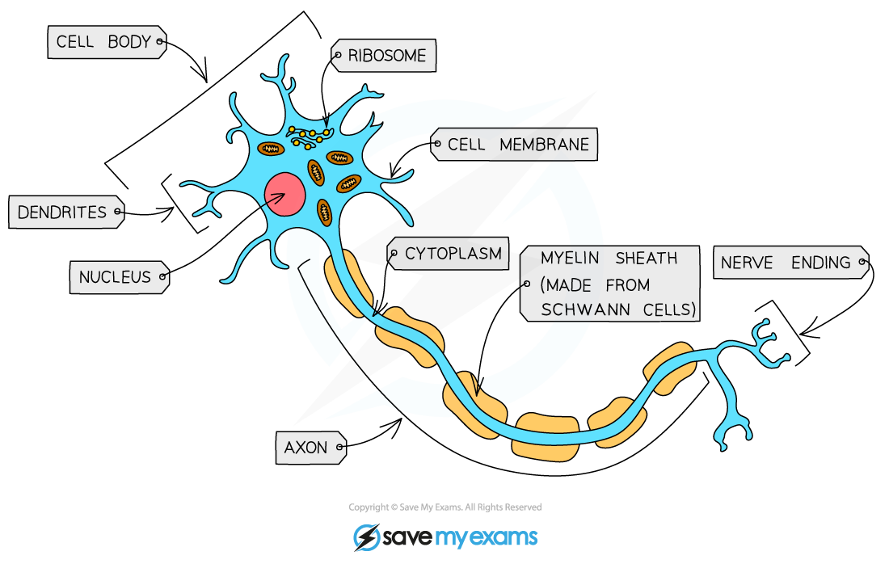
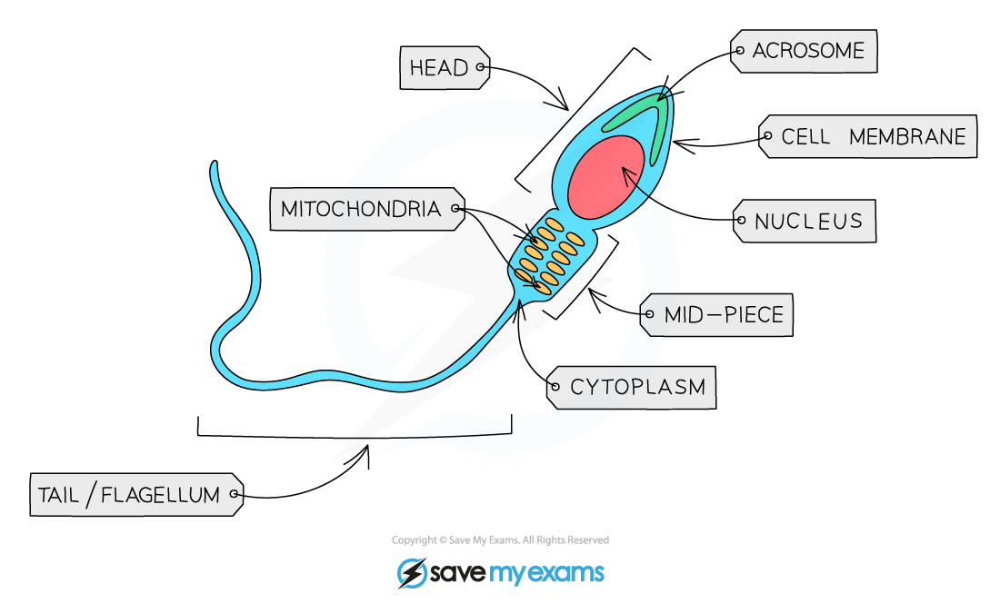
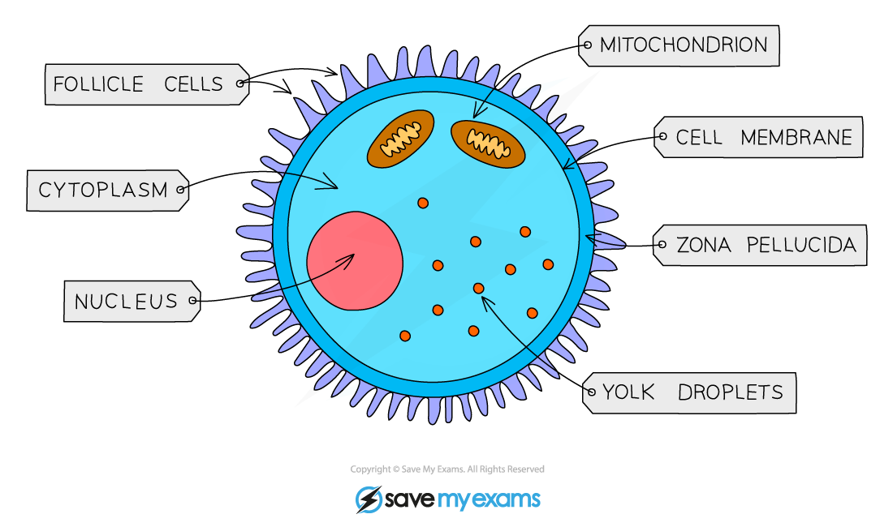
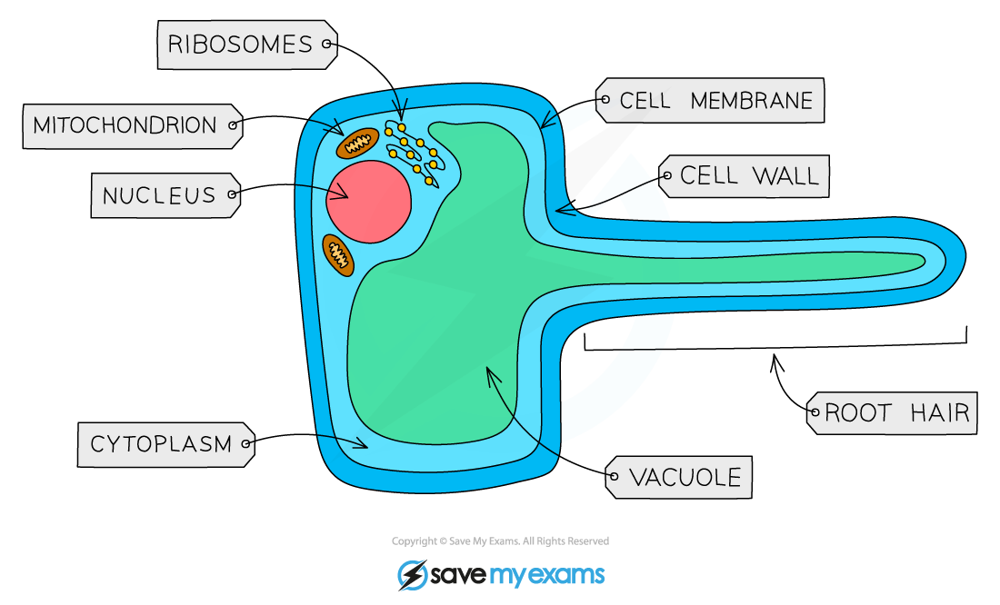

# Organisation of Cells

## Producing new cells

> **Spec point** — `spcpt_jt7pMQpXZBWdyhPR` · State that new cells are produced by division of existing cells

## Producing new cells

- The cells in the body need to [divide so that the body can grow and repair](https://www.savemyexams.com/igcse/biology/cie/23/revision-notes/17-inheritance/17-1-inheritance-genes-and-cell-division/17-1-6-mitosis/?_ai=internal-linking) itself
- Cells grow and divide over and over again
- New cells are produced by the **division of existing cells**

## Specialised cells

> **Spec point** — `spcpt_KwtZ4pxtFPR5vRnr` · State that specialised cells have specific functions, limited to:
(a) ciliated cells – movement of mucus in the trachea and bronchi
(b) root hair cells – absorption
(c) palisade mesophyll cells – photosynthesis
(d) neurones – conduction of electrical impulses
(e) red blood cells – transport of oxygen
(f) sperm and egg cells (gametes) – reproduction

## Specialised cells

### Specialised cells in animals and plants

- Specialised cells are those which have **developed certain characteristics** in order to **perform particular functions**. These differences are controlled by genes in the nucleus
- Cells specialise by undergoing **differentiation**: this is a process by which cells develop the structure and characteristics needed to be able to carry out their functions

#### Specialised cells in animals table

| Cell | Function | Adaptations |
|---|---|---|
| Ciliated cell | Movement of mucus in the trachea and bronchi | - Extensions of the cytoplasm at the surface of the cell form hair-like structures called **cilia**, which **beat to move mucus** and trapped particles up to the throat |
| Nerve cell | Conduction of impulses | - **Long** so that nerves can run to and from **different parts of the body** to the central nervous system The cell has **extensions and branches** so it can **communicate** with other nerve cells, muscles and glands The axon (extension of cytoplasm away from the cell body) is covered with a **fatty sheath**, which **insulates** the nerve cell and **speeds up** the nerve impulse |
| Red blood cell | Transport of oxygen | - **Biconcave disc shape** increases surface area for more efficient diffusion of oxygen Contains **haemoglobin**, which joins with oxygen to transport it Contains **no nucleus**, increasing the amount of space available for haemoglobin inside the cell |
| Sperm cell | Reproduction | - The head contains the genetic material for fertilisation in a **haploid nucleus** (containing half the normal number of chromosomes) The **acrosome** in the head contains **digestive enzymes** so that a sperm can penetrate an egg The mid-piece is packed with **mitochondria** to release energy needed to swim and fertilise the egg The **tail** enables the sperm to swim |
| Egg cell (ovum) | Reproduction | - Contains a lot of **cytoplasm**, which has **nutrients** for the growth of the early embryo **Haploid nucleus** contains the genetic material for fertilisation Cell membrane **changes after fertilisation** by a single sperm so that **no more sperm can enter** |

#### Diagrams of specialised cells in animals

*Ciliated cell*

*Nerve cell*

*Red blood cells*

*Sperm cell*

*Egg cell*

#### Specialised cells in plants table

| Cell | Function | Adaptations |
|---|---|---|
| Root hair cell | Absorption of water and mineral ions from soil | - Root hair increases surface area of the cell to ensure maximum absorption of water and mineral ions - Walls are thin to ensure water moves through quickly - No chloroplasts present |
| Xylem vessel | Conduction of water through the plant, support of the plant | - No top and bottom walls between xylem vessels, so there is a continuous column of water running through them - Cells are dead and lack organelles and cytoplasm, allowing free passage of water - Walls are thickened with a substance called lignin, which provides additional structural support to the plant |
| Palisade mesophyll cell | Photosynthesis | - Column-shaped to maximise absorption of sunlight and to allow as many cells as possible to fit in a layer under the upper epidermis of the leaf - Packed with chloroplasts for maximum photosynthesis |

#### Diagrams of specialised cells in plants

*Root hair cell*

*Xylem structure*

*Palisade mesophyll cell*

## Levels of organisation in an organism

> **Spec point** — `spcpt_TjGFyY5JFb7tB377` · Describe the meaning of the terms: cell, tissue, organ, organ system and organism as illustrated by examples given in the syllabus

## Levels of organisation in an organism

| Level | Description |
|---|---|
| Cells | Basic functional and structural units of all living organisms |
| Tissues | Groups of cells of similar structure working together to perform the same function |
| Organs | Made from different tissues working together to perform specific functions |
| Organ systems | Groups of organs with related functions, working together to perform body functions |

*Levels of organisation*

### Examples of systems in animals and plants

| System | Organs | Tissue examples |
|---|---|---|
| Digestive system | - Oesophagus - Stomach - Small intestine - Large intestine | - Muscle - Connective - Nerve - Epithelial |
| Circulatory system | - Heart - Veins - Arteries | - Muscle - Connective - Nerve - Epithelial |
| Immune system | - Thymus - Spleen | - Bone marrow |
| Respiratory system | - Trachea  - Bronchi  - Lungs | - Connective - Muscle - Epithelial |
| Excretory system | - Liver - Kidney - Skin, - Lungs | - Muscle - Connective - Nerve - Epithelial |
| Nervous system | - Brain  - Spinal cord | Nerve |
| Reproductive system | - Ovary - Cervix - Uterus Vagina - Testes - Penis | - Muscle - Connective - Nerve - Erectile |
| Shoot system | - Leaf - Stem, - Flower - Fruit | - Epidermis - Mesophyll, - Xylem - Phloem |
| Root system | - Root, - Tuber | - Xylem - Phloem - Ground tissue |

> **Exam Hint**
> - Your syllabus states that you should be able to identify the different levels of organisation in drawings, diagrams and images of familiar material
> - An example of this is shown in the exam question below:
> 
> 
> 
> ***The answer is B***
> 
> - The correct answer is B, because a leaf is an organ (arrow 1), arrow 2 is pointing to a palisade mesophyll cell, and arrow 3 is pointing to the layer of spongy mesophyll cells (which is a tissue)
> - Most incorrect answers here come from not being able to identify a tissue, so it’s worth making sure you understand and remember that **tissues are always made up of only one type of cell**.
